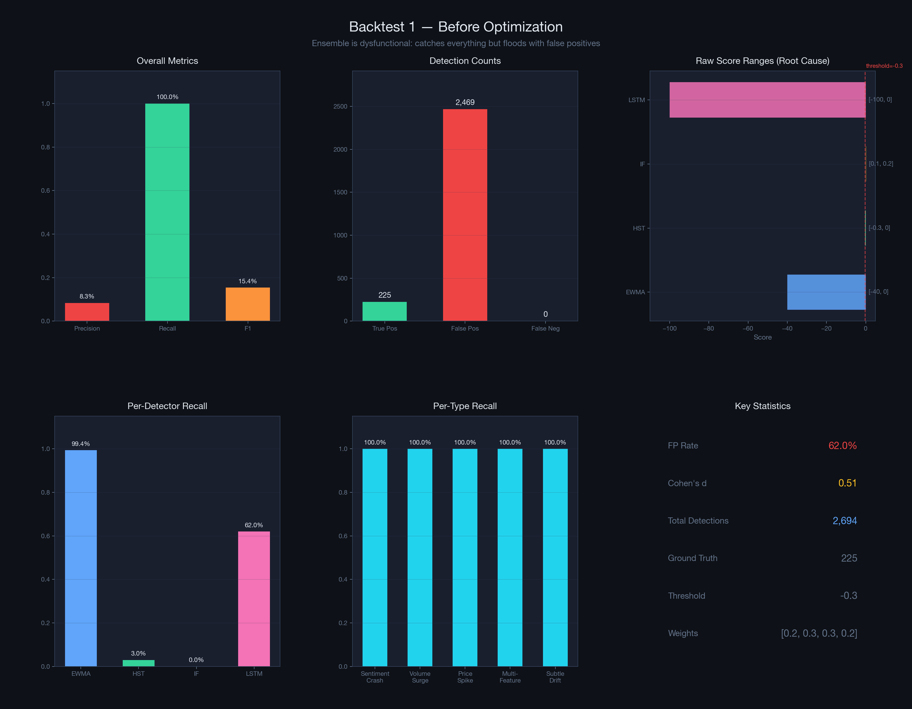
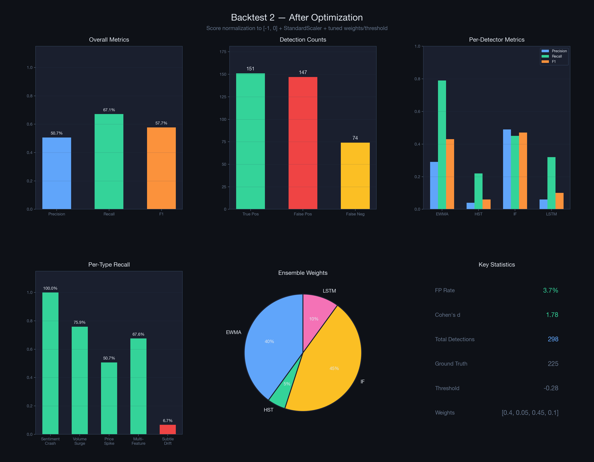
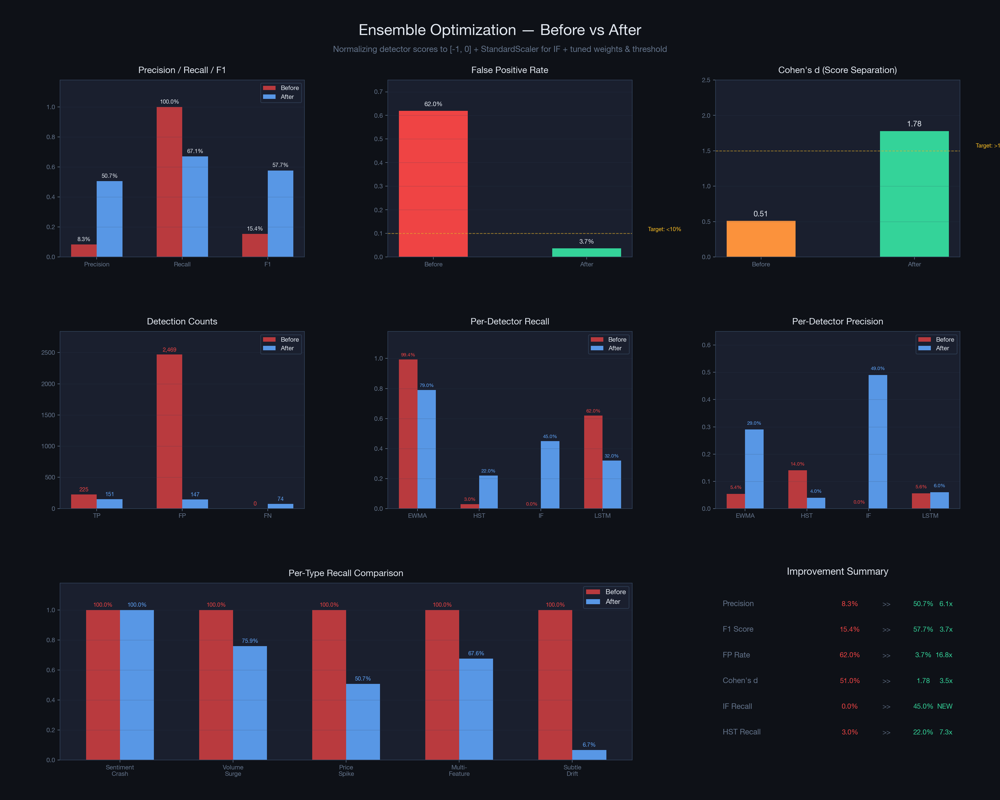
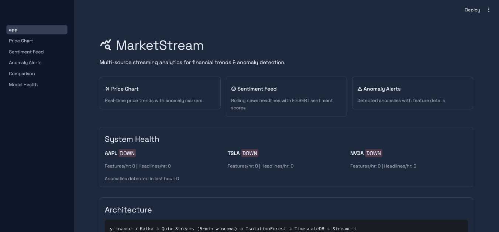
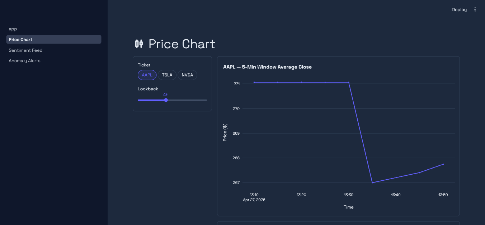
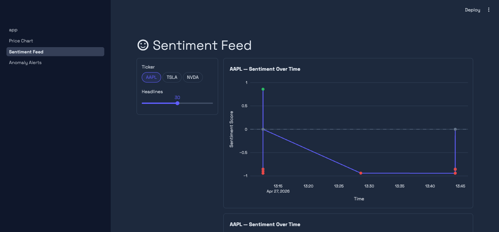
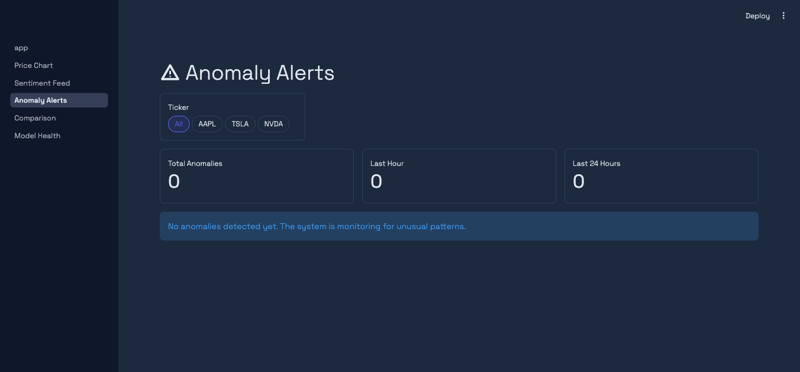
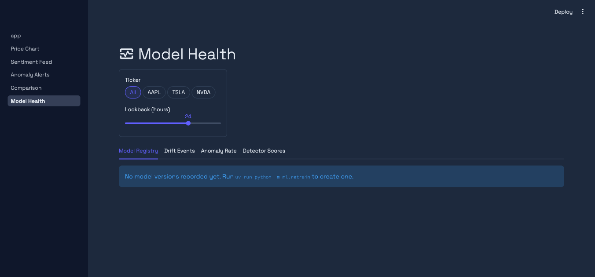

# MarketStream

MarketStream 是一个面向金融市场的实时、可解释异常检测系统。当前核心链路不再依赖旧项目的四模型 ensemble，而是把成交、报价、分钟 K 线和新闻统一为市场事件，计算八个轻量因子，再通过复杂事件处理（Complex Event Processing，CEP）识别有方向、有时间顺序且能够解释原因的异常模式。

当前跟踪五个标的：AAPL、TSLA、NVDA、QQQ 和 SPY。旧 ML ensemble 保留为离线 baseline 或可选 shadow process，不再是生产检测链路的核心。

## 一、项目背景与异常定义

MarketStream 不把“价格超过固定阈值”直接等同于异常。价格变化可能来自整个市场共同上涨、个股新闻、流动性压力、主动买卖失衡或坏数据。系统需要结合当前因子、近期因子序列、市场上下文和数据质量，判断这些变化是否组成值得告警的事件：

$$
A_t=g(F_t,F_{t-k:t},C_t,Q_t)
$$

- \(F_t\)：当前窗口的因子状态；
- \(F_{t-k:t}\)：最近一段时间的因子序列；
- \(C_t\)：市场基准、交易时段和新闻等上下文；
- \(Q_t\)：数据质量与 baseline 暖机状态；
- \(g\)：CEP 异常模式与告警规则。

因此，本项目关注的不是单独判断 \(|r_t|>2\%\)，而是解释“哪些因子以什么方向和顺序共同形成了异常”。

## 二、当前系统架构

```text
Alpaca IEX trade / quote / bar / timestamped news
                         或
                 MarketEvent JSONL replay
                         │
                         ▼
              raw.market_events (Kafka)
                         │
          数据质量检查 + 市场时段划分
                         │
                         ▼
       LightweightFactorEngine (10s / 1m / 5m)
                         │
                         ▼
           stream.factor_snapshots (Kafka)
                         │
                         ▼
          CEPDetector.process(FactorSnapshot)
                         │
           DetectionResult + cooldown
                         │
                         ▼
           TimescaleDB + stream.anomalies

          可选：stream.features → ML shadow
```

live 和 replay 会把相同语义的 `MarketEvent` 发布到同一个 Kafka topic，因此二者复用质量检查、因子计算和 CEP 检测逻辑。五分钟快照仍可以输出旧 `stream.features` 结构，用于兼容已有图表和离线 ML baseline。

## 三、三个共享数据协议

### 1. MarketEvent

`MarketEvent` 表示市场中发生了什么。它统一 Alpaca 和历史 JSONL 的字段，包含事件身份、来源、feed 覆盖、事件时间、接收时间、ticker、质量标记，以及 trade、quote、bar、news 四种 payload 中的一种。

### 2. FactorSnapshot

`FactorSnapshot` 表示当前窗口表现出什么，包含：

- ticker、event time、window start 和 cadence；
- 八个因子的数值与状态；
- baseline 版本和暖机状态；
- 数据质量摘要和源事件 ID；
- run、dataset、mode 和 provenance；
- 用于兼容旧链路的五分钟 feature summary。

### 3. DetectionResult

`DetectionResult` 表示当前表现是否构成异常，包含 score、severity、原子事件、完成或进行中的模式、因子证据、事件起止时间、检测时间、解释文本、源事件 ID 和确定性 dedupe key。

## 四、数据质量检查

原始事件不会被静默修复。系统先显式标记问题，再由因子引擎和 CEP 根据严重程度决定是否计算或告警。当前检查包括：

- `duplicate`：重复事件；
- `out_of_order`：事件时间乱序；
- `stale`：实时事件过期；
- `zero_volume`：零成交量；
- `invalid_price`：无效价格；
- `crossed_quote`：bid 高于 ask；
- `feed_gap`：相邻事件间隔异常。

去重 ID、事件时间和 ticker 状态都有容量上限，避免长期运行时内存无限增长。Alpaca minute bar 的时间戳表示窗口起点，因此 bar 使用独立的结束宽限，避免把正常 bar 误判为 stale。

## 五、八个轻量因子

| 金融维度 | 因子 | 含义 |
|---|---|---|
| Price | `return_surprise` | 当前收益相对历史日内基准的偏离 |
| Price | `volatility_burst` | 当前窗口波动范围相对正常水平的放大 |
| Activity | `relative_volume` | 成交量相对相同日内位置的异常程度 |
| Liquidity | `spread_stress` | bid-ask spread 相对正常价差的压力 |
| Liquidity | `quote_imbalance` | bid size 与 ask size 的报价压力 |
| Liquidity | `signed_trade_imbalance` | 主动买入与主动卖出成交量失衡 |
| Market context | `market_residual` | 个股收益扣除 QQQ/SPY 市场共同变化后的残差 |
| News | `news_shock` | 新闻方向与短时间聚集程度 |

新闻因子的定义为：

$$
news\_shock=news\_mean\times\log(1+n)
$$

其中 \(n\) 是窗口内新闻数量。对数缩放既能区分“一条负面新闻”和“短时间集中出现多条负面新闻”，又不会让新闻数量线性放大成过于极端的值。

## 六、Median/MAD baseline

因子异常程度使用稳健标准化：

$$
z_{robust}=\frac{x-Median}{1.4826\times MAD}
$$

其中：

$$
MAD=median(|x_i-Median|)
$$

baseline 按 ticker、cadence、market session 和 intraday slot 分开维护，用于去除股票自身差异和日内季节性。当前窗口必须先使用此前历史评分，完成后才能写入 baseline，避免异常窗口稀释自己的异常程度。

默认 baseline 最多使用前 20 个交易日，少于 5 个历史交易日时保持 warm-up。正式评测时 baseline 需要冻结并具有明确时间边界，不能使用整个数据集或未来测试数据。

20 天窗口和阈值仍是需要继续验证的工程选择；对于大量零值、只有少量非零值的离散因子，MAD 也可能退化，这是后续研究限制之一。

## 七、CEP 异常模式

CEP 首先把 elevated/extreme 因子转换为带方向、时间和源事件证据的原子事件，再识别六类模式：

1. `stock_specific_dislocation`：价格变化得到市场残差确认，说明不是市场共同走势单独造成；
2. `liquidity_pressure_move`：价差或买卖压力与价格方向共同形成流动性异常；
3. `news_confirmed_move`：新闻冲击先发生，随后得到同向价格变化确认；
4. `flash_reversal`：短时间内出现快速反转；
5. `sustained_pressure`：买卖压力跨多个窗口持续；
6. `cross_asset_shock`：多个资产在有限窗口中出现共同方向冲击。

普通告警优先要求不同因子组相互确认或跨窗口持续。单因子只有达到 extreme 状态时才允许作为受控例外。warm-up 未完成、出现关键数据质量问题或仍处于 cooldown 时，系统保留证据但抑制或合并正式告警。

## 八、研究问题

### RQ1

> Can lightweight and interpretable market factors replace a redundant model ensemble for real-time anomaly detection?

八因子是否足以表达异常，能否减少训练和推理成本，并在保持检测质量的同时提高可解释性？

### RQ2

> Is CEP more suitable than point detection for persistent, reversal, news-confirmed, and cross-asset anomalies?

显式时间顺序、多因素确认和持续条件能否识别单点 detector 无法表达的异常，并降低无意义告警？

### RQ3

> Can the system satisfy detection quality, alert-burden, traceability, and real-time latency requirements under strict event-level evaluation?

系统能否同时满足检测质量、告警负担、数据可追溯性和实时延迟要求？

## 九、实验设计

### 1. 实验边界

实验明确区分四类证据：

- 单元测试：证明代码逻辑符合预期，不代表真实市场有效性；
- 合成因子序列：验证六类 CEP 模式、负对照和消融逻辑；
- infrastructure soak/live transport：验证 Kafka、数据库和实时接入链路；
- reviewed real replay：使用独立审阅并冻结的真实历史事件验证实际检测效果。

数据集、模型、生成的 HTML、日志和实验结果不随本次源码提交上传。Replay 会在本地输出 manifest、checksum、trace、metrics 和 HTML，以便复现实验而不把原始 provider 数据放入 Git。

### 2. 合成 CEP 实验

合成协议覆盖六类异常模式和四类负对照：`high_volume_no_price_move`、`orderly_market_move`、`stale_news`、`after_hours_spread`。每个场景使用 20 个 seeds 和 low/medium/high 三档强度，减少单次随机结果造成的偏差。

消融实验包括：

- factor-group ablation：逐组移除 price、activity、liquidity、market context 或 news；
- microstructure ablation：移除 quote/trade microstructure 证据；
- leave-one-pattern-out：逐个关闭六类模式，观察各模式贡献；
- negative controls：检查正常但容易误判的场景是否产生告警。

合成结果只能证明实现逻辑和受控条件下的行为，不能替代真实市场 ground truth。

### 3. Reviewed real replay

真实 replay 采用以下顺序：

1. 在运行 detector 前预先定义事件区间和 control 区间；
2. 由独立审阅者填写 `reviewed_by`、`reviewed_at`、confidence 和证据；
3. 冻结标签文件并记录 hash，运行后不得修改 ground truth；
4. 收集事件日前的 baseline 数据和事件区间的 trade、quote、bar、news；
5. 校验 manifest、checksum、provenance 和数据时间边界；
6. 按事件时间排序，依次运行质量检查、八因子和 CEP；
7. 生成 detection trace、事件级指标和 HTML 报告。

评测器拒绝未冻结标签、标签 hash 变化、数据 checksum 不一致、baseline leakage、仍在 warm-up 的评测窗口，以及把 synthetic/soak 数据冒充真实 replay 的输入。

### 4. 事件级匹配

Primary evaluation 使用严格向前的一对一匹配：

- detection 早于真实事件开始时间，不能计为命中；
- 一个 detection 最多匹配一个 ground-truth event；
- 一个 ground-truth event 最多匹配一个 detection；
- primary match 要求 ticker 和 direction 一致；
- pattern name agreement 作为 secondary metric 单独报告。

### 5. 指标

$$
Precision=\frac{TP}{TP+FP}
$$

$$
Recall=\frac{TP}{TP+FN}
$$

$$
F1=2\cdot\frac{Precision\cdot Recall}{Precision+Recall}
$$

除 Precision、Recall 和 F1 外，还报告：

- first-detection delay：真实事件开始后多久首次发现；
- end-to-end latency：收到触发数据到告警持久化的时间；
- alerts per ticker-hour：每个 ticker 每小时告警数；
- duplicate alert rate：cooldown 内重复告警比例；
- traceability：告警能否追溯到 FactorSnapshot 和 MarketEvent；
- bootstrap 95% confidence interval：表达有限样本下的不确定性。

项目目标是在保持较高 recall 的同时提高 precision，并控制告警负担。过低 recall 会漏掉真实异常；过低 precision 会让使用者收到大量无意义警报。

### 6. 当前本地实验结果及其边界

| 实验 | 数据来源 | 当前本地结果 | 能证明什么 |
|---|---|---|---|
| Factor CEP 合成 | 人工生成的八因子异常序列 | Precision 0.75、Recall 1.00、F1 0.857 | CEP 逻辑与评测链路能够运行 |
| CEP/ML 受控对比 | 真实 OHLCV + 人工异常注入 + 合成情绪 | tuned CEP：Precision 0.754、Recall 0.818、F1 0.785 | 受控注入条件下的算法表现 |
| 历史事件案例 | 4 个真实日线事件，情绪为占位值 | 仅展示事件日检测结果 | 定性展示，不能计算可靠 P/R/F1 |
| Kafka/数据库 soak | 240 条明确标记为 soak 的合成事件 | 240 条落库，p95 1.718 秒 | 基础设施链路能够运行 |
| Alpaca live E2E | 48,734 条真实 IEX 事件 | 生成 10s/1m/5m 快照 | 实时采集与处理链路能够运行 |

上述结果来自本地生成产物，本次 Git 提交不上传数据、模型、日志和 HTML。Synthetic、soak 和 live transport 结果不能用来宣称真实市场 precision/recall；真实有效性必须等待冻结标签的 reviewed replay 完成。

## 十、运行方式

要求 Python 3.12、Docker、Kafka 和 TimescaleDB。安装并初始化：

```bash
uv sync
docker-compose up -d
bash scripts/create_topics.sh
uv run python -m storage.init_db
```

实时模式需要环境变量：

```bash
export ALPACA_API_KEY="..."
export ALPACA_API_SECRET="..."
bash scripts/start_all.sh
```

也可以分别启动组件：

```bash
scripts/run_component.sh data-source
scripts/run_component.sh factor-engine
scripts/run_component.sh cep
```

使用本地 JSONL 运行同 topic replay：

```bash
scripts/run_component.sh replay /path/to/events.jsonl --speed 20
```

运行合成 CEP 实验：

```bash
uv run python -m ml.evaluate_factor_cep
```

真实 replay 需要用户在本地准备并冻结 label registry 和 provider 数据，相关命令可以通过 `scripts/run_component.sh replay-labels`、`collect-reviewed-replay` 和 `evaluate-reviewed-replay` 执行。

## 十一、验证

```bash
uv run pytest -q
uv run ruff check .
```

当前源码按功能提交了 processing 和 CEP 测试。Replay 评测测试保留在本地，没有随本次源码提交上传。

## 十二、当前源码结构

```text
config/settings.py              环境变量、topic、ticker 和运行参数
processing/event_models.py      三个共享数据协议
processing/data_quality.py      有界数据质量检查
processing/factor_engine.py     八因子和稳健 baseline
processing/factor_stream.py     Kafka factor runner
producers/alpaca_producer.py    Alpaca IEX 与 timestamped news 接入
producers/replay_producer.py    MarketEvent JSONL 同 topic replay
cep/cep_detector.py             六类因子 CEP 与告警控制
cep/online_scorer.py            CEP Kafka consumer 和告警持久化
replay/                         标签、历史数据转换、评测和 HTML 报告
ml/event_metrics.py             严格向前的一对一事件指标
ml/sequence_anomalies.py        合成模式、负对照与消融场景
ml/evaluate_factor_cep.py       合成 CEP 实验入口
storage/                        TimescaleDB models、初始化与迁移
tests/                          processing 与 CEP 自动化测试
```

## 十三、Legacy baseline

旧项目的 EWMA、Half-Space Trees、Isolation Forest、LSTM Autoencoder、drift monitoring 和 backtest 代码仍保留在 `ml/` 中，用于离线 baseline、兼容或后续消融。它们不是当前 Factor + CEP 生产链路的必要组件。

---

# 重构前旧系统说明 / Legacy system before the core refactor

以下内容原样保留，用于展示本次核心重构之前的项目状态。其架构、ticker 数量、测试数量和运行方法不代表当前系统。

# MarketStream

Multi-Source Streaming Analytics Platform for Financial Trends and Anomaly Detection

A real-time streaming platform that detects financial market anomalies by combining price data and news sentiment through a four-algorithm ensemble system. Built with Apache Kafka, TimescaleDB, and Streamlit.

**Tracked tickers:** AAPL, TSLA, NVDA

---

## System Architecture


The system consists of five independently-running Python processes connected by Apache Kafka:

| Component | Role |
|-----------|------|
| **price_producer** | Polls Yahoo Finance every 60s for OHLCV data, produces to Kafka |
| **news_producer** | Polls news every 120s, runs FinBERT sentiment scoring, writes to Kafka + DB |
| **stream_app** | Quix Streams consumer — aggregates prices into 5-min tumbling windows, computes features |
| **online_scorer** | Enriches features with sentiment, runs 4-detector ensemble, writes results to DB |
| **Dashboard** | Streamlit app — reads from TimescaleDB, auto-refreshes every 5-10s |

---

## Ensemble Anomaly Detection

Instead of relying on a single algorithm, the system combines four detection methods through weighted voting. Each detector brings a different strength:

| Detector | Type | Weight | What it catches |
|----------|------|--------|----------------|
| **EWMA** | Statistical | 0.40 | Sudden single-feature spikes (z-score based) |
| **Half-Space Trees** | Streaming ML | 0.05 | Multivariate anomalies, adapts to distribution shifts in real time |
| **Isolation Forest** | Batch ML | 0.45 | Global outliers based on historical patterns (with StandardScaler) |
| **LSTM Autoencoder** | Deep Learning | 0.10 | Temporal sequence anomalies (unusual trends over time) |

All detectors normalize their scores to the [-1, 0] range (0 = normal, -1 = maximum anomaly). The ensemble score is a weighted average. If the score falls below -0.28, the observation is flagged as an anomaly.

---

## Model Maintenance (MLOps)

- **Drift Detection**: ADWIN monitors feature distributions per ticker. When market conditions shift, drift events are logged to the database.
- **Model Retraining**: IsolationForest supports scheduled retraining with versioned model files and a database-backed model registry.
- **Adaptive Detectors**: EWMA and HST continuously update with each new observation — they adapt to changing markets without explicit retraining.

---

## Backtest Results

We evaluated the ensemble on 60 days of historical data with 5% synthetic anomaly injection (price spikes, volume surges, sentiment crashes, multi-feature events, and subtle drift).

### Backtest 1 — Before Optimization

The initial ensemble was dysfunctional: detectors produced incompatible score scales (EWMA: [-40, 0], LSTM: [-100, 0], IF: [+0.1, +0.2], HST: [-0.3, 0]). EWMA's unbounded z-scores dominated the average, resulting in near-100% recall but massive false positive flooding.



| Metric | Value |
|--------|-------|
| **Precision** | 8.35% |
| **Recall** | 100% |
| **F1 Score** | 0.154 |
| **False Positives** | 2,469 |
| **FP Rate** | 62% |
| **Cohen's d** | 0.51 |

### Backtest 2 — After Optimization

We normalized all detector scores to [-1, 0], added StandardScaler for Isolation Forest, and tuned weights to favor the strongest detectors (EWMA + IF = 85% weight).



| Metric | Value |
|--------|-------|
| **Precision** | 50.67% |
| **Recall** | 67.11% |
| **F1 Score** | 0.577 |
| **False Positives** | 147 |
| **FP Rate** | 3.69% |
| **Cohen's d** | 1.78 |

### Before vs After Comparison



| Metric | Before | After | Improvement |
|--------|--------|-------|-------------|
| **Precision** | 8.35% | 50.67% | 6.1x |
| **F1 Score** | 0.154 | 0.577 | 3.7x |
| **FP Rate** | 62.0% | 3.69% | 16.8x reduction |
| **Cohen's d** | 0.51 | 1.78 | 3.5x |
| **IF Recall** | 0% | 45% | Was dead, now functional |
| **HST Recall** | 3% | 22% | 7.3x |

### Drift Detection

The backtest includes a simulated distribution shift at index 3367 (out of 4209 data points). ADWIN detected 37 drift events during the replay, with detection latencies of 88 windows for volume features and 182 windows for sentiment features.

---

## Dashboard Pages

| Page | Description |
|------|-------------|
| **Home** | System health, data freshness per ticker, anomaly count |
| **Price Chart** | Interactive price chart with anomaly markers |
| **Sentiment Feed** | Real-time news headlines with sentiment scores |
| **Anomaly Alerts** | Alert list with feature breakdown and per-detector scores |
| **Comparison** | Cross-ticker comparison view |
| **Model Health** | Model registry, drift events timeline, anomaly rate trends, detector agreement |

### Home



### Price Chart



### Sentiment Feed



### Anomaly Alerts



### Model Health



---

## Tech Stack

| Layer | Technology |
|-------|-----------|
| Message Broker | Apache Kafka 3.9.0 (KRaft mode) |
| Database | TimescaleDB (PostgreSQL 16) |
| Stream Processing | Quix Streams |
| ML — Statistical | EWMA (NumPy) |
| ML — Batch | Isolation Forest (scikit-learn) |
| ML — Streaming | Half-Space Trees (river) |
| ML — Deep Learning | LSTM Autoencoder (PyTorch) |
| NLP | FinBERT (Hugging Face Transformers) |
| Drift Detection | ADWIN (river) |
| Dashboard | Streamlit + Plotly |

---

## Project Structure

```
├── config/              # Settings (pydantic-settings) and logging
├── producers/           # Data ingestion (prices + news with FinBERT)
├── processing/          # Quix Streams windowed aggregation + feature engine
├── ml/
│   ├── detector.py          # Isolation Forest (BaseDetector)
│   ├── detectors/           # EWMA, HST, LSTM Autoencoder
│   ├── ensemble.py          # Weighted voting ensemble
│   ├── drift_monitor.py     # ADWIN concept drift detection
│   ├── retrain.py           # Model retraining with versioning
│   ├── backtest.py          # Offline backtesting framework
│   ├── train_baseline.py    # Isolation Forest training
│   └── train_lstm.py        # LSTM Autoencoder training
├── storage/             # SQLAlchemy models, TimescaleDB init
├── dashboard/           # Streamlit multi-page app (6 pages)
├── tests/               # Unit tests (50 tests)
├── docs/                # Literature review, architecture, project plan
├── scripts/             # Startup, topic creation
└── docker-compose.yml   # Kafka + TimescaleDB + Kafka-UI
```

---

## Quick Start

```bash
# Install dependencies
uv sync

# Start infrastructure
docker-compose up -d
bash scripts/create_topics.sh
uv run python -m storage.init_db

# Train models
uv run python -m ml.train_baseline    # Isolation Forest
uv run python -m ml.train_lstm        # LSTM Autoencoder

# Run backtest (optional)
uv run python -m ml.backtest

# Start the full pipeline
bash scripts/start_all.sh

# Access dashboard at http://localhost:8501
```

---

## Testing

```bash
uv run pytest tests/ -v     # 62 tests
uv run ruff check .         # Lint
```
