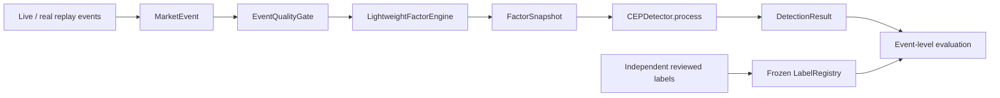

# MarketStream 研究算法核心代码说明、作者归属与参考来源

> 作者：**XI LU**  
> 适用范围：当前生产研究主链中的数据合同、数据质量、轻量因子、因子 CEP、真实回放标签、真实回放评估和事件级指标。  
> 状态说明：本文所述当前主链有部分尚未进入 Git 提交；作者归属由 XI LU 确认，提交后应再用 Git 历史固化。

## 1. 如何理解本文中的“原创”和“参考”

本文不把“使用了已有知识”与“复制了现有代码”混为一谈。

| 标记 | 含义 | 本项目中的写法 |
|---|---|---|
| 项目原创实现 | 针对 MarketStream 自行设计并编写的数据结构、组合规则、状态边界、评测门槛和工程实现 | 可以标注“由 XI LU 设计并实现” |
| 基于公开概念自行实现 | 使用公开论文中的统计、金融或 CEP 概念，但代码和系统组合由本项目实现 | 必须同时标出概念来源和项目实现边界 |
| 第三方接口或协议 | 上游 API、消息系统或库规定的数据格式和能力 | 只能写“接入/调用”，不能写成自创技术 |
| 直接参考或改写 | 与某个外部实现存在明确代码对应关系 | 当前七个核心文件中未发现足以确认的直接复制证据 |

因此，“MAD 是现有稳健统计方法”和“MarketStream 如何按时段维护 MAD baseline”可以同时成立：前者需要引用，后者属于项目的具体系统设计与实现。

### 1.1 代码注释的阅读格式

七个核心文件的开头统一使用以下结构：

```text
function：这个文件实现什么功能
贡献：本项目在该文件中完成了哪些设计与实现
参考边界：哪些概念或字段来自论文、官方文档或第三方协议
关键设计：该模块最重要的实现选择
需要解决的问题：实现前存在什么具体问题
解决方法：当前代码如何处理这些问题
```

关键代码段不逐行翻译 Python，而是根据实际需要使用以下说明：

- `目标`：为什么需要这个类、函数或数据结构。
- `关键设计`：为了实现目标，代码采用了什么结构或处理顺序。
- `解决的问题`／`解决方法`：先说明错误风险，再说明当前代码采取的措施。
- `参考内容`：直接写出 `Rxx` 和文献、论文或官方文档的名称，明确参考的是概念、公式还是字段语义。

这种写法避免使用过于抽象的“原创边界”标签。项目贡献通过“目标、关键设计和解决方法”具体呈现；已有知识则通过“参考内容”单独标明。

## 2. 当前研究算法主链



三个稳定数据合同回答三个不同问题：

- `MarketEvent`：市场中发生了什么，来自哪个数据源，事件何时发生。
- `FactorSnapshot`：当前时间窗口相对历史正常状态表现如何，数据是否可信。
- `DetectionResult`：多个因子是否构成具有方向、顺序和时间范围的异常模式。

## 3. 核心文件索引

| 文件 | 核心入口 | 输入 → 输出 | 核心程度 |
|---|---|---|---|
| [`processing/event_models.py`](../processing/event_models.py) | `MarketEvent`、`FactorSnapshot`、`DetectionResult` | 上游字段 ↔ 稳定 JSON 合同 | 基础合同核心 |
| [`processing/data_quality.py`](../processing/data_quality.py) | `EventQualityGate.assess()` | `MarketEvent` → 带质量标记的 `MarketEvent` | 输入可信度核心 |
| [`processing/factor_engine.py`](../processing/factor_engine.py) | `LightweightFactorEngine.process()` | 市场事件 → 八因子快照 | 研究方法核心 |
| [`cep/cep_detector.py`](../cep/cep_detector.py) | `CEPDetector.process()` | 因子快照 → 可解释异常结果 | 研究方法核心 |
| [`replay/labels.py`](../replay/labels.py) | `LabelRegistry.validate()`、`freeze_registry()` | 审阅草稿 → 冻结标签 | ground-truth 治理核心 |
| [`replay/evaluator.py`](../replay/evaluator.py) | `RealReplayEvaluator.run()` | 真实历史数据＋冻结标签 → trace/metrics/report | 实证验证核心 |
| [`ml/event_metrics.py`](../ml/event_metrics.py) | `match_events()`、`compute_event_metrics()` | 真实事件＋检测事件 → 事件级指标 | 评测方法核心 |

`CEPDetector.process(FactorSnapshot)` 是当前生产检测入口。`CEPDetector.score(dict)` 只用于兼容早期五分钟 features 和旧 ML 对比实验，不应在论文中描述成当前主链。

## 4. 各模块的思路、关键点和原创边界

### 4.1 统一数据合同：`processing/event_models.py`

**实现目标**

让 live 和 replay 数据在进入质量门之后不再分叉。四种原始事件只允许携带一种 typed payload，但共享事件身份、数据源、事件时间、接收时间、运行身份、数据集身份和 provenance。

**关键设计**

- `MarketEvent.__post_init__()` 把 ticker、事件类型和时间统一成稳定语义，并强制“一条事件只能有一种 payload”。
- `MarketEvent.create()` 在上游没有 ID 时，根据来源、feed、事件类型、ticker、事件时间和 payload 计算确定性 SHA-256 截断 ID。
- `FactorSnapshot` 同时保存因子值与相对 baseline 的状态，避免 CEP 重新解释统计阈值。
- `DetectionResult` 保存原子事件、完成/进行中的模式、证据、方向、事件时间、检测时间、质量信息和原始事件引用。

**项目原创部分**

三层合同的字段组合、live/replay 一致性、确定性身份、provenance 和告警回溯链属于 MarketStream 的具体设计与实现。

**参考边界**

Kafka 的事件流思想和 Alpaca 的消息字段语义分别来自 [R01]、[R02]；本文件没有实现 Kafka 或 Alpaca 协议本身。

### 4.2 数据质量门：`processing/data_quality.py`

**实现目标**

在计算因子前显式标记 duplicate、out-of-order、stale、zero-volume、invalid-price、crossed-quote 和 feed-gap。问题事件仍然保留用于审计，由下游决定是否跳过计算或抑制告警。

**关键设计**

- `_seen` 和 `_last_event_time` 都是有界 `OrderedDict`，避免长期运行时无限占用内存。
- 时间顺序状态按 `(ticker, event_type)` 分开，防止高频 quote 与低频 bar 互相误判。
- duplicate/out-of-order 事件保留质量证据，但不会进入窗口数值累计。
- 返回 `replace(event, ...)` 的副本，不就地篡改原始输入。

**已解决问题**

Alpaca minute bar 的时间戳位于一分钟区间左端，bar 在该分钟结束后发布。旧式统一 stale 阈值会把健康 bar 当作延迟数据；`bar_close_grace` 为 bar 单独增加窗口结束宽限。官方语义见 [R02]、[R03]。

**项目原创部分**

质量标记集合、有界状态、检查顺序、bar 宽限和向因子/CEP 传播质量证据的组合实现。

### 4.3 轻量因子引擎：`processing/factor_engine.py`

**实现目标**

在 10 秒、1 分钟和 5 分钟三种 cadence 下，把 trade、quote、bar 和 news 聚合为八个具有金融含义的因子，并判断每个因子相对历史 baseline 是 normal、elevated、extreme 还是 warmup。

#### 八因子公式

设当前窗口收益为 \(r_t\)，历史中位数为 \(m\)，MAD 为 \(d\)，市场基准收益为 \(r_{m,t}\)：

| 因子 | 当前实现 | 含义 |
|---|---|---|
| `return_surprise` | \((r_t-m)/\max(1.4826d,10^{-6})\) | 当前收益相对同类历史窗口的稳健异常程度 |
| `volatility_burst` | 窗口价格区间 / 历史区间中位数 | 当前波动范围是否突然扩大 |
| `relative_volume` | 当前成交量 / 历史成交量中位数 | 相同日内位置上的相对活跃度 |
| `spread_stress` | 当前 bid-ask spread bps / 历史 spread 中位数 | 流动性是否恶化 |
| `quote_imbalance` | \((bid\ size-ask\ size)/(bid\ size+ask\ size)\) | 最优报价两侧的挂单压力 |
| `signed_trade_imbalance` | \((buy\ volume-sell\ volume)/(buy\ volume+sell\ volume)\) | 主动买卖成交量方向 |
| `market_residual` | \(r_t-r_{m,t}\) | 扣除 SPY/QQQ 近期共同变化后的个股偏离 |
| `news_shock` | 情绪均值 \(\times\log(1+n)\) | 新闻方向与短时间集中程度 |

MAD 和 `1.4826` 修正来自稳健统计 [R04]；订单流失衡的金融依据见 [R05]；市场残差与 estimation/event window 分离的思想见 [R06]。八因子的选择、组合、窗口化与状态输出属于项目实现。

#### baseline 设计

baseline 键为：

```text
(ticker, cadence, market_session, intraday_slot, factor_name)
```

这样不会把盘前、常规盘、盘后或不同日内位置的统计分布混在一起。状态阈值同时参考历史经验 `99.5%/99.9%` 分位数与 `4×/6×` 稳健尺度。

**最关键的防泄漏顺序**

```text
读取此前历史 baseline
→ 计算当前 factor 的 robust_z 与状态
→ 输出 FactorSnapshot
→ 若 baseline 未冻结，再把当前值写入历史
```

当前窗口若先进入 baseline，会稀释自己的异常程度；测试窗口若能更新 baseline，则会改变评测期间的“正常”定义。当前代码通过“先评分、后更新”和 `frozen_baselines` 同时解决这两个问题。

### 4.4 因子 CEP：`cep/cep_detector.py`

**实现目标**

把 elevated/extreme 因子转换为带 group、direction、时间和来源引用的原子事件，再在有限时间窗内识别有金融含义的组合。通用 CEP/自动机式事件关联思想来自 [R07]；以下模式不是 SASE 的现成规则，而是 MarketStream 的项目设计。

| 模式 | 当前完成条件 | 主要目的 |
|---|---|---|
| `stock_specific_dislocation` | `return_surprise` 与 `market_residual` 同向；或 return 为 extreme | 区分个股异常与市场共同走势 |
| `liquidity_pressure_move` | spread stress＋同向 quote/trade pressure＋价格变化 | 要求流动性和交易压力确认价格 |
| `news_confirmed_move` | 五分钟内新闻与价格方向一致 | 表达新闻先发生、价格随后确认 |
| `flash_reversal` | 有限相邻窗口中价格异常方向翻转 | 识别快速冲击与回撤 |
| `sustained_pressure` | 至少三个不同窗口持续同向压力，再由价格确认 | 识别持续而非单点的订单压力 |
| `cross_asset_shock` | 60 秒内至少三个标的同向，且包含 SPY 或 QQQ | 识别带市场上下文的共同冲击 |

**告警控制**

- baseline 未 ready 或存在 duplicate、stale、invalid-price、crossed-quote 时，模式仍可记录，但正式告警被抑制。
- 同一 `(ticker, pattern, direction)` 在 cooldown 内合并，降低重复告警负担。
- dedupe key 基于 ticker、模式、方向和模式开始时间生成，用于持久化幂等。
- 主要模式由严重度选择；最终结果保存全部 completed/pending 模式和因子证据。

**项目原创部分**

六类模式、方向一致性、时间窗口、严重度、极端单因子例外、质量抑制、cooldown、解释文本和 `DetectionResult` 的组合实现。

### 4.5 标签注册表：`replay/labels.py`

**实现目标**

把“候选事件”与“可用于正式指标的 ground truth”分开。草稿必须由独立审阅者在不查看 detector 输出的条件下补齐证据、审批状态、审阅者、审阅时间和置信度，然后才能冻结。

**关键门槛**

- 数据必须声明为 `real_historical`、Alpaca、IEX。
- interval ID 和 event ID 必须唯一。
- 12 anomaly＋12 normal 基准必须覆盖五个跟踪标的。
- anomaly 必须带 HTTPS 外部证据。
- frozen 注册表必须有 `frozen_at`，且所有区间均 approved。
- `digest` 对规范化内容计算 SHA-256；数据 manifest 保存该值，标签变化会导致评估失败。

这些约束是针对时序异常评测偏差 [R08]、[R09] 的项目实现，不是从某个 benchmark 仓库复制的标签工具。

### 4.6 真实历史回放：`replay/evaluator.py`

**实现目标**

确定性复用生产链：

```text
MarketEvent
→ EventQualityGate
→ LightweightFactorEngine
→ CEPDetector
→ ReplayStep trace
→ event-level metrics/report
```

**输入与来源门**

- manifest、labels、dataset ID、interval 集合和 labels hash 必须一致。
- 所有分页请求必须标记 complete。
- baseline/evaluation 文件必须有事件数、路径和 SHA-256，运行时再次验算。
- source/mode/provenance 必须明确为 Alpaca、`replay_real` 和正确 phase。
- synthetic/soak ID 被显式拒绝。

**防泄漏门**

- baseline 的最后事件必须严格早于 evaluation interval 开始。
- 每个区间单独训练 baseline，不与其他事件区间共享可变 detector 状态。
- baseline 导入测试引擎时 `freeze=True`。
- evaluation 完成后重新比较 threshold-state hash；任何变化都会使运行失败。
- 任一快照仍在 warm-up 时，不允许生成正式指标。

**可追溯性**

每个 snapshot 的 `source_event_ids` 会与近期原始事件集合核对。输出 trace 同时保存输入摘要、因子状态、CEP 结果、truth 上下文、质量状态和匹配状态，使报告能够从一条告警回查到参与计算的原始事件。

### 4.7 事件级指标：`ml/event_metrics.py`

**实现目标**

避免逐时间点指标和对称容忍窗口高估效果。相关评测风险见 [R08]、[R09]；实时检测对及时性和误报的要求见 [R10]。

**一对一向前匹配**

一条 detection 只有同时满足以下条件才可匹配：

1. ticker 与 truth 相同；
2. direction 相同；
3. 若启用 pattern 要求，pattern 相同；
4. `truth.started_at <= detection.detected_at <= truth.ended_at + grace_after`；
5. 该 detection 尚未被其他 truth 使用。

因此事件开始前的告警不会被对称窗口“补算”为命中，一条告警也不能同时贡献多个 TP。

**输出指标**

- 事件 precision、recall、F1；
- 首次检测 delay 的 p50/p95/p99；
- receipt-to-persistence 端到端延迟；
- 每 ticker-hour 告警数；
- 与生产 cooldown 定义一致的重复告警率；
- 对真实事件有放回抽样、固定 seed 的 bootstrap 95% 区间。

## 5. 原创—参考—第三方来源矩阵

| 代码区域 | 项目原创实现 | 公开概念或第三方边界 | 引用 |
|---|---|---|---|
| 统一事件合同 | 三层合同、确定性 ID、provenance、live/replay 同语义 | Kafka 事件流；Alpaca 消息字段 | R01、R02 |
| 数据质量门 | 有界状态、质量标记组合、bar grace、质量传播 | Alpaca bar 发布与时间戳语义 | R02、R03 |
| baseline 与阈值 | 五维 baseline 键、暖机、经验分位＋MAD、冻结导入导出 | MAD/稳健尺度 | R04 |
| 流动性因子 | quote/trade imbalance 的窗口实现与 CEP 组合 | 订单流失衡与价格影响 | R05 |
| 市场残差 | SPY/QQQ 同 cadence、新鲜度约束 | abnormal return / market context 思想 | R06 |
| 六类 CEP | 金融模式、方向、窗口、严重度、抑制和解释 | CEP 事件关联与自动机思想 | R07 |
| 标签冻结 | 项目 schema、审批门、摘要绑定 | 无偏时序异常评测原则 | R08、R09 |
| 真实 replay | provenance/checksum、baseline 隔离、trace 工件 | 时间顺序与可复现评测原则 | R08、R09、R10 |
| 事件指标 | 一对一向前匹配、告警负担和项目指标组合 | 点调整偏差、实时及时性评测 | R08、R09、R10 |

当前审查没有发现上述七个文件与某个外部项目之间可确认的直接代码复制关系。该结论表示“根据现有仓库证据未发现”，不是对互联网上所有代码作绝对性保证。

## 6. 可核验的修改完善过程

### 6.1 Git 可核验阶段

| 日期 | 证据 | 可核验变化 | 与当前研究主链的关系 |
|---|---|---|---|
| 2026-05-11 | `b2e36c1`、`9548c29`、`ffe5709`、`02387c1` 等 | 建立基础设施、存储、数据接入、五分钟流处理与早期 ML 基线 | 证明项目先具备流式工程骨架 |
| 2026-05-11 | `84484f1` 至 `c25dd9b` | 增加 EWMA、HST、LSTM、Isolation Forest 集成 | 当前只保留为离线基线，不是生产研究核心 |
| 2026-06-13 | `e03254e` | 增加基于状态自动机的 CEP 检测 | 从单点模型向显式事件序列过渡 |
| 2026-06-13 | `43ae629` | DFA 扩展为有界 NFA，加入 gap、guard、negation、repeat 和组合 | 为后续因子 CEP 提供了序列表达实验基础 |

### 6.2 本地证据但不等同于 Git 提交

2026-05-15 的会议纪要记录了研究方向调整：保留 Kafka 流式系统，将早期机器学习/深度学习集成降为比较基线，转向更轻量、可解释的 CEP 方法。该纪要能够说明设计动机，但不应写成 Git 已验证代码历史。

### 6.3 当前未提交重构：作者填写模板

以下内容应由 XI LU 在提交前根据个人开发记录补齐；不要根据最终代码倒推并编造过程。

| 模块 | 原始问题 | 初始方案 | 测试/实流暴露的问题 | 修改内容 | 修改后结果 | 证据（commit/test/report） |
|---|---|---|---|---|---|---|
| 统一数据合同 | 待填写 | 待填写 | 待填写 | 待填写 | 待填写 | 待填写 |
| 数据质量门 | 待填写 | 待填写 | minute bar stale 问题可核对项目状态文档 | 待填写 | 待填写 | 待填写 |
| 八因子与 baseline | 待填写 | 待填写 | 待填写 | 待填写 | 待填写 | 待填写 |
| 六类因子 CEP | 待填写 | 待填写 | 负对照中的极端单因子误警可核对评测结果 | 待填写 | 待填写 | 待填写 |
| 标签冻结与真实 replay | 待填写 | 待填写 | 待填写 | 待填写 | 待填写 | 待填写 |
| 事件级指标 | 待填写 | 待填写 | 待填写 | 待填写 | 待填写 | 待填写 |

推荐每次重要完善形成一个独立 Git commit，并在表格最后一列写入 commit hash、对应测试和评测工件。这样“不断修改完善”不再只依赖口头说明。

## 7. 上传 GitHub 前注释审查清单

- [ ] 本说明文档的作者为 `XI LU`，七个核心文件中的“贡献”与本文归属说明一致。
- [ ] “原创”仅指项目的数据结构、组合规则和具体实现，没有把 MAD、CEP、Kafka、Alpaca 等写成自创技术。
- [ ] 每个 `[参考依据 Rxx]` 都能在本文参考文献中找到。
- [ ] 没有声称直接参考某项目代码，除非能够给出明确文件、版本和对应实现证据。
- [ ] `CEPDetector.process()` 被标为当前生产入口，旧 `score()` 被标为兼容入口。
- [ ] 八因子公式与当前代码一致，阈值和时间窗口没有只在文档中“美化”。
- [ ] 未提交阶段的开发过程只填写真实记录，不把最终状态倒写成未经证实的历史。
- [ ] 运行核心测试和 Ruff 后再提交；提交中不要包含密钥、原始凭据或无关生成文件。

## 8. 参考文献与官方文档

- **R01 — 第三方架构/协议：** Apache Kafka Documentation, “Design”. <https://kafka.apache.org/documentation/#design>
- **R02 — 第三方 API：** Alpaca, “Real-time Stock Data”. <https://docs.alpaca.markets/us/docs/real-time-stock-pricing-data>
- **R03 — 第三方 API：** Alpaca, “Market Data FAQ” — IEX/SIP 覆盖与 bar 左端时间戳。 <https://docs.alpaca.markets/us/docs/market-data-faq>
- **R04 — 公开统计方法：** Rousseeuw, P. J., and Croux, C. (1993), “Alternatives to the Median Absolute Deviation,” *Journal of the American Statistical Association*. <https://wis.kuleuven.be/stat/robust/papers/publications-1993/rousseeuwcroux-alternativestomedianad-jasa-1993.pdf>
- **R05 — 公开金融研究：** Cont, R., Kukanov, A., and Stoikov, S. (2014), “The Price Impact of Order Book Events,” *Journal of Financial Econometrics*, 12(1), 47–88. <https://doi.org/10.48550/arXiv.1011.6402>
- **R06 — 公开方法说明：** Reserve Bank of Australia, “The Impact of Rating Changes in Australian Financial Markets — Methodology,” 关于 estimation window、event window 与 abnormal return。 <https://www.rba.gov.au/publications/rdp/2004/2004-02/methodology.html>
- **R07 — 公开 CEP 研究：** Gyllstrom, D., Wu, E., Chae, H.-J., Diao, Y., Stahlberg, P., and Anderson, G. (2006), “SASE: Complex Event Processing over Streams.” <https://arxiv.org/abs/cs/0612128>
- **R08 — 公开评测研究：** Liu, Q., and Paparrizos, J. (2024), “The Elephant in the Room: Towards A Reliable Time-Series Anomaly Detection Benchmark,” NeurIPS 2024 Datasets and Benchmarks Track. <https://proceedings.neurips.cc/paper_files/paper/2024/hash/c3f3c690b7a99fba16d0efd35cb83b2c-Abstract-Datasets_and_Benchmarks_Track.html>
- **R09 — 公开评测研究：** Bhattacharya, D. et al. (2024), “Towards Unbiased Evaluation of Time-series Anomaly Detector.” <https://arxiv.org/abs/2409.13053>
- **R10 — 公开实时评测研究：** Lavin, A., and Ahmad, S. (2015), “Evaluating Real-time Anomaly Detection Algorithms — The Numenta Anomaly Benchmark.” <https://arxiv.org/abs/1510.03336>

## 9. 可用于答辩的简短归属表述

> 当前生产研究主链由 XI LU 针对 MarketStream 设计并实现，包括统一事件合同、有界数据质量门、三时间尺度八因子、六类方向性 CEP 模式、标签冻结、真实历史回放和事件级评测。系统使用了 MAD、订单流失衡、市场残差和 CEP 等公开概念，并通过论文和官方文档明确标注其来源；这些概念在 MarketStream 中的组合方式、状态约束、数据流、抑制逻辑和可追溯实现属于本项目工作。早期四模型集成仅保留为离线比较基线。
