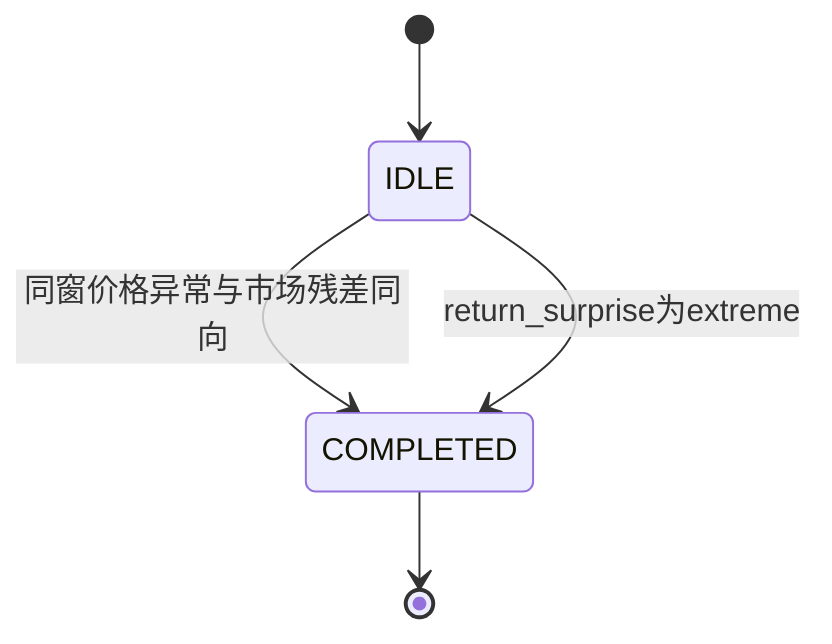
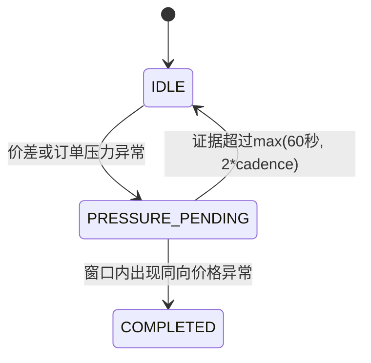
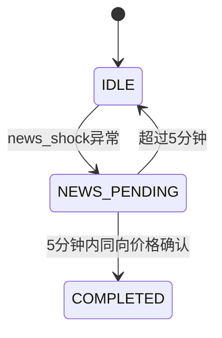
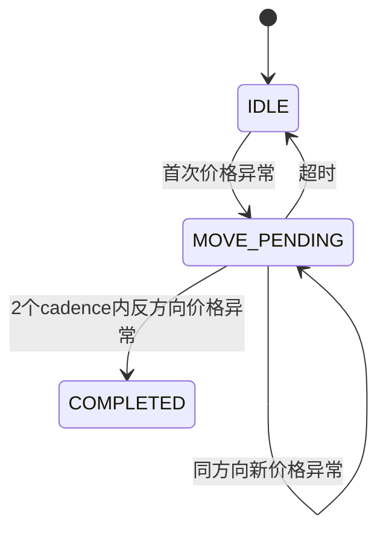
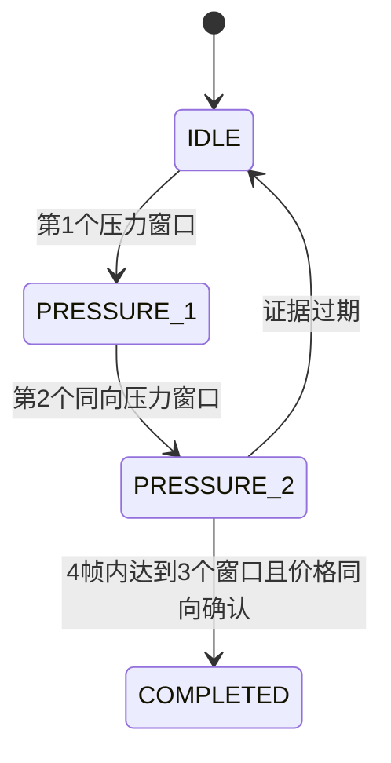
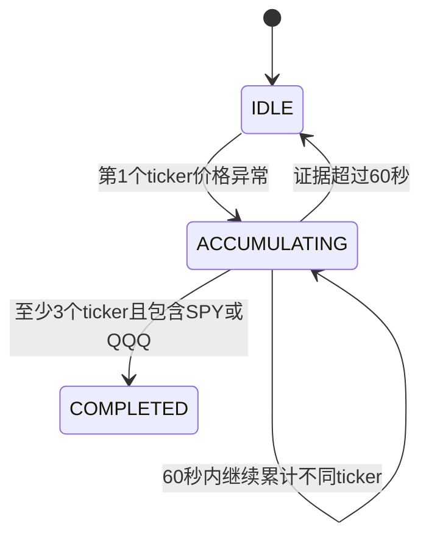

# MarketStream 核心源码导学

> 源码版本：`codex/core-simplification`。本导学只覆盖最终答辩主链，不覆盖快照分支中的旧四模型系统。

## 1. 前置知识

| 知识点 | 为何需要 | 项目位置 | 高频度 |
|---|---|---|---|
| 事件时间与接收时间 | 解释乱序、stale和端到端延迟 | `processing/event_models.py` | 高 |
| 滚动时间窗口 | 理解10s/1m/5m快照 | `processing/factor_state.py` | 高 |
| Median与MAD | 理解稳健baseline | `processing/factor_engine.py` | 高 |
| 有限状态机 | 解释六类CEP的等待、完成和过期 | `cep/state_machines.py` | 高 |
| Precision/Recall/F1 | 解释检测效果及误报代价 | `evaluation/metrics.py` | 高 |
| 时间序列数据泄漏 | 解释为何训练必须严格早于测试 | `replay/validation.py` | 高 |
| Isolation Forest | 只需解释离线基线的输入、训练和输出 | `evaluation/isolation_forest.py` | 中 |

## 2. 重点亮点与学习顺序

| 亮点 | 为什么重要 | 通用关键词 | 先看文件 | 顺序 |
|---|---|---|---|---:|
| 统一事件合同 | live与replay不再维护两套含义 | schema、provenance | `processing/event_models.py` | 1 |
| 可解释流式因子 | 每个数值能手算并回到原始输入 | window、MAD、bounded state | `processing/factor_state.py`、`processing/factor_calculations.py` | 2 |
| 显式状态建模 | 源码直接表现事件顺序和时间限制 | FSM、CEP、expiry | `cep/state_machines.py` | 3 |
| 告警治理 | 模式命中不一定等于正式告警 | quality gate、cooldown、dedupe | `cep/cep_detector.py` | 4 |
| 防泄漏评测 | 防止测试数据改写正常基准 | frozen state、checksum | `replay/validation.py`、`replay/evaluator.py` | 5 |
| 公平方法比较 | CEP与IF消费同一批八因子快照 | chronological split、shared metrics | `evaluation/comparison.py` | 6 |

## 3. 必备知识点

- [ ] 能区分`MarketEvent`、`FactorSnapshot`和`DetectionResult`。
- [ ] 能手算八个因子中的任意一个，并解释方向。
- [ ] 能画出新闻确认、快速反转和持续压力状态机。
- [ ] 能解释warm-up、先评分后更新和冻结baseline。
- [ ] 能从TP/FP/FN手算Precision、Recall和F1。
- [ ] 能说明真实输入跑通为什么不等于真实市场准确。
- [ ] 能说明AI辅助实现与个人研究决策的边界。

## 4. 主调用链

### Replay主演示

```text
producers/replay_producer.py
  → raw.market_events
processing/factor_stream.py
  → EventQualityGate.assess
  → LightweightFactorEngine.process
  → stream.factor_snapshots
cep/online_scorer.py
  → CEPDetector.process
  → anomaly_alerts + stream.anomalies
dashboard/
  → 展示因子窗口、新闻和告警证据
```

### 正式离线评测

```text
RealReplayEvaluator.run
  → validate_replay_inputs
  → baseline事件：质量门 + 因子引擎，只训练正常状态
  → export_baseline_state
  → evaluation事件：导入并冻结baseline
  → CEPDetector.process
  → IsolationForestBaseline.fit(同一区间baseline快照)
  → IsolationForestBaseline.predict(同一区间evaluation快照)
  → compute_event_metrics
  → metrics / trace / HTML / detector_comparison
```

## 5. 八因子公式

设当前窗口收益为`r`，历史中位数为`m`，MAD为`d`，市场同期收益为`r_m`：

| 因子 | 当前公式/计算 | 能回答的问题 |
|---|---|---|
| return_surprise | `(r-m)/max(1.4826*d, 1e-6)` | 当前收益偏离历史多少稳健尺度？ |
| volatility_burst | `窗口价格区间/历史区间中位数` | 波动范围是否突然扩大？ |
| relative_volume | `窗口成交量/历史成交量中位数` | 活跃度是否异常？ |
| spread_stress | `当前价差bps/历史价差中位数` | 流动性是否恶化？ |
| quote_imbalance | `(bid_size-ask_size)/(bid_size+ask_size)` | 最优报价哪一侧压力更大？ |
| signed_trade_imbalance | `(buy_volume-sell_volume)/(buy_volume+sell_volume)` | 主动买卖哪一侧占优？ |
| market_residual | `r-r_m` | 个股变化能否由市场共同走势解释？ |
| news_shock | `新闻情绪均值*log(1+新闻条数)` | 新闻方向和集中程度如何？ |

必须主动说明：这些公开统计或金融概念不是个人发明；项目工作是窗口、组合、状态输出、实时链路和评测边界。

## 6. 六个CEP状态机

### 6.1 个股偏离



### 6.2 流动性压力



### 6.3 新闻确认



### 6.4 快速反转



### 6.5 持续压力



### 6.6 跨资产冲击



## 7. 关键设计决策

| 决策 | 备选 | 当前取舍 | 风险 | 验证 |
|---|---|---|---|---|
| 统一live/replay合同 | 两套入口各自转换 | 使用同一MarketEvent | 上游字段映射错误 | round-trip与一致性测试 |
| Median/MAD baseline | 均值/标准差 | 对极端值更稳健 | MAD可能为0 | 1e-6下限和边界测试 |
| 先评分后更新 | 当前值先进入历史 | 防止异常稀释自身 | 顺序写错造成泄漏 | baseline冻结测试 |
| 小状态机 | 通用NFA引擎 | 只实现六个项目模式 | 扩展语法有限 | 每模式场景测试 |
| Replay主演示 | Live主演示 | 确定、可重复 | 现场感较弱 | 保留live链路证据 |
| 单一IF基线 | 四模型ensemble | 降低解释与依赖负担 | 对比广度下降 | 同一快照和指标比较 |

## 8. 保留的边界及原因

| 边界 | 真实失败场景 | 对应测试 |
|---|---|---|
| payload必须与事件类型一致 | trade消息被当成quote计算 | `test_event_models.py` |
| duplicate/out-of-order | 成交量重复累计或last price倒退 | `test_data_quality.py`、`test_lightweight_factor_engine.py` |
| stale/invalid/crossed quote | 坏数据制造虚假价格或价差异常 | `test_data_quality.py` |
| minute bar宽限 | bar时间戳是窗口起点，被误判过期 | `test_data_quality.py` |
| warm-up | 历史不足却生成正式告警 | `test_factor_cep.py` |
| baseline冻结 | 测试数据改变正常定义 | `test_lightweight_factor_engine.py` |
| cooldown/dedupe | 一个事件连续多个窗口重复告警 | `test_factor_cep.py` |
| 有界状态 | 长时间流处理内存无限增长 | 因子与CEP bounded-state测试 |
| 标签/checksum | 看过结果后修改ground truth | `test_replay_labels.py` |
| 向前一对一匹配 | 提前告警或一个告警命中多个事件 | `test_event_metrics.py` |

新增边界前必须先写出一句具体失败场景，再写一个确定性测试；不能只因为“可能出问题”就增加分支。

## 9. 现场修改练习

1. **数据合同**：给trade事件同时加入quote payload，先预测异常，再运行对应测试。
2. **质量门**：把stale阈值从30秒改成60秒，说明哪些事件标记会变化。
3. **因子公式**：手算一组quote imbalance，再修改bid size并预测方向。
4. **baseline**：交换“评分”和“写入历史”的顺序，解释为什么这是泄漏，再恢复。
5. **新闻状态机**：把5分钟改为3分钟，预测stale-news负对照结果。
6. **持续压力状态机**：把3个窗口改为2个，预测Recall和误报可能怎样变化。
7. **cooldown**：把300秒改为0，预测重复告警率。
8. **评测**：根据`TP=3, FP=1, FN=2`手算P/R/F1，再用测试核对。
9. **Isolation Forest**：解释为什么测试阶段只能`predict`，不能再次`fit`。
10. **Replay资格**：把标签`frozen`改为false，预测评测器在哪一步拒绝。

## 10. 量化与验证

- 已有单元测试和合成实验属于代码/技术验证。
- Live数据数量和端到端延迟只能证明链路能够运行。
- 合成Precision、Recall、F1不得写成真实市场效果。
- 正式真实指标仍为待测；必须等独立标签冻结后运行reviewed replay。
- 负对照误报应保留并解释，不删除失败结果。

## 11. 自学提醒

若某文件或原理看不懂，请继续追问AI；本导学负责给出学习路径和练习，不替代你对核心代码逐段解释、手算和现场修改。

## 12. 项目技术定位

这是一个数据工程、流处理和可解释异常检测交叉的研究型技术原型；不是生产交易系统，也没有证据证明已经被真实用户采用。
