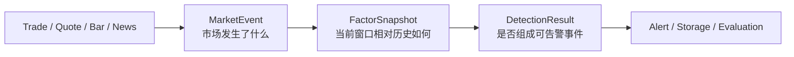
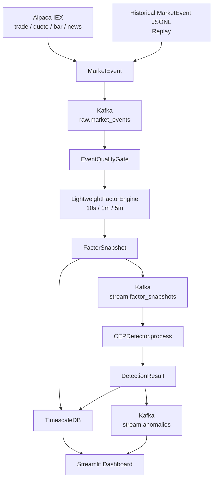
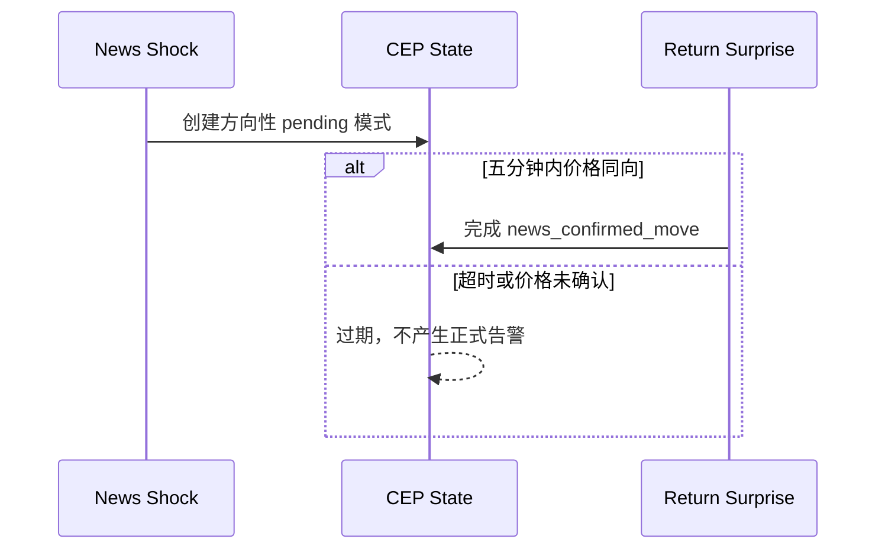
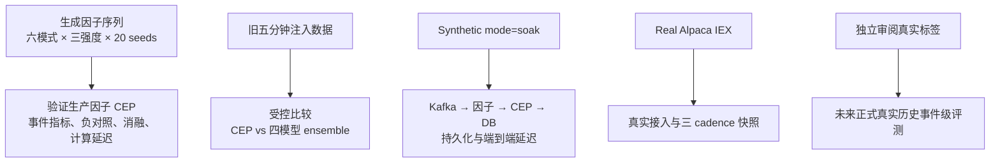

> 历史材料／非主稿（2026-10-22）：本文件保留旧口径，不作为当前结果或提交正文。唯一主稿见[中文修订报告](ownership_evidence/07_Revised_Report_CN.md)；计数解释与运行边界以主稿及其运行台账为准。

# MarketStream：基于轻量市场因子与复杂事件处理的实时可解释金融异常检测系统

> **文稿状态说明**：本文是一份可继续修改的中文完整参考稿。文中的合成检测实验、旧兼容对比实验、基础设施 soak 和 Alpaca IEX 实流验收均来自当前仓库中的可复现实验工件。经独立审阅和冻结标签的真实历史事件评测尚未完成，因此本文不提供真实历史 precision、recall 或 F1，也不将合成结果包装成真实市场效果。正式提交前还需按学校要求补充封面、声明、目录与规范化参考文献。

## 摘要

金融市场异常检测被广泛用于市场监控、风险预警与事件调查，但实时行情具有高频、噪声、厚尾、交易时段差异、市场共同波动和数据质量不稳定等特点。仅以价格越过固定阈值判断异常，难以区分个股独立异动、市场整体上涨、新闻驱动变化、流动性压力和错误数据；以多个机器学习模型加权得到单一异常分数，虽然能够提高特征覆盖，但也可能带来职责重叠、训练与推理成本、时间关系表达隐式以及解释困难等问题。

本文设计并实现 MarketStream，一套面向实时市场流的轻量、可解释异常检测系统。系统将 Alpaca IEX 成交、报价、分钟 K 线和时间戳新闻，以及历史回放数据，统一转换为 `MarketEvent`；在显式数据质量门之后，以 10 秒、1 分钟和 5 分钟三种时间尺度增量计算八个具有金融含义的因子；再使用复杂事件处理（Complex Event Processing，CEP）识别个股特异偏离、流动性压力价格变化、新闻确认变化、快速反转、持续订单压力和跨资产冲击六类方向性模式。正式告警同时受到暖机、数据质量、多因素确认、持续条件、冷却合并和确定性去重约束，并能够从告警追溯到因子状态与原始事件。

现有实验从不同层次验证系统。20 个随机种子、三种强度的生成因子序列实验得到事件级 Precision 0.750、Recall 1.000 和 F1 0.857，CEP 计算 p99 为 0.0495 ms；但 240 个负对照中仍有 40 个触发，表明极端单因子例外存在误警风险。旧五分钟兼容协议上的受控注入实验中，完整 CEP 的 F1 为 0.785，旧四模型集成为 0.639，平均单窗口计算延迟分别为 0.0033 ms 和 4.5135 ms；该结果仅代表早期协议，不能直接外推到当前生产因子链。基础设施 soak 将 240 条事件全部持久化，Kafka 到数据库告警持久化 p95 为 1.718 秒且重复为零。真实 Alpaca IEX 运行进一步持久化 48,734 条事件，并为五个标的生成三种时间尺度的因子快照，证明了真实数据接入和主链运行能力。

综合现有证据，轻量因子与 CEP 适合作为可解释、低计算成本的在线检测主线，显式时间关系也为单点检测难以表达的序列异常提供了自然表示。然而，合成序列与规则设计存在对齐风险，IEX 不能代表完整 SIP 覆盖，且正式真实历史标签尚未完成独立审阅。本文因此把结论限定为方法可行性与系统可运行性的初步证据，并将严格真实历史事件级评测列为下一阶段的最高优先级。

**关键词**：实时异常检测；复杂事件处理；金融市场微观结构；流处理；可解释人工智能；事件级评测

## 1. Introduction：研究背景与问题定义

### 1.1 研究背景

金融市场由连续到达的成交、报价、K 线和新闻共同构成。市场监管人员、风险管理者和交易研究人员不仅关心价格是否发生了显著变化，也关心变化发生的原因、演化顺序、影响范围和数据可信度。例如，一只股票在数分钟内上涨 3%，可能是公司发布利好新闻后形成的独立上涨，也可能只是整个科技板块与纳斯达克指数共同上涨；还可能伴随买卖价差扩大、主动买入量增加和报价失衡，反映短时流动性压力；甚至可能来自重复消息、陈旧数据或错误报价。以上情形具有相似的价格结果，却对应不同的风险含义和调查优先级。

因此，市场异常不能被简单定义为 \(|r_t|>2\%\)。固定价格阈值忽略了至少四类上下文。第一，不同标的具有不同波动水平，同一变化幅度对稳定 ETF 和高波动个股的含义不同。第二，盘前、常规交易时段和盘后市场的流动性与价差分布不同。第三，个股收益需要与 SPY 或 QQQ 等市场基准比较，才能区分共同波动与特异性变化。第四，实时系统必须知道输入是否完成暖机、是否乱序、是否过期以及是否存在跨价报价。真正有用的异常判定应回答“当前变化相对什么正常状态发生、哪些因素参与、它们以何种顺序出现，以及证据是否可靠”。

早期 MarketStream 使用指数加权移动平均（Exponentially Weighted Moving Average，EWMA）、Half-Space Trees、Isolation Forest 和长短期记忆自编码器（Long Short-Term Memory Autoencoder，LSTM-AE）四个检测器，通过加权集成输出异常分数。该方案提供了多模型视角，但存在三方面不足。首先，不同模型可能对相似的价格与成交量变化重复评分，模型职责难以区分。其次，最终分数与权重的金融含义有限，用户较难从一个负分判断异常由价格、流动性、市场上下文还是新闻驱动。再次，旧特征主要以窗口向量输入，事件先后、允许间隔和持续时间只被隐式编码，无法直接表达“新闻先出现，价格在五分钟内同向确认”或“订单压力连续三个窗口后才发生价格变化”。

本研究将问题重新定义为流上的上下文事件识别：先用少量具有金融意义的因子描述每个窗口，再用 CEP 表达因子事件之间的方向、顺序、持续与跨资产关系。系统的总判定可表示为：

\[
A_t=g(F_t,F_{t-k:t},C_t,Q_t)
\]

其中，\(F_t\) 表示当前因子状态，\(F_{t-k:t}\) 表示最近若干窗口的因子序列，\(C_t\) 表示市场基准、交易时段和新闻等上下文，\(Q_t\) 表示数据质量与暖机状态，\(g\) 是带方向和时间约束的 CEP 告警逻辑。该定义把异常从孤立数值越界提升为可追溯的事件判断。

### 1.2 研究问题

本文围绕以下三个研究问题展开：

**RQ1：轻量、可解释的市场因子能否替代冗余的模型集成，完成实时异常检测？**

该问题关注八因子是否足以表达主要异常、计算和运维成本是否降低、输出是否更容易解释，以及在可比较实验中是否能保持合理的 precision 与 recall。由于当前八因子生产协议尚未与 ML 在冻结真实标签上完成同协议对比，本文对 RQ1 给出的是初步而非最终答案。

**RQ2：CEP 是否比点检测更适合表达持续、反转、新闻确认和跨资产异常？**

该问题关注固定阈值不能表达的事件顺序、最大间隔、方向一致性与持续条件。验证重点包括六类序列能否被识别、删除时间或因子关系后表现如何，以及负对照是否揭示规则边界。

**RQ3：在严格事件级评测要求下，系统能否同时满足检测质量、低告警负担、可追溯性与实时延迟要求？**

该问题不把 F1 作为唯一目标，而是同时考察首次检测延迟、每 ticker 每小时告警数、重复告警率、端到端延迟、数据质量处理和从告警回查原始事件的能力。

### 1.3 研究贡献

本文的主要贡献如下：

以下为项目产出。本人主导方案选择与具体约束，AI 按确认方案实施；八因子／三窗口／六模式的架构采纳、核心模块与报告修订决策见[贡献归属五列表](ownership_evidence/08_Contribution_Attribution_Matrix_CN.md)。实现和文字的实际来源分别披露。

1. 设计了 live 与 replay 共用的统一市场事件合同，使成交、报价、K 线和新闻在进入检测链后具有一致身份、时间和来源语义。
2. 实现了三时间尺度、有限内存的八因子引擎，以价格、活跃度、流动性、市场上下文和新闻五个维度表达窗口状态。
3. 设计了六类具有方向和时间语义的金融 CEP 模式，用显式事件关系表示个股偏离、流动性压力、新闻确认、反转、持续压力和跨资产冲击。
4. 建立了包含质量抑制、暖机、冷却合并、确定性去重键与原始事件引用的可追溯告警合同。
5. 实现了严格时间切分、一对一向前匹配、标签冻结和 baseline 防泄漏机制，使事件级评测更接近在线检测的因果条件。
6. 在生成序列、旧受控基线、Kafka 到数据库 soak 和真实 Alpaca IEX 流上分别验证了方法逻辑、早期相对表现、基础设施性能与真实链路可运行性。

### 1.4 报告结构

第 2 章从医疗、工业与航天、网络安全、通用时序和金融市场五个领域回顾异常检测经验；第 3 章形式化系统输入、因子状态、异常事件和告警要求；第 4 章介绍架构与数据平面；第 5 章给出八因子、鲁棒基线、六类 CEP 和告警控制方法；第 6 章说明数据、实验组、指标与防泄漏协议；第 7 章报告当前已有结果；第 8 章讨论研究含义、负面结果和局限；第 9 章回答研究问题并提出未来工作。

## 2. Literature Review：跨领域异常检测综述

### 2.1 综述范围与组织方法

本章不把其他领域的结论直接当作金融市场中的事实，而是选择能够回答 MarketStream 设计问题的代表研究。每个领域均按照“具体研究与方法—主要发现—研究局限—对本项目的启发”展开。跨领域论文用于说明可迁移的检测原则，金融论文用于支持因子选择；MarketStream 的八因子组合、六类模式和具体时间阈值仍属于本项目设计，不能写成来自某一篇已有论文的现成方案。

### 2.2 医疗预警：可解释评分与告警负担

Prytherch、Smith、Schmidt 和 Featherstone（2010）[11] 在 *ViEWS—Towards a National Early Warning Score for Detecting Adult Inpatient Deterioration* 中构建了 VitalPAC Early Warning Score。该研究将常规采集的生命体征转换为加权、可人工计算的综合评分，用于预测住院患者恶化；以观察后 24 小时内的院内死亡为结果时，ViEWS 的受试者工作特征曲线下面积（AUROC）为 0.888，95% 置信区间为 0.880–0.895。这个结果表明，少量经过领域知识选择并分级的变量可以形成具有较强判别力且容易解释的预警工具。其局限是研究对象、采样频率和错误成本都属于临床环境，不能把 ViEWS 的变量、权重或 AUROC 直接迁移到金融数据。

Drew 等人（2014）[4] 在 31 天内连续观察 461 名重症监护患者，记录到 2,558,760 个监护报警，其中可听报警负担达到每床每天 187 个；在人工标注的 12,671 个心律失常报警中，88.8% 为假阳性。作者将过量报警归因于设置不当、患者状态和算法缺陷的共同作用，并建议根据具体状态调整阈值、利用更多可用信号和设置可配置延迟。这项研究说明：即使单条规则具有合理医学依据，大量低价值或重复报警仍会削弱系统安全性。它不能证明金融告警应采用相同阈值，但为单独测量告警负担、重复率和持续确认提供了实证动机。

对 MarketStream 而言，Prytherch 等人的研究[11] 支持了使用少量轻量的因子这个设计方向；Drew 等人的观察[4] 则说明 precision 之外还必须评价告警负担。项目因此将普通 elevated 因子视为原子事件，正式告警通常要求正交因子或持续窗口确认，并使用 cooldown、合并和 alerts-per-ticker-hour 指标。不过，极端收益率意外 `return_surprise` 依然允许的单因子例外仍可能重现类似的过度报警问题，需要在真实正常时段中校准。

### 2.3 工业与航天监测：运行状态、派生量与置信度

Powell 等人（2020）[10] 在 NISTIR 8219 *Securing Manufacturing Industrial Control Systems: Behavioral Anomaly Detection* 中，将行为异常检测能力部署在两个演示环境：机器人制造系统，以及类似化工生产的过程控制系统。报告的贡献不是提出一个通用最高准确率模型，而是证明基于正常操作行为的监测能够在实际控制环境中发现异常状态，并将检测能力映射到网络安全控制框架。该研究强调异常必须相对于受监控物理过程和正常运行行为解释。由于它是两个测试床上的能力演示，而不是跨行业算法排行榜，其结论不能证明某一种检测算法在所有工业系统上最优。

Barrie 等人（2025）[1] 提出的航天器事件驱动运行模块 MEDOS，则更直接展示了“派生量—正常参照—事件置信度”的链路。MEDOS 从原始星载测量计算对任务规划有物理意义的派生参数，再用模糊集合与典型值比较，输出事件发生的置信度并触发运行响应。作者使用 Magnetospheric Multiscale（MMS）任务的真实飞行数据验证系统，并在飞行硬件上完成 NASA 技术成熟度等级 6（TRL-6）验证。作者认为，采用领域专家熟悉的参数并以可能性而非绝对断言呈现结果，有助于建立运行人员的信任。该结论来自航天器物理测量，不能自动验证金融因子，但为保留 baseline、因子状态、质量信息和置信证据提供了清晰范例。

MarketStream 对这两项工作的迁移是方法层而非变量层：原始成交量需要转换为相对成交量，原始价差需要相对于相同 session 和日内位置解释，个股收益需要与市场基准比较。系统还保留 baseline 版本、质量标记和原始事件引用。NIST [10] 和 MEDOS [1] 均未给出本项目使用的 median/MAD 阈值或六类金融模式，因此这些具体设计仍需由金融数据实验验证。

### 2.4 网络安全与复杂事件处理：有界状态和事件关联

Manzoor、Milajerdi 和 Akoglu（2016）[9] 在 *Fast Memory-efficient Anomaly Detection in Streaming Heterogeneous Graphs* 中提出 StreamSpot，能在数据流快速进入的情况下，用固定大小的内存块（sketch）就把复杂的网络图结构存下来，处理速度超过每秒 100,000 条边。在模拟正常浏览器系统调用和攻击场景的数据上，其检测准确率超过 95%，且检测延迟较小。该研究说明：高速流检测可以在有限内存下保留结构关系，但其实验对象是主机级攻击图，不能保证在金融市场领域使用该方法也能达到这个准确率。

Gyllstrom 等人（2006）[6] 在 SASE 系统中研究了如何把实时 RFID 读数过滤、关联并转换为对应用有意义的复杂事件。他们设计了描述事件序列的语言与相应查询处理方法，并通过超市零售场景展示：单条 RFID 读数只有与其他读数按模式关联后，才形成可行动信息。虽然 SASE 和金融无关，SASE 中没有对“订单压力”或者“新闻利好”的定义，但它提出了复杂事件处理（CEP）的通用思想：每一条数据的价值，由它和前后事件的时间窗口与组合逻辑来体现。

这两篇研究共同给出了 MarketStream 在工程约束上的启发。第一，系统中的输入、窗口、输出、历史都必须有明确的内存上限；第二，单个事件的意义必须要结合前因后果、上下文。项目中的新闻后价格确认、持续订单压力和跨资产冲击是这一思想的金融化实现，但其方向、窗口和完成条件需要由本项目实验负责，而不能归因于 StreamSpot [9] 或 SASE [6]。

### 2.5 通用流式与时序异常检测：简单方法和评测偏差

Guha、Mishra、Roy 和 Schrijvers（2016）[5] 提出 Robust Random Cut Forest，将动态数据流表示为可增量更新的随机切割树集合，并把新点对其余数据模型复杂度造成的影响定义为非参数异常程度。作者展示了该 sketch 可以在动态流中高效更新，并在公开真实数据上验证可行性。该研究说明在线异常检测并不必然依赖深度序列模型，树结构和数据摘要也能形成严肃基线；但论文并未研究金融事件顺序，因此不能替代本项目的 CEP 评测。

Liu 和 Paparrizos（2024）[7] 针对时序异常检测数据集错误、指标偏差和实验设置不一致的问题构建 TSB-AD。该基准包含来自 40 个数据集的 1,070 条高质量时间序列，并在统一调参与设置下比较 40 种算法。作者报告，先进神经网络并未稳定占优，简单结构和统计方法经常取得更好表现；同时，他们将 VUS-PR 识别为相对可靠的时序异常指标。该研究直接挑战“模型越复杂越好”的默认假设，但其跨领域离线基准仍不能回答 MarketStream 的实时告警负担和因果检测延迟。

Bhattacharya、Mukherjee、Kamanchi、Ekambaram、Jati 和 Dayama（2024）[2] 进一步分析点调整（point adjustment）对 F1 的影响。他们指出，只要检测到异常区间中的少量点，传统点调整就可能把整个区间都改为正确检测，因而系统性偏向 true positive 并高估性能；作者提出 Balanced Point Adjustment，并用公理化定义论证其公平性。该发现与 MarketStream 的评测设计直接相关：一个持续五分钟的真实事件不能因为系统重复报警而贡献多个 TP，事件开始前的告警也不能通过对称窗口变成命中。

因此，本项目采用按时间的 60/20/20 切分、测试前冻结 baseline、一对一向前事件匹配，并同时报告 precision、recall、F1、首次检测延迟、告警负担和重复率。这里的具体匹配规则是 MarketStream 为在线金融事件制定的协议；它受到上述评测研究启发，但并不等同于直接采用 VUS-PR [7] 或 Balanced Point Adjustment [2]。

### 2.6 金融市场研究：订单流、市场基准与新闻

Cont、Kukanov 和 Stoikov（2014）[3] 使用 50 只美国股票的 NYSE Trades and Quotes 数据研究限价单、市价单和撤单的价格影响。三位作者的实证结果显示，在短时间尺度上，价格变化主要由最优买卖价上的订单流失衡（Order Flow Imbalance，OFI）驱动；OFI 与价格变化近似线性，斜率与市场深度成反比，而且结果在日内季节性、股票和时间尺度之间较稳定。他们还发现，仅用成交量解释价格变化的关系更嘈杂、稳健性更差。这项结果为 `quote_imbalance`、`signed_trade_imbalance` 和 `spread_stress` 比单独成交量更有解释力提供了直接金融依据。需要注意的是，MarketStream 只观察当前 feed 的最优报价，并未完整复现论文的 OFI 定义或全市场深度。

MacKinlay（1997）[8] 系统总结事件研究方法，指出事件研究的目标是通过事件窗口附近的证券价格衡量经济事件对公司价值的影响。其关键步骤是先估计“正常收益”，再将实际收益与正常收益之差定义为异常收益；市场模型是常用正常收益模型之一。该工作支持“个股绝对收益必须相对于市场共同变化解释”的原则。MarketStream 的 `market_residual=r_i-r_m` 是这一思想的轻量化近似，并不是 MacKinlay 市场模型中估计 \(\alpha\) 和 \(\beta\) 后得到的严格 abnormal return，报告中必须保留这一差别。

Tetlock（2007）[12] 使用《华尔街日报》专栏的日度文本量化媒体悲观程度，发现高媒体悲观度可以预测市场价格的向下压力及随后向基本面的回归，而异常高或异常低的悲观程度与较高交易量相关。该研究证明媒体文本与价格和成交活动具有可测量的时间关系，但也表明新闻情绪不能被简单解释为基本面因果。MarketStream 因而不把 `news_shock` 单独视为正式异常，而是要求新闻之后在有限窗口内出现同方向价格确认，并将“新闻出现但价格未确认”保留为负对照。

上述金融研究支持因子类别，却没有给出 MarketStream 的五分钟新闻窗口、三窗口持续压力或 60 秒跨资产门槛。这些参数属于项目规则，需要在验证集和冻结真实标签上评价，不能用文献存在本身证明其正确。

### 2.7 跨领域综合与研究空白

| 代表研究 | 主要发现 | 对 MarketStream 的启发 | 不能直接推出的结论 |
| --- | --- | --- | --- |
| Prytherch et al.（2010）[11]；Drew et al.（2014）[4] | 少量分级指标可形成有效预警；过量假警造成严重告警负担 | 因子分级、多因素确认、cooldown 和 alert burden | 临床阈值适用于金融市场 |
| Powell et al.（2020）[10]；Barrie et al.（2025）[1] | 异常应相对于运行行为解释；派生量与置信度支持可行动事件 | session/slot baseline、派生因子、质量和证据保留 | 航天或 ICS 模型能直接检测股票异常 |
| Manzoor et al.（2016）[9]；Gyllstrom et al.（2006）[6] | 流式结构可在有界内存下处理；相关事件可组成可行动模式 | 有界 ticker 状态和六类时间模式 | 既有论文已经定义本项目的金融规则 |
| Guha et al.（2016）[5]；Liu & Paparrizos（2024）[7]；Bhattacharya et al.（2024）[2] | 简单在线方法是有效基线；数据与评测偏差可改变排名和 F1 | 保留 ML baseline、冻结阈值、一对一事件匹配 | 合成或通用基准能代表真实金融效果 |
| Cont et al.（2014）[3]；MacKinlay（1997）[8]；Tetlock（2007）[12] | 订单流、市场基准和新闻均提供价格之外的信息 | 流动性因子、market residual 和 news confirmation | 文献已经验证八因子组合和具体 CEP 门槛 |

现有研究分别证明了可解释评分、运行状态、有界流处理、公平评测、订单流和新闻等原则的重要性，但尚未直接给出一套同时整合 live/replay 统一事件、显式质量门、三时间尺度八因子、六类方向性 CEP、告警治理和严格事件级评测的实时金融系统。MarketStream 的研究贡献正位于这一组合与验证层：它不声称发明上述公共概念，而是把它们组织成可运行、可追溯且可被反驳的研究方法，并通过负对照、消融、基线比较和真实回放检验这种组合是否成立。

## 3. Problem Formulation and Requirements：问题形式化

### 3.1 统一市场事件

设市场事件为：

\[
e_i=(id_i,s_i,f_i,y_i,a_i,t_i^{event},t_i^{recv},p_i,q_i,z_i)
\]

其中，\(id_i\) 为确定性事件身份，\(s_i\) 为数据来源，\(f_i\) 为 feed 覆盖，\(y_i\) 为事件类型，\(a_i\) 为 ticker，\(t_i^{event}\) 与 \(t_i^{recv}\) 分别为事件发生和系统接收时间，\(p_i\) 为 typed payload，\(q_i\) 为质量标记，\(z_i\) 为运行、数据集和 provenance 信息。事件类型属于 trade、quote、bar、news 四类，而且每个事件必须且只能携带与类型一致的一种 payload。

这种约束避免下游不断判断数据来自 live 还是 replay。上游若未提供稳定 ID，系统根据来源、feed、事件类型、ticker、事件时间和 payload 计算确定性摘要。相同输入因而产生相同身份，可以用于重复检查和可重放测试。

### 3.2 因子快照

对 ticker \(a\) 和时间尺度 \(c\)，窗口 \(w_t=[t-c,t)\) 内的事件经过质量处理与聚合后形成：

\[
S_{a,t,c}=(F_{a,t,c},H_{a,t,c},B_{a,t,c},Q_{a,t,c},R_{a,t,c})
\]

其中，\(F\) 是八个因子值，\(H\) 是每个因子相对历史基线的状态，\(B\) 是 baseline 版本与暖机状态，\(Q\) 是窗口质量摘要，\(R\) 是参与计算的原始事件 ID。因子状态属于 warmup、normal、elevated 和 extreme。`FactorSnapshot` 不只保存数值，还保存方向、robust z-score、阈值、历史天数和因子组，使 CEP 不必重新推断统计语义。

### 3.3 原子事件、复杂模式与正式告警

若某因子状态达到 elevated 或 extreme，系统将其映射为原子事件：

\[
u_j=(factor_j,group_j,direction_j,value_j,z_j,t_j,R_j)
\]

CEP 在当前原子事件和有限历史中搜索模式。一个模式具有名称、方向、开始时间、完成时间、状态和证据集合。完成模式并不自动等于正式告警；系统还必须检查：

1. baseline 已至少覆盖五个严格在先的交易日；
2. 窗口不存在 duplicate、stale、invalid price 或 crossed quote 等关键质量问题；
3. 相同 ticker、模式和方向不处于冷却合并期；
4. 模式满足方向、时间间隔、持续或跨资产条件。

最终 `DetectionResult` 保存 `is_alert`、分数、严重度、方向、全部原子事件、完成与进行中模式、因子证据、事件时间、检测时间、原始事件引用、质量摘要、解释文本和确定性去重键。由此，异常不再是孤立分数，而是可以审计的事件报告。

### 3.4 上下文相关的异常定义

本文将异常定义为：在数据质量可接受且基线准备完成的条件下，当前因子与最近有限序列相对于 ticker、时间尺度、交易时段和日内位置的正常状态发生显著偏离，并组成具有金融意义的方向性事件模式。形式上：

\[
A_{a,t,c}=g(F_{a,t,c},F_{a,t-k:t,c},C_{a,t,c},Q_{a,t,c})
\]

这里 \(C\) 至少包含市场 session、日内位置、SPY/QQQ 上下文和新闻时间关系。该定义允许同一个绝对价差或收益在不同上下文下得到不同判断，也允许质量恶化时记录模式但抑制正式告警。

### 3.5 系统需求

MarketStream 的功能与非功能需求可归纳为：

| 需求 | 可检查条件 |
| --- | --- |
| 统一语义 | live 与 replay 产生同一 `MarketEvent` wire contract，并进入相同 topic |
| 因果检测 | 当前窗口只使用严格在先 baseline；检测不得早于真实事件开始 |
| 上下文相关 | 基线区分 ticker、cadence、session 和 intraday slot |
| 可解释性 | 告警包含模式、方向、因子状态、时间和人类可读说明 |
| 数据质量 | 重复、乱序、过期、零量、无效价格、跨价和断流被显式标记 |
| 有界状态 | 事件 ID、ticker、baseline、窗口和 CEP 历史均有配置上限 |
| 告警治理 | cooldown、合并和确定性 dedupe key 控制重复 |
| 可追溯性 | DetectionResult 能关联 FactorSnapshot 与原始事件 ID |
| 实时性 | 记录 CEP 计算分位数与接收至持久化的端到端分位数 |
| 评测可信度 | 时间切分、标签冻结、一对一匹配、checksum 和 provenance 门槛 |

### 3.6 三层数据合同



三层合同将接入、统计和决策职责分开。数据提供方字段变化主要影响 `MarketEvent` 适配；因子调整主要影响 `FactorSnapshot`；告警模式和解释调整集中在 `DetectionResult` 生成逻辑。这种分离也是 live/replay 一致、单元测试和未来替换数据源的基础。

## 4. System Architecture and Data Plane：系统架构与数据平面

### 4.1 总体架构



系统采用事件驱动数据平面。数据接入层只负责把外部消息转换为统一事件；Kafka 隔离接入、因子和检测模块；质量门在数值聚合前添加可信度证据；因子引擎以多个 cadence 输出快照；CEP 生成可解释结果；TimescaleDB 保存因子与告警，Streamlit 提供兼容与调试展示。旧五分钟特征结构仍由 5 分钟快照兼容输出，使既有图表和离线 ML 实验能够继续运行，但它不再是生产检测主入口。

### 4.2 数据接入与覆盖边界

实时股票数据来自 Alpaca WebSocket，跟踪 AAPL、TSLA、NVDA、QQQ 和 SPY。事件包括逐笔成交、最优报价和分钟 bar；新闻流提供带创建时间的新闻。默认股票 feed 为 IEX。IEX 能够支持原型、实时链路和方法开发，但只覆盖一个交易所，不等同于覆盖全市场的 Securities Information Processor（SIP）综合行情。因此本文所有真实流结论均显式标记为“Alpaca IEX only”，不把它描述为完整美国股票市场微观结构。

历史模式使用相同 `MarketEvent` JSON 表示。Replay producer 按事件时间顺序将 JSONL 记录写入 `raw.market_events`，后续仍经过质量门、因子引擎和 CEP，而不是调用一套简化的离线检测函数。这样可以用同一输入重复调试生产逻辑，并比较 live 与 replay 的序列化和处理一致性。

API key 和 secret 只从环境变量读取，并在配置对象中使用 secret 类型，防止明文出现在日志或报告。历史下载保存来源和 manifest，真实评估还要求每个文件具备事件计数与 SHA-256，以避免无意更换数据后继续使用旧结果。

### 4.3 Kafka topic 与模块解耦

| Topic | 主要消息 | 生产者 | 消费者 |
| --- | --- | --- | --- |
| `raw.market_events` | 统一 `MarketEvent` | Alpaca producer 或 replay producer | 质量门与因子流 |
| `stream.factor_snapshots` | 八因子 `FactorSnapshot` | factor engine | CEP 与存储 |
| `stream.anomalies` | 正式 `DetectionResult` | CEP | 存储、界面和其他告警消费者 |
| `stream.features` | 旧五分钟兼容特征 | factor engine 的兼容输出 | 旧图表与 ML shadow |

Kafka 的作用不是计算异常，而是提供有序事件通道和模块边界。接入速度短时高于因子计算速度时，消息能够缓冲；因子方法调整时，无需修改 Alpaca 适配；CEP 重启时也不要求数据提供方了解下游实现。topic 的命名同时使 raw、factor 和 alert 三种语义保持清晰。

### 4.4 数据质量门

`EventQualityGate` 在因子计算前检查七类问题：duplicate、out-of-order、stale、zero-volume、invalid-price、crossed-quote 和 feed-gap。去重身份集合与最大事件时间映射均有容量上限；时间顺序按 `(ticker,event_type)` 分开维护，避免高频 quote 与低频 bar 相互触发错误的乱序或断流判断。

质量门采用标记而非静默丢弃。duplicate 与 out-of-order 事件仍进入证据链，但窗口累加器不会重复累加其成交量或更新价格状态。无效价格和跨价报价会被记录，CEP 可以识别到模式正在形成，却在正式告警阶段因质量降级而抑制输出。这样既保护计算，又保留审计信息。

真实流测试暴露了 minute bar 的时间语义问题。Alpaca bar 的时间戳表示一分钟区间的左端，而消息通常在该分钟完成后发布。若与 trade/quote 共用 30 秒 stale 阈值，健康 bar 会被误认为陈旧。系统因此只对 bar 增加 60 秒窗口结束宽限。2026-08-19 的实流复验中，5 条 bar 均未再被错误标记为 stale。这个修正说明真实数据验证的价值不仅在于证明连接成功，也在于发现文档设计阶段不易看到的时间边界。

### 4.5 因子流与 CEP 检测

因子引擎为每个 ticker 同时维护 10 秒、1 分钟和 5 分钟窗口。trade、quote、bar 和 news 更新同一窗口累加器，窗口结束后形成 `FactorSnapshot`。10 秒与 1 分钟快照主要服务于低延迟 CEP；5 分钟快照兼容旧研究与图表。因子引擎不依赖 Kafka 或 Alpaca 类型，只接收 `MarketEvent`，因此可以独立单元测试。

CEP 的生产接口为：

```python
CEPDetector.process(snapshot: FactorSnapshot) -> DetectionResult
```

该入口读取已经校准的因子状态，创建原子事件，搜索有限历史中的模式，处理质量、暖机与 cooldown，最后输出可追溯结果。旧 `score(features: dict)` 只是为早期五分钟回测保留的适配层，本文在呈现实验结果时将两种入口严格分开。

### 4.6 存储与界面

TimescaleDB 保存市场事件、因子快照和异常告警。告警记录包含 pattern、direction、severity、事件开始与完成时间、首次检测时间、因子证据、原始事件引用、数据质量和 dedupe key。数据库迁移采用幂等的 `ADD COLUMN IF NOT EXISTS` 与 `CREATE INDEX IF NOT EXISTS`，使旧环境能够升级而无需手工重建。

Streamlit 展示价格、情绪、模型健康和异常告警，并兼容新的模式、方向、证据和质量字段。当前前端定位是调试与兼容界面，而不是已经完成的专业告警调查产品。未来界面应围绕 Live Overview、Alert Investigation、Research Evaluation 和 System Health 重新组织，而不应把旧模型分数页面直接视为最终用户体验。

### 4.7 live/replay 一致性

系统要求 live 与 replay 在进入 `raw.market_events` 后共享完全相同的质量门、因子和 CEP 逻辑。Replay 事件保留 dataset、interval、phase 和 mode provenance；评估器拒绝把 synthetic 或 soak 身份伪装为真实历史数据。对相同有序事件序列，关键合同与检测结果应具有确定性；不同之处只应来自接收时间和运行环境，而不是检测语义。这一要求使离线实验能够真正代表生产代码路径，也减少了“离线准确、上线逻辑不同”的风险。

## 5. Methodology：轻量因子与 CEP 方法

### 5.1 因子设计原则

MarketStream 的因子不是为了最大化特征数量，而是为了用有限状态回答五类金融问题：价格是否反常、市场活动是否放大、流动性是否承压、变化是否独立于市场共同方向、新闻是否提供了时间一致的解释。八因子被分为 price、activity、liquidity、market context 和 news 五组。因子组的划分使 CEP 能够区分同一组内部的重复证据与跨组确认；例如 `return_surprise` 与 `volatility_burst` 都属于价格组，而价格和流动性共同出现比两个价格因子同时升高提供更正交的证据。

设计遵循以下原则：

1. 因子必须有明确市场含义，用户能够从名称、方向和公式理解其来源。
2. 计算使用增量窗口与有限历史，长期运行时状态不会随事件总数无限增长。
3. 基线应区分 ticker、cadence、交易 session 与日内位置，不将不可比较的市场状态混合。
4. 金融分布可能厚尾，因此中心与尺度优先使用 median、MAD 和经验分位数。
5. 当前样本必须先相对过去评分，再写入历史；测试期 baseline 必须冻结。
6. 暖机不足时仍可输出快照供观察，但普通因子不能升级成正式告警。
7. 因子本身只表示“窗口状态”，CEP 再负责判断这些状态是否组成异常事件。

### 5.2 窗口基础量

对每个 ticker 和 cadence，系统维护窗口的首价、末价、最高价、最低价、trade volume、bar volume、估计主动买卖量、最新 bid/ask 价格与数量、新闻情绪列表、事件 ID 和质量标记。设窗口末价为 \(P_t\)，前一窗口末价为 \(P_{t-1}\)，则窗口收益为：

\[
r_t=\frac{P_t-P_{t-1}}{P_{t-1}}
\]

窗口价格区间为：

\[
range_t=\frac{P_t^{high}-P_t^{low}}{P_t^{first}}
\]

若 bid 和 ask 均有效，中间价与以基点表示的价差为：

\[
mid_t=\frac{ask_t+bid_t}{2},\qquad
spreadBps_t=\frac{ask_t-bid_t}{mid_t}\times 10{,}000
\]

系统在计算成交量 Volume 相关的活跃度因子时，首选“逐笔成交（Tick-level trades）”，如果拿不到逐笔数据，才退而求其次使用“K线（Bar Volume）”里的汇总成交量。该回退使低频或历史输入仍能形成 activity 因子，但报告结果时需要说明逐笔成交与 bar 汇总在微观结构精度上并不等价。

### 5.3 八个轻量因子

#### 5.3.1 Return Surprise

设同类历史窗口收益中位数为 \(m_r\)，MAD 为 \(d_r\)，稳健尺度为 \(s_r=\max(1.4826d_r,10^{-6})\)，则：

\[
return\_surprise_t=\frac{r_t-m_r}{s_r}
\]

该因子表示当前收益相对于同 ticker、同 cadence、同交易时段和日内位置的稳健异常程度，而不是简单收益率。正值表示向上偏离，负值表示向下偏离。它是六类模式中最重要的价格确认因子，也是在 extreme 状态下允许单因子告警的唯一例外。潜在误报来自基线样本不足、企业拆股等结构变化、市场基准尚未同步或极端但正常的开盘波动。

#### 5.3.2 Volatility Burst

设历史同类窗口价格区间中位数为 \(m_{range}\)，则：

\[
volatility\_burst_t=
\begin{cases}
range_t/m_{range}, & m_{range}>0\\
0, & m_{range}=0
\end{cases}
\]

该比率描述窗口内高低振幅相对正常范围的放大程度。它与 `return_surprise` 不同：价格可能先上后下而最终收益接近零，此时振幅仍可能异常。当前六类生产模式主要以 `return_surprise` 完成方向确认，`volatility_burst` 则作为价格组的补充证据和调查信息。低流动性时少量报价跳动可能放大区间，因此需要结合 spread 和质量状态解释。

#### 5.3.3 Relative Volume

设当前有效成交量为 \(V_t\)，同类历史窗口成交量中位数为 \(m_V\)，则：

\[
relative\_volume_t=
\begin{cases}
V_t/m_V, & m_V>0\\
0, & m_V=0
\end{cases}
\]

该因子衡量活动水平，而不是直接表示上涨或下跌方向。按日内位置建立基线能够避免把开盘天然高成交量与午间低成交量直接比较。高成交量但价格不动是重要负对照，因为活跃度本身不应被自动解释成价格异常。当前模式库中 activity 因子的直接作用较弱，这一点也在消融实验中表现为删除 activity 后汇总指标不变，提示未来可进一步明确其模式职责。

#### 5.3.4 Spread Stress

设同类历史价差中位数为 \(m_s\)，则：

\[
spread\_stress_t=
\begin{cases}
spreadBps_t/m_s, & m_s>0\\
0, & m_s=0
\end{cases}
\]

该因子表达即时流动性相对正常状态的恶化。价差放大可能反映做市商撤单、不确定性上升或低流动性时段，但在盘后并不一定异常。因此 session 基线和后续价格/订单压力确认非常重要。在 `liquidity_pressure_move` 中，spread stress 必须与同向 quote/trade pressure 以及价格变化共同出现。

#### 5.3.5 Quote Imbalance

设最优 bid 和 ask 的挂单量分别为 \(B_t\) 与 \(A_t\)，则：

\[
quote\_imbalance_t=
\begin{cases}
\frac{B_t-A_t}{B_t+A_t}, & B_t+A_t>0\\
0, & B_t+A_t=0
\end{cases}
\]

其取值理论上位于 \([-1,1]\)。正值表示 bid 一侧数量较大，负值表示 ask 一侧数量较大。该因子只观察最优报价而非完整订单簿，因此可能受到撤单、隐藏订单和单交易所覆盖影响。MarketStream 不把它单独解释成买入或卖出信号，而是用于有限窗口中的方向确认和持续压力计数。

#### 5.3.6 Signed Trade Imbalance

设估计主动买入量与主动卖出量为 \(V_t^{buy}\) 和 \(V_t^{sell}\)，则：

\[
signed\_trade\_imbalance_t=
\begin{cases}
\frac{V_t^{buy}-V_t^{sell}}{V_t^{buy}+V_t^{sell}}, & V_t^{buy}+V_t^{sell}>0\\
0, & \text{otherwise}
\end{cases}
\]

该值同样位于 \([-1,1]\)，用于表达成交压力方向。主动方分类依赖成交价与当时 midpoint 的关系，因此在报价缺失、快速移动或 IEX 覆盖有限时可能不完整。与 quote imbalance 一致时，证据更强；持续三个不同窗口同向出现并被价格确认时，可完成 `sustained_pressure`。

#### 5.3.7 Market Residual

设当前标的收益为 \(r_{i,t}\)，最近且有效的 SPY 或 QQQ 基准收益为 \(r_{m,t}\)，则：

\[
market\_residual_{i,t}=r_{i,t}-r_{m,t}
\]

该因子用于区分个股特异性变化与市场共同方向。若 TSLA 与 QQQ 同时上涨且幅度接近，TSLA 的绝对收益可能很大，但 residual 较小；若 TSLA 大幅上涨而 QQQ 平稳，residual 会突出个股偏离。当前实现是轻量差值，不是完整市场模型回归所得 abnormal return，因此应避免将其解释为严格意义上的 alpha。

#### 5.3.8 News Shock

设窗口内新闻情绪分数均值为 \(\bar{s}_t\)，新闻数量为 \(n_t\)，则：

\[
news\_shock_t=\bar{s}_t\log(1+n_t)
\]

平均值保留情绪方向，但单独使用平均值无法区分一条负面新闻和短时间内多条一致负面新闻。乘以 \(\log(1+n)\) 后，新闻聚集会提高绝对值，同时边际增幅递减，避免数量线性放大。例如一条情绪为 \(-0.8\) 的新闻得到约 \(-0.5545\)，五条同均值新闻得到约 \(-1.433\)。该因子只形成新闻冲击，正式 `news_confirmed_move` 仍要求五分钟内出现同向价格确认。

#### 5.3.9 因子汇总

| 因子组 | 因子 | 主要输入 | 主要解释 | CEP 中的角色 |
| --- | --- | --- | --- | --- |
| Price | `return_surprise` | trade/bar price | 相对历史的收益偏离 | 多数模式的价格确认与方向 |
| Price | `volatility_burst` | high/low/first price | 窗口振幅放大 | 补充价格证据 |
| Activity | `relative_volume` | trade/bar volume | 相对日内活动水平 | 活跃度背景，待进一步强化模式职责 |
| Liquidity | `spread_stress` | bid/ask price | 相对正常价差的恶化 | 流动性压力模式 |
| Liquidity | `quote_imbalance` | bid/ask size | 报价两侧压力方向 | 流动性确认与持续压力 |
| Liquidity | `signed_trade_imbalance` | trade 与 midpoint | 主动成交方向 | 流动性确认与持续压力 |
| Market context | `market_residual` | ticker 与 ETF return | 扣除共同变化后的偏离 | 个股特异性确认 |
| News | `news_shock` | 新闻时间、数量与情绪 | 新闻方向与聚集程度 | 新闻先行、价格确认 |

### 5.4 鲁棒基线、阈值与暖机

每个基线的键为：

```text
(ticker, cadence, market_session, intraday_slot, factor_name)
```

`market_session` 分为 pre-market、regular、post-market 和 closed；`intraday_slot` 根据窗口结束时间和 cadence 计算。系统默认保留 20 个历史交易日，并要求至少 5 个严格在先的交易日才将快照标记为 ready。这样可以避免用盘后稀疏价差校准常规盘，也避免用开盘高成交量定义午间正常状态。

对历史序列 \(X\)，稳健 z-score 为：

\[
z_t^{robust}=\frac{x_t-\operatorname{median}(X)}
{\max(1.4826\operatorname{MAD}(X),10^{-6})}
\]

其中：

\[
\operatorname{MAD}(X)=\operatorname{median}(|x-\operatorname{median}(X)|)
\]

系统同时计算经验 99.5% 和 99.9% 分位数。对有方向因子，elevated 阈值至少为距中位数 4 倍稳健尺度或经验 99.5% 距离，extreme 阈值至少为 6 倍稳健尺度或经验 99.9% 距离；对非负因子则比较上尾值。经验分位数与 MAD 共同使用，既不强制正态分布，也避免历史样本过于平静时阈值接近零。

防泄漏顺序为：读取此前基线、计算当前因子、确定状态、输出快照、最后才将当前值写入历史。正式测试导入 baseline 时设置 freeze，测试窗口不能改变正常定义。若顺序相反，异常样本会参与自己的基线并稀释 robust z-score；若测试期持续更新阈值，则不同实验顺序可能得到不同结果。

### 5.5 从因子状态到原子事件

因子状态为 elevated 或 extreme 时，CEP 创建带 factor、group、direction、value、robust z-score、时间和 source event IDs 的原子事件。有方向因子根据相对中位数位置标记 up 或 down；非负压力因子方向默认为 up，随后由价格或订单方向完成解释。原子事件代表“有值得关注的变化”，不等于正式异常。

这一分层使统计阈值与事件语义分离。因子引擎只负责判断偏离程度，CEP 决定多个偏离是否构成金融故事。例如 spread stress 单独出现只会使流动性模式处于 in-progress；只有价差、同向订单压力和价格变化在有限窗口内共同出现，才完成正式模式。

### 5.6 六类方向性 CEP 模式

#### 5.6.1 Stock-Specific Dislocation

当 `return_surprise` 与 `market_residual` 在当前窗口同向 elevated/extreme 时，系统判断价格变化具有个股特异性。若 `return_surprise` 单独达到 extreme，也允许作为例外完成该模式，但解释会表明市场上下文未提供普通确认。该例外提高对极端价格事件的召回率，同时是当前负对照误警的主要来源。

#### 5.6.2 Liquidity Pressure Move

系统在不超过 \(\max(60\text{秒},2\times cadence)\) 的最近窗口中寻找 `spread_stress`、`quote_imbalance` 或 `signed_trade_imbalance`。正式完成要求：当前存在价格异常、存在价差压力、至少一个订单或成交压力因子与价格方向一致。仅有价差或订单压力时，模式保持 in-progress。这一规则用于避免把盘后价差放大或无价格影响的订单波动直接报警。

#### 5.6.3 News-Confirmed Move

系统寻找最近五分钟内的 `news_shock`。若当前 `return_surprise` 与新闻方向一致，则模式从新闻时间开始，在价格窗口完成；若只有新闻，模式保持等待价格确认。该规则明确规定新闻必须先发生或至少不晚于价格确认，陈旧新闻与方向相反的价格变化不应完成模式。



#### 5.6.4 Flash Reversal

若当前价格原子事件与不超过两个 cadence 前的价格事件方向相反，则完成快速反转。模式开始时间取前一方向事件时间，完成时间为当前窗口。该模式能够表达“先发生冲击、随后迅速回撤”，而固定点阈值只能分别标记两个方向异常，不能说明它们属于同一反转事件。

#### 5.6.5 Sustained Pressure

系统检查最近最多四个相关帧。若 `quote_imbalance` 或 `signed_trade_imbalance` 在至少三个不同窗口持续同向，并在当前窗口出现同向 `return_surprise`，则完成持续压力模式；达到两个窗口时只保持 in-progress。该模式把持续性作为证据，降低单个报价快照噪声的影响。

#### 5.6.6 Cross-Asset Shock

系统汇总最近 60 秒内各 ticker 的 `return_surprise`。同一方向至少三个标的异常，且集合中必须包含 SPY 或 QQQ，才完成跨资产冲击。ETF 条件提供市场上下文，避免把两三只相关个股的共同变化误称为全市场事件。当前实现对满足条件的相关 ticker 分别生成可追踪模式结果。

#### 5.6.7 模式汇总

| 模式 | 关键事件关系 | 主要解决的问题 |
| --- | --- | --- |
| `stock_specific_dislocation` | price 与 market residual 同向，或 extreme price | 区分个股偏离与市场共振 |
| `liquidity_pressure_move` | spread + 同向 quote/trade pressure + price | 解释流动性压力下的价格变化 |
| `news_confirmed_move` | news → 五分钟内同向 price | 区分新闻出现与新闻被市场确认 |
| `flash_reversal` | price(up/down) → 两个 cadence 内反向 price | 表达快速冲击和回撤 |
| `sustained_pressure` | 至少三窗口同向 pressure → price | 区分持续订单压力与单点噪声 |
| `cross_asset_shock` | 60 秒内至少三资产同向且含 SPY/QQQ | 识别带基准上下文的共同冲击 |

### 5.7 告警控制与解释

完成模式按预设严重度选择主要模式。系统根据模式严重度和原子事件最大 robust z-score 生成统一 severity，但是否正式告警还取决于抑制条件。baseline 未 ready 时，模式可以记录但 `is_alert=False`；duplicate、stale、invalid price 或 crossed quote 出现时同样抑制正式告警。

同一 `(ticker,pattern,direction)` 默认在 300 秒内冷却。冷却期内再次完成的同类模式标记为 merged，不产生第二条正式告警。确定性 dedupe key 由 ticker、模式、方向和模式开始时间的摘要生成，支持 Kafka 重投或数据库写入重试时的幂等处理。

解释文本需要回答：哪个 ticker、何种模式、方向为何、哪些因子提供证据、数据质量如何，以及为什么告警被产生或抑制。`DetectionResult` 同时保留全部完成和进行中模式，避免只展示最高分模式而丢失事件发展的其他线索。

### 5.8 计算复杂度与状态边界

八因子使用固定窗口累加器与有界 baseline，单事件更新不需要遍历全部历史。CEP 只搜索固定长度的 ticker 历史帧和 60 秒跨资产历史，ticker 数量、窗口数量、source event IDs 和 cooldown 映射均有上限。若将最大 ticker 数、cadence 数、每 ticker 历史帧和模式数视为配置常量，在线处理成本近似为每事件常数时间；实际性能仍通过分位延迟实验验证，而不只依赖渐进复杂度声明。

## 6. Experimental Design：实验设计

### 6.1 实验目标与证据分层

没有一种现有实验可以同时证明检测准确性、基础设施性能和真实行情接入。因此本文采用分层证据设计：



第一层验证当前生产因子和六类模式能否按设计工作；第二层提供早期 CEP 与 ML 的相同数据受控比较；第三层测试消息与数据库链路；第四层证明真实 IEX 事件能进入系统；第五层才有资格回答真实市场检测质量。将这些证据分开可以避免用链路成功替代算法有效性，或用合成 F1 替代真实事件表现。

### 6.2 标的与历史数据

项目跟踪三只高关注科技股 AAPL、TSLA、NVDA，以及两个市场基准 ETF QQQ 和 SPY。凭据支持的历史语料覆盖 2025-07-09 至 2026-08-13，共 400 个自然日跨度。每个标的有 277 行日 OHLCV，总计 1,385 行；Alpaca/Benzinga 新闻共 15,148 条，其中 AAPL 2,770、TSLA 3,821、NVDA 5,054、QQQ 1,724、SPY 1,779 条。NVDA 新闻最早日期略早于统一请求起点，但所有标的均通过至少 400 天覆盖检查。

时间切分为：训练段 2025-07-09 至 2026-03-05，验证段 2026-03-06 至 2026-05-22，测试段 2026-05-23 至 2026-08-13，对应 60/20/20。训练段建立基线，验证段选择或检查阈值，测试段在阈值冻结后评估。金融时间序列不能随机打乱，因为未来市场状态进入训练会造成信息泄漏，也会破坏事件顺序。

日 OHLCV 与新闻语料用于覆盖、基线和研究准备，但不能替代逐笔 trade/quote 微观结构数据。当前真实历史回放设计将从预登记事件区间采集 Alpaca IEX trades、quotes、minute bars 和新闻，并为每个事件使用此前 20 个交易日相同日内时段建立基线。

### 6.3 当前生产因子 CEP 的生成序列实验

主方法验证由 `ml.evaluate_factor_cep` 运行。协议包含六类生产模式、20 个随机种子和 low、medium、high 三种强度。每个生成序列提供因子值、状态、方向和时间关系，使真实模式和检测结果可以做事件级匹配。协议还运行五个因子组消融、微观结构消融和六个 leave-one-pattern-out 实验。

生成实验的优势是 ground truth 完全已知，可以覆盖真实市场中难以大量标注的新闻确认、快速反转和跨资产序列，并能够精确改变一个因子或模式。它的主要限制是生成逻辑与检测规则可能对齐，导致 recall 过高、bootstrap 变化过小或不能代表市场噪声。因此其 `metric_scope` 被明确标记为 `pipeline_validation_only`。

### 6.4 负对照

负对照用于检查“单个现象存在，但不应形成目标故事”的情况，主要包括高成交量但价格不动、只有部分资产有序变化的市场共同波动、超出新闻确认窗口的陈旧新闻和盘后单独扩大价差。负对照比随机正常点更有挑战，因为其中包含接近异常的高强度因子。若系统在 high 强度下因 extreme price 例外产生告警，应被记录为误警，而不是通过事后改变标签消除。

### 6.5 旧五分钟 CEP/ML 对比实验

早期实验在相同 60 日五分钟数据上比较旧 ML ensemble、完整 CEP 和 automata-only CEP。数据包含 AAPL、TSLA、NVDA，按 70/30 时间切分；测试段有 4,209 个窗口，以 5% 比例注入 225 个异常，包含 price spike、volume surge、sentiment crash、multi-feature 和 subtle drift，随机种子为 42。三种方法对相同注入数据评分，并测量每窗口计算时间。

该实验能够提供“在早期共同特征接口和相同注入数据上”的直接比较，却存在四个限制：它使用旧 point/automata 兼容入口，不是当前八因子 `process()` 主线；多数注入是点异常而非完整六类序列；情绪为合成数据；只运行一个 seed。因此其结果适合作为发展过程和早期 RQ1 证据，不应与当前生成因子序列的 F1 混为一个实验，也不能证明真实市场中的相对优势。

### 6.6 基础设施 soak 与真实 IEX 验收

Kafka 到数据库 soak 生成 240 条明确标记 `mode=soak` 的事件，并使用临时 topic 经过 MarketEvent、Kafka、因子引擎、CEP 和 PostgreSQL。验收门包括全部事件持久化、足够告警样本、p95 不超过 15 秒、无重复告警和所有告警可追踪。其目的不是模拟真实金融分布，而是验证异步传输、持久化与追踪。

真实 Alpaca IEX 运行验证 WebSocket 认证、订阅、真实事件接收、五标的持久化、trade/quote/bar 三类事件、三种 cadence 快照和 minute bar 非 stale。由于运行处于 baseline warm-up，且没有冻结真实标签，该工件明确标记 `metric_eligible=false`，只支持链路结论。

### 6.7 真实历史事件级评测协议

真实历史评测使用预登记标签注册表。当前草稿包含异常候选和正常对照，但状态仍为 proposed。独立审阅者必须在不查看 detector 输出的前提下确认每个区间，填写批准状态、审阅者、审阅时间、证据和置信度，之后才能冻结。冻结摘要与数据 manifest 绑定，标签内容变化会使评估器拒绝运行。

每个真实区间使用此前 20 个交易日同一日内时段的数据建立 baseline。评估器要求 baseline 最后事件严格早于测试区间开始，导入时 `freeze=True`，测试后 threshold-state hash 不得变化；任何快照仍处于 warm-up 都不能产生正式指标。输入文件还需通过路径、计数、checksum、分页完整性和 provenance 检查，synthetic/soak 身份被显式拒绝。

### 6.8 事件匹配与评价指标

设真实事件集合为 \(G\)，检测集合为 \(D\)。一条检测只有在 ticker、方向及时间条件一致，而且尚未匹配其他真实事件时，才能成为 true positive。检测时间必须满足：

\[
t_g^{start}\le t_d^{detect}\le t_g^{end}+\Delta
\]

该一对一向前匹配不允许事件开始前的检测通过对称容忍窗口计为命中，也不允许一条检测贡献多个 TP。主指标为：

\[
Precision=\frac{TP}{TP+FP},\qquad
Recall=\frac{TP}{TP+FN}
\]

\[
F1=2\cdot\frac{Precision\cdot Recall}{Precision+Recall}
\]

首次检测延迟为匹配检测时间减去真实事件开始时间。告警负担以每 ticker 每小时正式告警数表示；重复告警率按生产 cooldown 语义计算；CEP 计算延迟与接收至持久化端到端延迟分别报告 p50、p95 和 p99。真实事件完成后还应对事件进行有放回 bootstrap 计算 95% 置信区间。

## 7. Results：实验结果

### 7.1 当前生产因子 CEP 的生成序列结果

20 seeds、三种强度和六类模式的生成因子序列汇总结果如下：

| 指标 | 结果 |
| --- | ---: |
| True positives | 360 |
| False positives | 120 |
| False negatives | 0 |
| Precision | 0.750 |
| Recall | 1.000 |
| F1 | 0.857 |
| 首次检测延迟 p50 | 10 s |
| 首次检测延迟 p95 | 30 s |
| 首次检测延迟 p99 | 30 s |
| Alerts per ticker-hour | 1.604 |
| Duplicate alert rate | 0.000 |

结果表明，在按规则生成且标签已知的六类序列中，生产因子 CEP 找到了全部 360 个正事件。由于存在 120 个假阳性，precision 为 0.75，而不是因高 recall 自动达到完美表现。10–30 秒的首次检测延迟与模式结构一致：单窗口或短序列可在第一个 10 秒快照完成，需要持续或后续确认的模式则等待更多窗口。

评测工件给出的 bootstrap 95% 区间对 precision、recall 和 F1 都退化为单点。这不应被解释为真实不确定性为零，而是生成协议在不同 seeds 下具有高度确定性。对真实历史事件的置信区间需要在独立标签集上重新估计。

### 7.2 CEP 纯计算延迟

| 分位数 | 延迟 |
| --- | ---: |
| p50 | 0.0114 ms |
| p95 | 0.0227 ms |
| p99 | 0.0495 ms |

纯 CEP 计算在 p99 下仍低于 0.05 ms，说明有限历史与六模式匹配本身不会成为实时链路瓶颈。该指标只包含 detector 计算，不包含 Kafka 等待、序列化、数据库连接或界面刷新。端到端系统延迟必须使用独立 soak 结果衡量。

### 7.3 负对照与不利结果

240 个生成负对照中有 40 个触发正式告警，false-alert rate 为：

\[
\frac{40}{240}=16.7\%
\]

这是当前方法最重要的不利结果。进一步的 leave-one-pattern-out 实验显示，删除 `stock_specific_dislocation` 后负对照告警从 40 降为 0，precision 从 0.75 提高为 1.00，但 recall 从 1.00 下降为 0.833。由此可见，假阳性主要不是来自所有 CEP 模式普遍失效，而是集中于 extreme `return_surprise` 可以绕过市场残差确认的单因子例外。

该结果体现了 precision 与 recall 的真实权衡。删除例外能够消除当前负对照误警，却会漏掉 60 个仅靠极端价格表达的生成正事件。合理下一步不是直接选择其中一个数字，而是在真实正常期与真实事件上判断：哪些 extreme price 确实应无条件告警，哪些需要流动性、市场或新闻的第二阶段确认。

### 7.4 因子组与微观结构消融

| 实验 | Precision | Recall | F1 | 负对照告警率 |
| --- | ---: | ---: | ---: | ---: |
| 完整方法 | 0.750 | 1.000 | 0.857 | 0.167 |
| 删除 activity | 0.750 | 1.000 | 0.857 | 0.167 |
| 删除 liquidity | 0.600 | 0.667 | 0.632 | 0.167 |
| 删除 market context | 0.727 | 0.889 | 0.800 | 0.167 |
| 删除 news | 0.682 | 0.833 | 0.750 | 0.167 |
| 删除 price | 0.000 | 0.000 | 0.000 | 0.000 |
| 删除全部 microstructure | 0.600 | 0.667 | 0.632 | 0.167 |

价格组是当前模式库的必要完成条件，删除后所有 360 个正事件均未检出。该结果说明价格仍是异常结果的核心，但并不意味着只看价格已经足够：完整方法的 precision 只有 0.75，而且极端单因子正是主要误报来源。

删除 liquidity 或全部微观结构后 F1 同样下降到 0.632，召回率降低三分之一，表明 quote/trade pressure 对流动性压力和持续压力模式不可替代。删除 news 后 F1 为 0.750，对应新闻确认事件丢失；删除 market context 后 F1 为 0.800，说明个股特异性判断依赖基准信息。

删除 activity 后汇总指标完全不变，暴露了当前设计的冗余或利用不足：`relative_volume` 虽然具有金融含义，却没有成为六类生产模式的关键完成条件。未来可探索把成交量作为部分模式的确认或严重度证据，但必须通过新的负对照和真实数据验证，不能仅为了让每个因子在消融中“看起来有用”而增加规则。

### 7.5 旧五分钟协议下的 CEP 与 ML 对比

| 方法 | Precision | Recall | F1 | FP rate | 平均计算延迟 | p99 计算延迟 |
| --- | ---: | ---: | ---: | ---: | ---: | ---: |
| ML ensemble | 0.572 | 0.724 | 0.639 | 3.06% | 4.5135 ms | 5.1190 ms |
| CEP full | 0.754 | 0.818 | 0.785 | 1.51% | 0.0033 ms | 0.0080 ms |
| CEP automata-only | 0.611 | 0.049 | 0.091 | 0.18% | 0.0033 ms | 0.0094 ms |

在相同旧注入数据上，完整 CEP 的 F1 比 ML ensemble 高约 0.145，precision 高约 0.182，false-positive rate 低约 1.55 个百分点。平均单窗口计算时间约为 ML 的 1/1,370。该受控实验为轻量方法提供了初步相对证据，也说明无需模型推理的事件规则具有明显计算优势。

automata-only 的 recall 只有 0.049，而完整 CEP 为 0.818。原因是旧注入集以单窗口点异常为主，绝大多数样本不能完成序列自动机。该结果显示单点原子层与序列层承担不同职责：点规则提供孤立异常的 recall，自动机为组合事件增加结构和 precision。它也提醒研究者，若数据集主要由点异常构成，就不能据此充分评价序列 CEP 的价值。

这一比较不能被写成“当前八因子 CEP 已经全面优于 ML”。它使用早期 `score(features)` 适配、三只股票、60 日五分钟数据、单个随机种子和合成情绪；当前生产入口则使用三 cadence、八因子和六类不同模式。更严格的 RQ1 答案需要让当前因子 CEP、简单点阈值和 ML baseline 在同一冻结真实事件集上运行。

### 7.6 Kafka 到数据库基础设施 soak

| 指标 | 结果 |
| --- | ---: |
| 输入事件 | 240 |
| 持久化事件 | 240 |
| 可追溯告警样本 | 88 |
| receipt-to-alert-persistence p50 | 1.418 s |
| receipt-to-alert-persistence p95 | 1.718 s |
| receipt-to-alert-persistence p99 | 1.738 s |
| 重复告警 | 0 |

240 条 `mode=soak` 事件全部经过独立 Kafka topic、因子引擎和 CEP 后写入数据库。88 条告警样本均能回查参与计算的事件，p95 低于预设 15 秒门槛，且没有重复告警。第一次 soak 只有 15 条告警样本，未满足样本量门槛；失败记录被保留，而不是被成功运行覆盖。这说明验收不仅检查最终布尔值，也保留失败过程。

1.718 秒远高于 0.0495 ms 的 CEP p99，表明当前端到端延迟主要来自消息调度、组件轮询、序列化和数据库持久化，而非六模式计算本身。若未来需要显著降低告警展示延迟，优化重点应放在消费者 cadence、批量策略和数据库写入，而不是过早重写 CEP 算法。

### 7.7 真实 Alpaca IEX 端到端运行

2026-08-19 的真实 IEX 运行窗口约为 88 秒，结果如下：

| 项目 | 数量 |
| --- | ---: |
| 持久化真实市场事件 | 48,734 |
| 覆盖 ticker | 5 |
| Quote | 48,283 |
| Trade | 446 |
| Bar | 5 |
| 无质量标记事件 | 48,729 |
| Feed-gap 标记 | 5 |
| Stale bar 标记 | 0 |
| 10 秒因子快照 | 40 |
| 1 分钟因子快照 | 5 |
| 5 分钟因子快照 | 5 |

股票与新闻 WebSocket 的认证和订阅均成功，五个标的和三类市场事件全部落库，三种 cadence 均为每个 ticker 生成快照。该运行证明统一事件、Kafka、质量门和因子链能够消费真实 IEX 数据，也验证了 minute bar 宽限修复。

该工件处于 warm-up，且没有冻结真实 ground truth，因此不具备检测指标资格。48,734 条真实事件不是 48,734 个独立评测样本，真实接入成功也不等同于 anomaly precision 或 recall。本文仅将其用于回答系统是否能在真实数据上运行，不用于回答系统是否正确识别真实市场异常。

### 7.8 真实历史事件效果的当前状态

当前已建立真实回放采集器、草稿标签注册表、冻结命令、checksum/provenance 门、严格 baseline 导入和事件级报告生成器。草稿包含 12 个异常候选与 12 个正常对照，但尚未由独立审阅者全部批准并冻结。因此本版报告不提供真实历史 precision、recall、F1、分模式 recall 或真实首次检测延迟。

后续完成评测后，应在本节补入以下表格，而不是改写前述合成结果：

| 真实历史主指标 | CEP 当前方法 | 简单点阈值 | 旧 ML baseline |
| --- | ---: | ---: | ---: |
| Event precision | 待独立评测 | 待独立评测 | 待独立评测 |
| Event recall | 待独立评测 | 待独立评测 | 待独立评测 |
| Event F1 | 待独立评测 | 待独立评测 | 待独立评测 |
| First-detection delay p50/p95 | 待独立评测 | 待独立评测 | 待独立评测 |
| Alerts per ticker-hour | 待独立评测 | 待独立评测 | 待独立评测 |
| Duplicate rate | 待独立评测 | 待独立评测 | 待独立评测 |

还应补充逐事件错误分析：未检出事件是否缺少 IEX 报价、新闻方向是否错误、市场 residual 是否因 ETF 时间未对齐而失效、假阳性是否集中于开盘、盘后或极端单因子例外。只有在这些结果完成后，RQ1 和 RQ3 的检测质量部分才能形成最终结论。

## 8. Discussion：研究含义、反思与局限

### 8.1 复杂性应优先放在事件表达，而不是模型数量

MarketStream 的方向调整并不是简单地把机器学习替换成若干固定阈值，而是重新分配系统复杂性。旧四模型方案把复杂性放在不同检测器、训练流程、模型文件、加权分数和阈值上；当前方案把复杂性放在金融含义、运行基线、因子组、方向、时间顺序、持续条件和告警治理上。两种方法都可能复杂，但后者的每一部分更容易映射到使用者能理解的问题：价格是否独立于市场、价差是否恶化、订单压力是否同向、新闻是否先发生、压力持续了几个窗口。

旧受控实验中，CEP 在更低计算成本下获得较高 F1，为轻量方法提供了初步证据；当前生成序列中六类模式全部被识别，也说明事件表达具有足够功能覆盖。然而，这些结果并不证明规则永远优于学习方法。旧对比协议与当前生产协议不同，生成序列又可能偏向已知规则。更合理的系统定位是：因子与 CEP 作为在线主线，提供稳定、透明和低延迟的第一层检测；ML 保留为离线基线、shadow 进程或告警后的二阶段调查工具。若未来学习方法能在冻结真实标签上显著提高 precision，而没有破坏延迟与解释性，它仍可以补充系统，而不是被原则性排除。

### 8.2 异常是相对于运行状态的偏离

相同数值在不同状态下具有不同意义，是本研究最重要的设计认识。盘后价差扩大可能是流动性自然下降，常规盘同幅度扩大则可能值得调查；开盘五分钟的成交量天然高于午间，因此必须与相同日内位置比较；TSLA 上涨 3% 在 QQQ 同涨 2.8% 时与 QQQ 平稳时具有不同个股含义。

五维 baseline 键将 ticker、cadence、session、intraday slot 和 factor 放入正常状态定义。median、MAD 和经验分位数减少少量极端样本对基线的影响，暖机和阈值冻结则防止系统在历史不足或测试期间不断改变判断标准。这个设计比单一全局阈值更符合市场运行机制，也为解释提供具体参照。

代价是基线被切分得更细后，每个单元需要更多历史才能稳定。五个交易日只是当前最低暖机门槛，并不保证所有稀疏 ticker、盘后 slot 或新闻因子都具有充分样本。未来应报告各 baseline 单元的实际样本量与覆盖，而不能只依赖全局“400 天数据”说明每个微观结构状态都已充分校准。

### 8.3 检测准确率不是唯一系统目标

异常检测的使用价值不仅由 F1 决定。高 recall 但持续重复报警会造成使用者疲劳；高 precision 但首次发现延迟过长可能失去实时预警价值；算法很快但数据库落库慢会延迟实际界面；没有原始事件引用的高分告警难以被调查；坏数据上的模式如果没有质量说明，甚至可能比漏警更具误导性。

MarketStream 因此分别测量事件 precision/recall/F1、首次检测延迟、每 ticker 每小时告警数、重复告警率、CEP 计算分位数和端到端持久化分位数。合成实验中的 duplicate rate 为 0，基础设施 soak 也没有重复，说明 cooldown 与 dedupe 机制按设计工作。CEP p99 低于 0.05 ms，但端到端 p95 为 1.718 秒，说明系统优化需要辨别算法与基础设施瓶颈。

告警可追溯性也应作为质量维度。`DetectionResult` 保留因子、方向、阈值状态、时间范围、质量和 source event IDs，使用户可以从结果回到参与计算的窗口和原始事件。虽然本文尚未进行正式的用户研究，但这种结构至少提供了可验证的解释接口，优于只保存一个 ensemble score。

### 8.4 可靠评测可能比继续增加模型更有价值

异常检测结果很容易因评测细节被高估。如果当前异常参与自身基线，分数会被稀释；如果测试段继续更新阈值，模型在评测过程中看到了测试分布；如果允许真实事件开始前的检测匹配，系统可以在因果上不可能知道事件时得到 TP；如果正常点数量巨大，accuracy 会掩盖事件漏检。

MarketStream 的真实回放链通过时间切分、冻结 threshold state、独立标签审阅、一对一向前匹配、checksum 和 provenance 门主动处理这些问题。当前没有正式真实历史结果，反而体现了协议约束的意义：草稿标签没有通过独立审阅，就不应为了完成结果章而计算 headline metrics。相比快速生成一个看似完整的 F1，保留“尚待验证”的状态更符合研究可信度。

评测协议本身仍可继续完善。12 个异常与 12 个正常对照的规模较小，标签选择可能偏向知名大事件；人工审阅者之间的一致性尚未测量；模式类别与人工事件类别不一定一一对应。后续应在不查看模型输出的前提下扩大正常期抽样、记录多审阅者一致性，并预先定义标签争议处理流程。

### 8.5 对负面结果的解释

负对照 16.7% 的触发率不能被“生成数据太极端”轻易忽略。它直接说明当前 extreme price 例外可能在高强度但缺少上下文确认的序列上产生误警。另一方面，删除 `stock_specific_dislocation` 会漏掉六分之一正事件，表明该例外不是毫无价值。真正问题是如何区分“必须立即提示的极端价格”与“应等待第二证据的极端但可解释变化”。

可以考虑三种后续方向。第一，根据真实正常期告警负担校准 extreme 阈值，而不是只用生成序列。第二，将单因子 extreme 告警标记为较低置信度或调查提示，与多因素确认告警分层展示。第三，让轻量 ML shadow 或市场状态分类器只处理单因子边界案例，而不阻塞主 CEP 链。任何方案都应在新的冻结 holdout 上评估，不能根据同一测试集误警反复调参。

activity 消融无影响也是有价值的负面结果。它说明因子列表的金融合理性不等于模式库已经有效利用该因子。未来若 `relative_volume` 继续保留，应明确其独立用途：作为 `liquidity_pressure_move` 的附加证据、用于严重度调整，或构成 volume-led 模式；若真实评测中仍无增益，则应考虑删除，保持研究方法简洁。

### 8.6 可解释性的边界

MarketStream 的解释属于结构化过程解释：系统能说明哪些因子达到何种状态、方向是否一致、事件按什么顺序完成，以及哪些原始事件参与计算。这比黑箱总分更可审计，但不等于证明经济因果。例如新闻先于价格且方向一致，只说明时间确认关系，不能证明该新闻导致价格变化；quote imbalance 与价格同向也可能由共同的未观测信息驱动。

因此报告应使用“与……一致”“提供确认证据”“构成模式”而不是“证明由……导致”。用户仍需结合公司公告、宏观事件、其他交易所数据和市场结构进行调查。系统的价值在于缩小调查范围并组织证据，而不是自动给出最终因果判断或投资建议。

### 8.7 研究局限

**数据覆盖局限。** 实时股票数据来自 IEX，不是 SIP；quote imbalance 和 signed trade imbalance 因而只反映有限交易所视角。五个标的集中于大型科技股和 ETF，不能代表小盘股、低流动性资产、期权、期货或其他市场。历史 OHLCV 为日频数据，无法替代长周期逐笔微观结构基线。

**标签局限。** 真实事件标签具有主观性，目前草稿尚未完成独立审阅和冻结。知名新闻事件容易被选择，而不显眼但真实的流动性异常可能被遗漏。正式结果需要报告审阅流程、证据来源和置信度。

**合成实验局限。** 生成因子序列与 CEP 规则共享概念结构，可能高估 recall；固定 seeds 下指标区间退化，不能代表真实市场不确定性。高强度负对照还表明生成协议并非只产生有利结果，但其噪声结构仍比真实市场简单。

**新闻处理局限。** 当前在线新闻情绪采用轻量透明方法，不能充分处理否定、讽刺、主体消歧、重复转载和复杂事件。新闻数量也可能受数据提供方覆盖与标签方式影响。

**方法局限。** `market_residual` 是简单基准收益差，不是估计 beta 后的严格 abnormal return；最优报价失衡不等于完整订单簿；极端单因子规则可能增加误警；固定阈值面对长期 regime shift 仍需监控和再校准。

**系统与界面局限。** 真实 IEX soak 时间较短，不能证明长期内存、断线恢复和全天告警负担；Kafka 到数据库 p95 虽通过当前门槛，但仍有优化空间。Streamlit 前端主要用于调试，尚未完成面向分析人员的告警调查流程和可用性测试。

## 9. Conclusion and Future Work：结论与未来工作

### 9.1 研究总结

本文提出并实现 MarketStream，一套将统一市场事件、显式数据质量、八个轻量因子、六类方向性 CEP、可追溯告警和严格事件级评测连接起来的实时异常检测系统。与只判断价格越界的点检测不同，MarketStream 将异常定义为当前因子、有限历史序列、市场上下文和质量状态共同作用下的事件判断。与旧四模型集成相比，当前生产主线不依赖在线模型训练或推理，并能够直接输出模式、方向、时间和因子证据。

系统在方法、基础设施和真实数据接入三个层次获得初步证据。生成因子序列上的 F1 为 0.857，CEP p99 计算延迟约 0.0495 ms；旧兼容协议中 CEP 的 F1 和计算成本优于四模型 ensemble；Kafka 到数据库 soak 完成全部事件持久化并达到 1.718 秒 p95；真实 IEX 运行处理 48,734 条事件并生成三种 cadence 的五标的快照。同时，16.7% 负对照触发率暴露了极端单因子例外的误警风险，真实历史标签尚未冻结也限制了结论范围。

### 9.2 对研究问题的回答

**RQ1：轻量、可解释因子能否替代冗余模型集成？**

现有证据对该问题提供初步支持。八因子能够覆盖价格、活跃度、流动性、市场上下文和新闻，生成序列实验表明其可以驱动六类模式；纯 CEP 计算延迟远低于毫秒，旧共同协议上的 CEP 也优于四模型 ensemble。系统因此有理由把轻量因子和 CEP 设为在线生产主线，把 ML 降为离线 baseline 或 shadow。然而，当前八因子方法尚未与 ML 在同一冻结真实事件集上比较，activity 因子的消融也没有影响。因此不能得出“八因子已在真实市场全面替代 ML”的最终结论。

**RQ2：CEP 是否比点检测更适合序列异常？**

从表达能力看，答案是肯定的。新闻确认、快速反转、持续压力和跨资产冲击均需要顺序、间隔、持续或集合条件，单个 \(x_t>\theta\) 无法完整表示。生成序列与模式消融说明这些关系能够由当前实现检测，automata-only 在点异常数据上的低 recall 也反向表明序列方法必须用适当任务评价。但 CEP 的价值不等于规则越多越好：极端单因子例外造成负对照误警，activity 因子尚未形成独立贡献，真实数据仍需检验时间关系是否实际降低误报。

**RQ3：系统能否同时满足检测质量、告警负担、可追溯性与实时性？**

实时性、重复控制和可追溯性已经获得较强工程证据。CEP p99 低于 0.05 ms，Kafka 到数据库 p95 为 1.718 秒，soak 重复为零，真实 IEX 五标的事件与三 cadence 快照均成功持久化；三层合同和 source event IDs 支持告警回溯。检测质量和正常期告警负担则只有生成协议证据，尚不能代表真实市场。RQ3 因而只能被部分回答：系统链路具备满足要求的能力，但真实事件级 precision、recall、delay 与 alert burden 仍待严格评测。

### 9.3 未来工作

第一优先级是完成真实历史事件评测。独立审阅者应在不查看 detector 输出的情况下批准或拒绝草稿区间，冻结标签后采集对应 IEX trade、quote、bar 和新闻，运行 production replay，并报告 CEP、简单点阈值和旧 ML baseline 的同协议事件级结果。任何调参都应在验证集完成，测试集只能运行一次；若测试后修改方法，应建立新的 detector 版本与独立 holdout。

第二，应扩大数据覆盖。使用 SIP 或更完整的订单簿数据验证 quote/trade imbalance，增加不同规模、行业和流动性的股票，并考虑市场高波动、低波动、财报期和正常期的分层结果。长时间真实 soak 应覆盖完整交易日、断线重连、开盘与收盘高负载，并监控内存上界与告警负担。

第三，应改进标签与新闻。建立包含多审阅者、一致性记录、证据质量和争议处理的真实事件集；对新闻去重、主体识别、发布时间与更新时间进行更严格处理；将轻量词法情绪与金融语言模型离线比较，但保持在线主链的延迟和可解释边界。

第四，应研究自适应但仍可解释的阈值。可以监控 baseline drift、分市场状态校准 empirical quantile，或学习少量透明参数；任何自适应方法都必须保持当前“测试不回写 baseline”的评测约束，并记录 baseline 版本。

第五，可以把 ML 放在 shadow 或二阶段调查。CEP 完成模式后，异步调用较重模型评估置信度、聚类相似历史事件或辅助新闻归因，而不阻塞实时告警。这样能够利用学习方法的非线性能力，同时保留主链的确定性和低延迟。

第六，应重构调查型前端。未来界面应分别展示实时总览、告警时间线、因子与原始证据、研究评测和系统健康；对 merged、suppressed、warming-up 和 degraded-quality 状态使用明确视觉区分，并通过用户研究评价解释是否真正帮助分析人员做出更快、更一致的判断。

### 9.4 最终结论

MarketStream 的核心认识是：金融异常不是一个数字超过阈值，而是一组变化在特定市场状态、时间顺序和数据质量背景下形成了反常事件。轻量因子提供可解释的状态表示，CEP 提供显式事件语法，统一合同与严格评测则保证结果能够回放、追踪和审查。当前项目已经证明该路线能够运行、计算成本很低，并能在生成序列和受控实验中获得有竞争力的表现；它尚未证明的是在独立标注真实市场事件上的最终检测质量。保留这一边界并完成严格真实评测，是将工程原型发展为可信研究成果的关键一步。

### 9.4 本人主导的核心贡献与 AI 辅助开发

我主导 MarketStream 核心方案的选择与开发推进，负责确定实施优先级、开发范围、关键设计约束和验证要求。我决定先完成底层主链，选定八因子、三窗口、六类 CEP 模式作为检测架构，并推动系统核心化与模块化。我直接提出 baseline 落库、每 cell 保留最近 20 个交易日、三种显式启动模式及恢复要求，同时要求评测使用真实数据、预先确定异常区间并提供可视化回放。

AI 作为辅助开发工具，为上述决策提供技术建议，协助细化方案、生成和重构代码、执行测试与调试，并起草和修改报告文字。详细因子／窗口／模式方案及显式状态机重构包含 AI 的具体建议，实施方案经我确认后开展；这些建议和实际生成记录在来源说明中逐项保留。

我的核心贡献体现为方案选型、具体问题与约束设计、开发取舍、验证要求和报告修订决策。贡献表将“我直接提出的要求”和“我选择采纳的建议”分别列证，并将个人决策、AI 辅助工作与最终代码／实验产物连接起来。

我直接推动的具体工作包括：确定底层优先并要求核心化与模块化；提出 baseline 落库、20 日保留及三种显式启动模式；质疑指标是否来自真实数据并要求预先标签与 HTML 回放；要求报告明确异常定义、逐篇引用、指标单位、分母和分表呈现。八因子／三窗口／六模式的详细技术方案和六状态机重构由 AI 提出建议，经我确认后实施。AI 承担了具体代码生成、重构、工具执行、调试和大量参考稿文字起草。

我主张的个人贡献是这些方案选择、具体约束和修订决策；核心代码及报告逐段的本人手写范围目前不能完整确认，不把它们写成已证实的个人生成。详细证据与待确认项见[贡献归属对照表](ownership_evidence/08_Contribution_Attribution_Matrix_CN.md) D01–D10，其中每项均定位本人消息、AI 工作和实际产物。Git 记录与测试结果分别证明版本和行为，不能代替作者来源。MAD、订单失衡、市场残差和 CEP 等公开方法及第三方平台保留其原有归属。

## 参考文献

[1] Barrie, A. C., Bengtson, M., Greenlee, L., Patton, J., Kinney, R., Firth, C., Doe, S., et al. (2025). *The Module for Event Driven Operations on Spacecraft (MEDOS)*. NASA Technical Reports Server, Document ID 20250002215. <https://ntrs.nasa.gov/citations/20250002215>

[2] Bhattacharya, D., Mukherjee, S., Kamanchi, C., Ekambaram, V., Jati, A., & Dayama, P. (2024). *Towards Unbiased Evaluation of Time-series Anomaly Detector*. arXiv:2409.13053. <https://arxiv.org/abs/2409.13053>

[3] Cont, R., Kukanov, A., & Stoikov, S. (2014). The Price Impact of Order Book Events. *Journal of Financial Econometrics, 12*(1), 47–88. <https://doi.org/10.1093/jjfinec/nbt003>

[4] Drew, B. J., Harris, P., Zègre-Hemsey, J. K., Mammone, T., Schindler, D., Salas-Boni, R., et al. (2014). Insights into the Problem of Alarm Fatigue with Physiologic Monitor Devices: A Comprehensive Observational Study of Consecutive Intensive Care Unit Patients. *PLOS ONE, 9*(10), e110274. <https://doi.org/10.1371/journal.pone.0110274>

[5] Guha, S., Mishra, N., Roy, G., & Schrijvers, O. (2016). Robust Random Cut Forest Based Anomaly Detection on Streams. *Proceedings of the 33rd International Conference on Machine Learning*, PMLR 48, 2712–2721. <https://proceedings.mlr.press/v48/guha16.html>

[6] Gyllstrom, D., Wu, E., Chae, H.-J., Diao, Y., Stahlberg, P., & Anderson, G. (2006). *SASE: Complex Event Processing over Streams*. arXiv:cs/0612128. <https://arxiv.org/abs/cs/0612128>

[7] Liu, Q., & Paparrizos, J. (2024). The Elephant in the Room: Towards a Reliable Time-Series Anomaly Detection Benchmark. *Advances in Neural Information Processing Systems, 37*, Datasets and Benchmarks Track. <https://doi.org/10.52202/079017-3437>

[8] MacKinlay, A. C. (1997). Event Studies in Economics and Finance. *Journal of Economic Literature, 35*(1), 13–39. <https://ideas.repec.org/a/aea/jeclit/v35y1997i1p13-39.html>

[9] Manzoor, E., Milajerdi, S. M., & Akoglu, L. (2016). Fast Memory-efficient Anomaly Detection in Streaming Heterogeneous Graphs. *Proceedings of the 22nd ACM SIGKDD International Conference on Knowledge Discovery and Data Mining*, 1035–1044. <https://doi.org/10.1145/2939672.2939783>

[10] Powell, M. P., McCarthy, J. J., Tang, C., Stouffer, K., Zimmerman, T., Barker, W. C., Ogunyale, T., & Wynne, D. M. (2020). *Securing Manufacturing Industrial Control Systems: Behavioral Anomaly Detection* (NISTIR 8219). National Institute of Standards and Technology. <https://doi.org/10.6028/NIST.IR.8219>

[11] Prytherch, D. R., Smith, G. B., Schmidt, P. E., & Featherstone, P. I. (2010). ViEWS—Towards a National Early Warning Score for Detecting Adult Inpatient Deterioration. *Resuscitation, 81*(8), 932–937. <https://doi.org/10.1016/j.resuscitation.2010.04.014>

[12] Tetlock, P. C. (2007). Giving Content to Investor Sentiment: The Role of Media in the Stock Market. *The Journal of Finance, 62*(3), 1139–1168. <https://doi.org/10.1111/j.1540-6261.2007.01232.x>

## 附录建议

### 附录 A：核心数据合同字段

最终提交版本可列出 `MarketEvent`、`FactorSnapshot` 和 `DetectionResult` 的完整字段、类型、是否必填和示例值，但无需粘贴完整 Python dataclass。

### 附录 B：六类模式的伪代码与边界案例

可为每个模式提供一段不超过十行的伪代码，并列出一个正例、一个负对照、一个质量抑制例。正文保留金融含义，附录提供复现细节。

### 附录 C：实验配置与工件索引

建议列出运行命令、Git commit、Python 版本、配置摘要、随机种子、输入 manifest、输出 JSON 和 checksum。应分别标记 synthetic、legacy、soak、real live 和 real historical。

### 附录 D：真实历史结果补写模板

真实标签冻结后，附录应给出每个事件的 ticker、方向、开始与结束时间、证据、审阅状态、CEP 首次检测、匹配状态、因子证据和错误分析。正文第 7.8 节只保留汇总指标与主要发现。

### 附录 E：参考文献整理提示

当前稿已对第 2 章使用作者—年份式引用，并列出直接支持综述论述的代表文献。最终提交前仍需按学校指定格式统一作者缩写、标题大小写、期刊卷期和 DOI，并为方法与系统章节补充 MAD 稳健统计、Kafka 架构，以及 Alpaca IEX/SIP、bar 时间戳和历史新闻等官方资料。公共概念与第三方协议必须引用，MarketStream 自行设计的合同组合、六类金融模式和评测门槛则应清楚说明项目实现边界。
