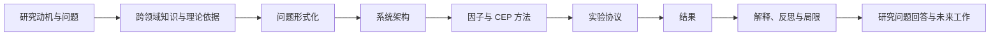

> 历史材料／非主稿（2026-10-22）：本文件保留旧口径，不作为当前结果或提交正文。唯一主稿见[中文修订报告](ownership_evidence/07_Revised_Report_CN.md)；计数解释与运行边界以主稿及其运行台账为准。

# MarketStream 逐章写作指南

贡献归属更新（2026-10-22）：报告应突出“本人主导需求、方案选择、具体约束与修订决策，AI 按确认方案实施”。逐项使用[贡献五列表](ownership_evidence/08_Contribution_Attribution_Matrix_CN.md) D01–D10；详细建议、核心代码和参考稿的 AI 生成来源保留，不由项目产出推断全部本人手写。

> 本指南配合《MarketStream 完整报告参考稿》使用。它说明每一章应该回答什么问题、如何组织论证、现有仓库中有哪些可复用证据，以及哪些结论目前不能写得过满。正文中的数据和规则均以当前项目代码及评测工件为准；学校封面、声明、目录和最终引用格式可在提交前另行适配。

## 一、写作总原则

### 1. 把“系统完成”改写成“研究问题得到何种程度的回答”

这份报告不能只按代码模块介绍功能。每一章都应服务于三个研究问题：轻量因子能否替代冗余模型集成、复杂事件处理（Complex Event Processing，CEP）是否比单点检测更适合表达序列异常，以及系统能否同时满足检测质量、告警负担、可追溯性和实时性要求。Introduction 提出问题，Methodology 给出解决方法，Experimental Design 说明如何验证，Results 提供证据，Discussion 与 Conclusion 回答问题并限定结论边界。

### 2. 严格区分四类陈述

建议在写作时不断检查每句话属于以下哪一类：

- **设计目标**：希望系统达到的能力，例如“在保持较高召回率的同时减少误警”。
- **已经实现**：代码已经提供的机制，例如八因子、六类 CEP、五分钟冷却和确定性去重键。
- **已经验证**：有可复现实验工件支持的结论，例如合成序列 F1、Kafka 到数据库延迟和真实 IEX 事件落库。
- **尚待验证**：已建立实验入口但还没有合格结果，例如经独立审阅标签上的真实历史 precision/recall。

不要把“已经实现”自动等同于“真实市场上有效”，也不要把 synthetic 或 soak 数据称为真实检测效果。

### 3. 建议的篇章关系

架构章回答“系统如何运行”，方法章回答“为什么这样检测”，实验章回答“怎样公平验证”。这三个章节不要互相重复。

### 4. 当前证据口径

正文可使用的主要证据如下：

| 证据类型 | 当前工件 | 可以支持的结论 | 不能支持的结论 |
| --- | --- | --- | --- |
| synthetic factor sequences | `data/evaluation/factor_cep.json` | 六类模式流程、消融、计算延迟和负对照表现 | 真实市场 precision/recall |
| legacy injected backtest | `data/comparison_results_nfa_tuned/comparison_60d_0.05.json` | 旧五分钟特征协议下 CEP 与四模型的受控比较 | 当前八因子生产协议全面优于 ML |
| synthetic infrastructure soak | `data/evaluation/kafka_db_soak.json` | Kafka、因子、CEP、数据库链路与持久化延迟 | 真实行情下的检测准确性 |
| real live IEX soak | `data/evaluation/alpaca_live_e2e.json` | 真实行情接入、五标的落库、三 cadence 快照和 bar 语义修复 | precision、recall 或真实告警质量 |
| historical corpus manifest | `data/historical/alpaca/manifest.json` | 400 天 OHLCV 与新闻覆盖、60/20/20 切分 | 已完成真实历史效果评估 |
| draft label registry | `data/replay/labels/iex_benchmark_v1.draft.json` | 真实回放协议已准备 | 可作为正式 ground truth |

## 二、摘要与关键词

### 写作目的

摘要应让读者在不看正文的情况下理解问题、方法、数据、主要结果和限制。建议采用“背景—问题—方法—证据—结论—限制”六句式结构，不要把摘要写成项目功能列表。

### 推荐顺序

1. 金融市场实时异常检测为什么困难。
2. 旧点检测和四模型集成有什么不足。
3. MarketStream 的统一事件、八因子和六类 CEP 方法是什么。
4. 当前有哪些数据和实验。
5. 报告最重要的数值结果是什么。
6. 结论限于合成验证与系统可运行性，真实历史效果仍待独立标签评测。

### 关键词建议

实时异常检测；复杂事件处理；金融市场微观结构；流处理；可解释人工智能；事件级评测。

### 常见问题

- 不要在摘要中说“在真实市场取得 F1=0.857”；该值来自生成的因子序列。
- 不要把 1.718 秒写成纯 CEP 计算延迟；它是 Kafka 到数据库的端到端持久化 p95。
- 不要写“完全替代 ML”；当前更稳妥的结论是“支持轻量方法作为生产主线、ML 作为离线基线或 shadow 的设计”。

## 三、第 1 章 Introduction

### 本章要回答的问题

为什么市场异常不能简化为价格超过固定阈值？现有方案的不足是什么？本项目提出什么新研究路径？

### 推荐论证顺序

先介绍市场监控、风险预警和事件调查的应用价值；再说明行情流具有高频、噪声、厚尾、时段效应、市场共振和数据质量问题；然后用“TSLA 上涨 3%”的例子解释相同价格变化可能对应市场共涨、新闻驱动、流动性压力或坏数据。接着介绍旧四模型 ensemble 的局限：职责重叠、分数难解释、训练与推理依赖较重、时间顺序表达隐式。最后提出 RQ1–RQ3，并列出贡献。

### 可复用素材

- 学习笔记中的异常定义、公式 \(A_t=g(F_t,F_{t-k:t},C_t,Q_t)\) 和 TSLA 例子。
- `README.md` 与 `docs/PROJECT_GUIDE_CN.md` 中的新旧主线说明。
- `docs/CORE_CODE_AUTHORSHIP_AND_REFERENCES_CN.md` 中关于项目原创边界的表述。

### 建议图表

本章只需一张“点异常与事件异常”的简图或对照表。总系统架构图留到第 4 章。

### 需要文献支持的位置

- 金融时间序列的厚尾、概念漂移和时段效应。
- 告警疲劳对实际监控系统的影响。
- 可解释检测和实时决策之间的关系。

### 常见问题

- 贡献要写成可核验的设计和方法，不要把 Kafka、MAD 或 CEP 概念本身写成原创。
- RQ 应能在第 7–9 章被明确回答，避免提出无法验证的新问题。

## 四、第 2 章 Literature Review

### 本章要回答的问题

不同领域的异常检测经验如何共同支持 MarketStream 的设计？现有研究留下了什么空白？

### 推荐组织方式

每个领域都必须写清楚“哪位作者、哪篇论文、使用什么数据或场景、采用什么方法、得到什么发现”。不能用“相关研究表明”“他们发现”代替具体归属。与此同时，也不要把论文摘要彼此孤立地堆在一起；每项研究后面都应立即说明其局限，以及它为什么与 MarketStream 有关。

建议每个领域至少选择两项代表研究，并对每项研究采用以下证据单元：

1. **文献身份**：作者、年份和论文标题。
2. **研究设计**：研究对象、数据、方法或实验环境。
3. **主要发现**：给出论文实际报告的结论和关键数值，不使用模糊概括。
4. **适用边界**：说明该发现不能直接证明什么。
5. **项目映射**：指出该文献具体支持 MarketStream 的哪个设计选择。

例如，不应只写“医疗研究发现告警疲劳严重”，而应写成：“Drew 等人（2014）在 31 天内观察 461 名 ICU 患者，记录到 2,558,760 个报警；人工标注的心律失常报警中 88.8% 为假阳性。该结果说明系统必须单独评价告警负担，但临床报警率不能直接作为金融系统阈值。”

#### 2.1 医疗预警

重点讨论少量关键生命体征、分段风险评分、持续条件和告警疲劳。对应设计是：普通单因子只形成原子事件，正式告警需要多因素或持续确认。

代表文献：Prytherch 等人（2010）的 ViEWS 早期预警评分；Drew 等人（2014）的 ICU 告警疲劳观察研究。

#### 2.2 工业与航天监测

重点讨论派生量、运行工况、残差和可追溯诊断。对应设计是：使用 relative volume、spread stress 和 market residual，而不是直接阈值化原始价格和成交量。

代表文献：Powell 等人（2020）的 NISTIR 8219 工业控制行为异常检测；Barrie 等人（2025）的 NASA MEDOS 事件驱动航天器运行系统。

#### 2.3 网络安全

重点讨论有界流状态、计数和比例、单事件正常但组合异常、事件关联。对应设计是：固定长度窗口、有限 ticker 状态和 CEP 序列模式。

代表文献：Manzoor、Milajerdi 和 Akoglu（2016）的 StreamSpot；Gyllstrom 等人（2006）的 SASE 复杂事件处理系统。

#### 2.4 通用时序异常检测

重点讨论统计方法、在线树、深度模型和评测偏差。强调复杂模型并不稳定优于简单方法，随机切分、point adjustment 和对称容忍窗口可能改变结论。

代表文献：Guha 等人（2016）的 Robust Random Cut Forest；Liu 和 Paparrizos（2024）的 TSB-AD；Bhattacharya 等人（2024）的无偏时序异常评测研究。

#### 2.5 金融异常检测

围绕价格、成交量、流动性、订单压力、市场共同因子和新闻时间关系展开。说明价格异动需要市场与微观结构上下文。

代表文献：Cont、Kukanov 和 Stoikov（2014）的订单流失衡研究；MacKinlay（1997）的事件研究方法综述；Tetlock（2007）的媒体情绪与股票市场研究。

### 本章结尾如何收束

用综合表将“领域经验”映射到“MarketStream 设计”，随后指出研究空白：现有研究通常分别关注模型精度、单一数据源或某种异常，而本项目尝试把可解释因子、显式时间模式、数据质量、告警治理和严格事件级评测放进同一条实时链路。

### 常见问题

- 文献综述不能只为项目背书，要写出矛盾、限制和不可直接迁移的部分。
- 作者、年份、样本、指标和结论必须与论文原文一致，不能根据项目需要扩大作者结论。
- 当前参考稿采用作者—年份式引用；最终提交前应按学校要求统一格式。
- 官方 API 文档支持数据语义，不能替代学术文献支持研究结论。

## 五、第 3 章 Problem Formulation and Requirements

### 本章要回答的问题

系统的输入、状态、异常事件和正式告警分别是什么？怎样判断 live 和 replay 一致？

### 核心定义

- `MarketEvent`：带确定性身份、来源、feed、事件时间、接收时间、单一 typed payload、质量标记和 provenance 的统一市场事件。
- `FactorSnapshot`：某 ticker 在某 cadence 窗口的八因子值、相对基线状态、暖机状态、质量摘要和原始事件引用。
- `DetectionResult`：原子事件、完成或进行中的模式、方向、严重度、证据、时间范围、抑制原因和去重键。
- 异常事件：具有开始、发展和完成语义的上下文相关偏离。
- 正式告警：CEP 模式完成，且暖机、质量和冷却条件允许持久化的结果。

### 建议形式化内容

保留总公式：

\[
A_t=g(F_t,F_{t-k:t},C_t,Q_t)
\]

进一步将系统要求写成六项可检查约束：因果时间、方向一致性、上下文相关、数据质量可见、live/replay 语义一致、有界状态与可追溯性。

### 建议图表

画出三层合同之间的转换，并用一张表对比三种对象回答的问题、主要字段和生命周期。

### 常见问题

- 不要把 `DetectionResult.score` 当作唯一决策依据；当前生产入口以模式完成和抑制条件共同决定 `is_alert`。
- 不要把 replay 描述为简化离线路径；它发送相同序列化 `MarketEvent` 并复用后续链路。

## 六、第 4 章 System Architecture and Data Plane

### 本章要回答的问题

数据如何从提供方进入系统、经过哪些边界、在哪里保存和展示？

### 推荐结构

先给总架构图，再依次介绍数据接入、统一事件与 Kafka、质量门、因子流、CEP、存储和界面。每节写接口与责任，不展开因子数学原理。

### 必须说明的边界

- 股票实时流默认使用 Alpaca IEX，仅代表单交易所覆盖，不是 consolidated SIP。
- 新闻保留提供方时间戳；当前在线情绪为透明轻量方法。
- `raw.market_events`、`stream.factor_snapshots` 和 `stream.anomalies` 分别承载统一事件、因子快照和正式异常。
- API key 只从环境变量读取，不进入报告、代码示例或日志。
- Streamlit 是兼容和调试界面，不能写成已经完成的专业调查产品。

### 可作为工程反思的案例

真实流验证发现 minute bar 时间戳表示一分钟窗口起点，若统一使用 30 秒 stale 阈值，会把正常 bar 错标为陈旧。系统为 bar 增加 60 秒窗口结束宽限，并通过复验确认 5 条 bar 均不再被误标。这个案例适合说明真实运行如何修正数据语义，而非只展示架构图。

### 建议图表

- 总数据流 Mermaid 图。
- Kafka topic 与消息合同表。
- 数据质量标记及下游处理表。

## 七、第 5 章 Methodology

### 本章要回答的问题

八个因子为什么合理、如何计算，CEP 如何把因子变成事件，正式告警如何控制？

### 5.1 因子设计原则

依次说明金融意义、因子组相对正交、增量计算、有界内存、session/slot 基线、先评分后更新、暖机和阈值冻结。避免先堆公式再解释用途。

### 5.2 八因子统一写法

每个因子使用相同的小结构：市场含义、输入事件、公式、正常基线、误报来源、CEP 用途。公式必须以 `processing/factor_engine.py` 当前实现为准。

特别注意：

- `return_surprise` 已经是以历史收益中位数和 MAD 标准化的值；不要再把它错误写成简单收益率。
- `market_residual` 是当前 ticker 收益减去最近基准 ETF 收益，不是完整回归估计出的 alpha。
- `relative_volume` 使用 trade volume，若没有 trade 则使用 bar volume。
- `news_shock` 使用新闻情绪均值乘 \(\log(1+n)\)，其作用是表达聚集而避免线性放大。

### 5.3 鲁棒基线与状态

解释五维基线键 `(ticker, cadence, session, intraday slot, factor)`、20 日有界历史、至少 5 个先前交易日暖机、median/MAD、99.5%/99.9% 分位数以及 4/6 倍稳健尺度。强调当前样本完成评分后才写入历史，测试时导入冻结 baseline。

### 5.4 六类 CEP

每种模式写金融故事、因子组、方向、先后关系、最大时间间隔、完成条件和负对照。当前规则中的关键数字包括：新闻确认 5 分钟、反转不超过 2 个 cadence、持续压力至少 3 个不同窗口、跨资产冲击 60 秒内至少 3 个标的且包含 SPY 或 QQQ。

### 5.5 告警语义

说明 elevated/extreme 因子先形成原子事件；普通情况下需要模式完成，极端 `return_surprise` 是单因子例外；暖机不足或出现 duplicate、stale、invalid price、crossed quote 时抑制正式告警；相同 ticker/pattern/direction 使用 300 秒 cooldown；去重键由 ticker、模式、方向和模式开始时间确定。

### 建议图表

- 八因子总表。
- 六类 CEP 模式表。
- `news_shock → return_surprise` 的时间线示例。
- “当前窗口先评分、后更新”的防泄漏流程图。

## 八、第 6 章 Experimental Design

### 本章要回答的问题

每项实验验证什么，使用什么数据，怎样避免泄漏和指标误导？

### 建议划分四个证据层

1. **当前生产因子 CEP 的合成序列验证**：20 seeds、三种强度、六种模式、负对照和消融。
2. **旧兼容协议的 CEP/ML 对比**：60 日、三 ticker、5 分钟窗口、225 个注入异常、seed 42；作为早期受控对照。
3. **基础设施 soak**：合成且明确标记 `mode=soak`，测传输、持久化、延迟、重复和追踪。
4. **真实 IEX 实流验收**：只测接入与链路，不计算检测质量。

### 数据写法

历史语料覆盖 AAPL、TSLA、NVDA、QQQ、SPY，日期为 2025-07-09 至 2026-08-13；共 1,385 行日 OHLCV 和 15,148 条 Alpaca/Benzinga 新闻记录。需要说明这些日频数据并不能代替微观结构真实回放数据。

### 指标写法

给出 precision、recall、F1 公式，并解释事件级一对一向前匹配、首次检测延迟、每 ticker 每小时告警数、重复告警率和端到端延迟。不要把 accuracy 作为 headline，因为正常时间点远多于异常事件。

### 真实历史评测预留

写清楚草稿注册表必须由独立审阅者在不看 detector 输出的情况下批准并冻结；评估器会检查标签摘要、数据 checksum、baseline 时间、warm-up、provenance 和 synthetic/soak 身份。后续完成时应补充事件清单、审阅规则、实际数据覆盖、主指标、分模式结果和错误分析。

## 九、第 7 章 Results

### 本章要回答的问题

已有证据分别支持哪些结论，又暴露了什么问题？

### 推荐结果顺序

#### 7.1 当前因子 CEP 合成验证

报告 Precision 0.75、Recall 1.00、F1 0.857、TP 360、FP 120、FN 0；首次检测延迟 p50 10 秒、p95/p99 30 秒；计算延迟 p50 0.0114 ms、p95 0.0227 ms、p99 0.0495 ms；告警负担 1.604 alerts/ticker-hour，重复率 0。

紧接着报告不利结果：240 个负对照中有 40 个触发，false-alert rate 为 16.7%。不要把固定的 bootstrap 区间当成真实不确定性，因为生成协议高度确定，应解释其局限。

#### 7.2 消融

重点讨论而非罗列：删除 price 后 F1 变为 0；删除 liquidity 或全部微观结构后 F1 下降到 0.632；删除 market context 后 F1 为 0.800；删除 news 后 F1 为 0.750。删除 `stock_specific_dislocation` 后 precision 变为 1.00、recall 降为 0.833，并消除负对照误警，说明极端单因子例外是当前主要误报来源和明确的调参对象。

#### 7.3 旧 CEP/ML 受控对比

报告 CEP full 的 Precision/Recall/F1 为 0.754/0.818/0.785，ML ensemble 为 0.572/0.724/0.639；两者平均计算延迟为 0.0033 ms 与 4.5135 ms。必须加粗限制：这项实验使用旧五分钟特征、点异常注入和单 seed，不能直接证明当前八因子生产方法在真实数据上优于 ML。

#### 7.4 系统性能

报告 soak 的 240/240 持久化、88 条可追溯告警样本、p50 1.418 秒、p95 1.718 秒、p99 1.738 秒和零重复。真实 IEX 运行报告 48,734 条事件、五 ticker、48,283 quote、446 trade、5 bar，以及 40/5/5 个 10s/1m/5m 快照。

#### 7.5 真实历史结果状态

明确写“暂不报告正式真实历史 precision/recall”，并保留待填表格。不得用四个旧案例的定性命中替代冻结标签上的主结果。

### 常见问题

- 结果章先报结果，再解释；方法细节不要重新写一遍。
- 不要隐藏负对照误警或早期失败 soak。
- 不要比较不同实验协议中的 F1 并宣称一种方法绝对优越。

## 十、第 8 章 Discussion

### 推荐四个观点

1. 复杂性更适合放在事件表达和上下文，而不是模型数量。
2. 异常是相对于 ticker、cadence、session 和日内位置的偏离。
3. 检测质量之外还必须考虑延迟、告警负担、重复、质量和可追溯性。
4. 无泄漏、因果匹配和标签治理可能比继续增加模型更有研究价值。

每个观点应使用“主张—结果证据—反例或限制—实际意义”的结构。比如讨论极端单因子例外时，既说明它提高召回率，也说明 16.7% 负对照触发集中于该模式，因此后续可能需要真实正常期校准或二阶段确认。

### 局限必须主动写

- IEX 不是 SIP，不能代表完整市场盘口。
- 五个标的和 400 天覆盖仍有限。
- 当前实时新闻情绪方法较轻量。
- 合成序列可能与规则边界过度对齐。
- 真实异常标签具有主观性，目前尚未冻结。
- 历史微观结构覆盖不足，日 OHLCV 不能替代逐笔验证。
- 当前 Streamlit 是调试界面，不是成熟调查工作台。

## 十一、第 9 章 Conclusion and Future Work

### 逐项回答研究问题

- **RQ1**：当前证据表明轻量因子具备表达能力和明显计算成本优势，但真实历史检测质量及与 ML 的同协议比较尚未完成，因此只能给出初步支持。
- **RQ2**：六类模式和合成序列/消融显示 CEP 能显式表达方向、顺序、持续和跨资产关系；负对照误警说明单因子例外仍需校准。
- **RQ3**：系统已验证有界状态、可追溯合同、零重复 soak、亚 2 秒持久化 p95 和真实 IEX 端到端运行；真实事件级检测质量仍待验证。

### 未来工作排序

优先完成独立审阅与冻结标签上的真实回放；其次补充 SIP 或订单簿数据、扩大资产和市场范围、建立更完整标签集、学习可解释的自适应阈值、将 ML 作为 shadow/二阶段调查，最后重构面向告警调查和系统健康的前端。

结论不要再引入新方法或新数字，也不要用“成功完成项目”代替研究问题回答。

## 十二、最终提交前的补充清单

- [ ] 根据学校模板加入封面、作者、导师、课程、日期、声明和目录。
- [ ] 核对当前作者—年份式引文与文末条目，并按学校指定格式统一排版。
- [ ] 独立审阅并冻结真实历史标签，不查看 detector 输出反向改标签。
- [ ] 补充真实回放的 dataset manifest、run manifest、指标表和错误案例。
- [ ] 重新核对报告中的代码版本、配置值、实验日期和 JSON 工件。
- [ ] 给所有图表添加编号、标题、来源和正文引用。
- [ ] 检查 synthetic、soak、legacy、real live、real historical 五种 provenance 是否始终清楚。
- [ ] 将参考稿中的限制性措辞保留到最终版本，不因结果好看而删除。
