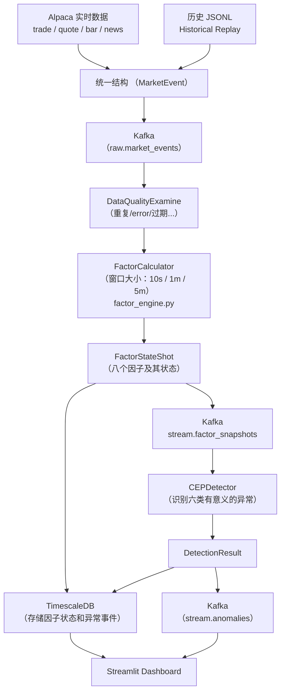

# Marketstream outliers 学习笔记

### 一、背景

#### 1.MarketStream Definition

MarketStream 是一个面向金融市场的实时、可解释异常检测系统。

该系统持续接收股票成交、报价、分钟 K 线和新闻，将这些原始数据转换成有金融意义的因子，再通过 CEP 判断多个异常信号是否按照特定方向和时间顺序组成了真正值得告警的市场事件。

* 当前五个asset：AAPL、TSLA、NVDA、SPY标普五百ETF、QQQ纳斯达克一百ETF

最重要的思想是：

> 异常不是某个数字超过阈值，而是某个变化在当前市场状态、时间顺序和数据质量背景下是否反常。

* 整个系统可以概述为一个公式：\[ A_t=g(F_t,F_{t-k:t},C_t,Q_t) \]

其中：

- \(F_t\)：当前因子状态
- \(F_{t-k:t}\)：最近一段时间的因子序列
- \(C_t\)：市场、交易时段、新闻等上下文 
- \(Q_t\)：数据质量和暖机状态。
- \(g\)：CEP 异常警报规则。

#### 2. 异常的定义

不能单一的定义某个指标的变化就是异常，特别是不能只看price的变化。在大多数人的认知中，看到价格突变（±2%）就会认为这个是异常。但是单一指标的变化会受到多方因素的影响（还要看交易时段、历史基准、市场共同走势和数据质量），是各个factor共同作用的。比如“ TSLA price 上涨 3%”，这个结果可能是因为整个市场都在上涨所以TSLA也上涨了，也可能是因为出现了利好TSLA的新闻所以price上涨，也可能是价格差异变大、主动买入量增加。我们需要解释为什么这个asset为什么这么变化，是哪些因素影响的，只有理解了其发生背后的“故事”，我们才能断定这个变化是否为异常，是否要报警。而使用者在看到这个“故事”之后也能做出更好更理性的判断。

因此，该项目并不是在简单地判断\[ |r_t| > 2\% \;\]来发出异常警报，而是在：

> 确定各个因子如价格、成交量、流动性、市场基准和新闻后，判断它们是否形成了一个有时间意义的异常组合。如果形成了异常组合再警告用户，让用户根据异常来做出理智决策。

#### 持续异常

持续异常是指某种异常状态并非只出现一次，而是在连续或相邻的多个时间窗口中持续存在。

在 MarketStream 当前规则中，`sustained_pressure` 的具体含义是：

1. `quote_imbalance` 或 `signed_trade_imbalance` 在至少三个不同窗口中持续表现出相同方向；
2. 随后出现同方向的 `return_surprise`；
3. 系统将其识别为“持续订单压力最终得到价格确认”。

- **反转异常**：价格先显著上涨，随后在有限时间内显著下跌。
- **新闻确认异常**：新闻冲击先出现，价格在五分钟内向相同方向变化。
- **跨资产异常**：60 秒内至少三个标的同向异常，而且包括 SPY 或 QQQ。
- **持续异常**：订单或成交压力在多个窗口中保持同一方向，之后由价格变化确认。

固定阈值只能分别看到每个异常点，而 CEP 可以判断这些点是否组成一个完整的“市场故事”。


#### 3.MarketStream model draft

##### 整个系统的workflow：

```
市场实时数据/历史数据
→ 统一格式
→ 质量检查
→ 计算因子
→ CEP：识别异常模式
→ 保存并展示异常
```



##### 实际代码执行顺序：

```
Producer
  → MarketEvent
  → raw.market_events
  → EventQualityGate
  → Factor Engine
```

##### dataflow：

```
Alpaca
  → Kafka     
  → 因子引擎
  → Kafka
  → CEP
  → TimescaleDB
```

主要的三种data：

```
MarketEvent：市场发生了什么
（将live数据和replay数据统一成MarketEvent，二者拥有相同的语义，所以可以共用同一pipeline。当然，这样也保证了即使使用历史数据验证也和实时数据验证的逻辑一致）
FactorSnapshot：当前窗口表现出什么
DetectionResult：这些表现是否构成异常事件
```

##### Alpaca 实时数据

- `trade`：成交了多少钱、多少股。
- `quote`：当前买价、卖价及挂单量。
- `bar`：一分钟内的开盘价、最高价、最低价、收盘价和成交量。
- `news`：与股票相关的新闻。

##### MarketEvent

由于Alpaca和replay数据的字段完全不同，如果不统一成相同的数据结构，就需要在代码中每次都要判断：

```
if source == "alpaca":
    ...
elif source == "historical":
    ...
```

因此引入了“data contracts”这一概念，可以理解为一种”schema“。为了让上游和下游方便进行数据处理和分析，特别是在项目中还使用了Kafka这种中间件，因此就需要让上下游用同一种约定的格式传输和接收数据。

##### Kafka

Kafka 主要用来处理流动、有序的数据，这正好符合实时交易数据的流式处理。其作为上游把事件放入指定通道，下游按顺序读取。主要作用就是把各个模块隔离开来，让数据接收、因子计算和异常检测是独立的模块，方便管理。主要通道包括：

- `raw.market_events`：原始统一事件；
- `stream.factor_snapshots`：计算好的因子快照；
- `stream.anomalies`：正式异常告警。

##### 新闻因子计算：

\(news\_shock = news\_mean \times \log(1+n)\)

其中，\(n\) 是窗口内的新闻数量（\(n\geqq0\)），mean就是新闻情绪的均值。

新闻因子一般想到用一个时间窗口的新闻情绪值的均值。但是只用平均值会有一个问题，一条负面新闻平均值可能是 \(-0.8\)，十条负面新闻平均值也可能是 \(-0.8\)，平均值无法体现短时间内新闻集中爆发这个情况。因此引入了新闻数量n，为了衡量新闻聚集程度用了\(ln\)函数（`log1p` 变换,对数缩放），因为随着n的增大，\(ln\)函数虽会增大，但是增幅越来越缓。因为增幅变缓，所以不会让新闻因子的值线性放大，得到过于极端的值。

计算后得到的因子并不代表有异常，只push到Kafka，最后由CEP模块取出综合多种因素来判断是否有异常。

* 例子：
  * \(\text{news\_shock} = -0.8\times ln(2) \approx-0.5545\)
  * \(\text{news\_shock} = -0.8\times\ln(6) \approx-1.433\)
  * 集中出现五条负面新闻比只出现一条更值得关注

##### 八类因子：

```bash python
# event_models.py
FACTOR_GROUPS: dict[str, str] = {
    "return_surprise": "price",
    "volatility_burst": "price",
    "relative_volume": "activity",
    "spread_stress": "liquidity",
    "quote_imbalance": "liquidity",
    "signed_trade_imbalance": "liquidity",
    "market_residual": "market_context",
    "news_shock": "news",
}
```

| 影响金融市场的五个维度 | 因子                                                         |
| ---------------------- | :----------------------------------------------------------- |
| Price                  | `return_surprise`, `volatility_burst`                        |
| Activity               | `relative_volume`                                            |
| Liquidity              | `spread_stress`, `quote_imbalance`, `signed_trade_imbalance` |
| Market context         | `market_residual`                                            |
| News                   | `news_shock`                                                 |

##### CEP：

``` bash python
# not simple 
if A and B:
	alert()
#CEP需要考虑时间间隔、顺序、因子状态的跨窗口
if news_shock happened first
and return_surprise happened later
and gap <= 5 minutes
and directions match:
    alert()

```

CEP vs 机器学习：

| 维度               | 机器学习中的定义                                             | 因子 + CEP                            |
| ------------------ | ------------------------------------------------------------ | ------------------------------------- |
| input              | 只提取出四个feature                                          | MarketEvent和八个因子                 |
| decision           | 计算加权的异常分数                                           | CEP定义了六种异常模式                 |
| 异常之间的时间关系 | 隐式的（机器学习不输入时间戳，虽然学习一段时间的数据，但是无法判断异常的先后顺序、间隔时间等信息，关系隐藏在神经网络中） | 显式时间窗口和顺序（                  |
| 异常的判断         | 通过哪些模型分数较低                                         | 判断哪些因子组成了哪一种CEP识别的模式 |

PS：但是机器学习的异常检测可以保留作为baseline，检验新方法是否真正优化了异常检测（无法通过数据对比得出，因为二者的结果指标不相同）。

##### 异常检测评价标准：

| questions（项目focus优先级降序） | 指标                  | 指标意义                                                     |
| -------------------------------- | --------------------- | ------------------------------------------------------------ |
| 检测是否正确                     | Precision、Recall、F1 | 判断检测的质量                                               |
| 告警负担是否太重                 | False alert rate      | 异常警告per ticker per hour（使用cooldown降低短时间内的重复警报） |
| 检测是否及时                     | First-detection delay | 事件开始后多久发现异常                                       |
| 系统是否够快                     | End-to-end latency    | 从收到该数据多久后发出异常警报                               |

* \(Precision=\frac{TP}{TP+FP}\)  发出的警报有多少是真的 （准不准）

* \(Recall=\frac{TP}{TP+FN} \)  真实异常有多少被发现了（漏没漏）

* \[ F1= 2\cdot\frac{Precision\cdot Recall}{Precision+Recall} \]  F1 是 precision 和 recall 的调和平均，用来避免只优化其中一个。

本项目MarketStream的目标是：

> 在保持较高 recall 的同时，提高 precision，并控制告警负担。

会面临两种问题：

1. **Recall 太低**：市场的真实异常被漏掉，系统失去监控价值

2. **Precision 太低**：user收到大量无意义警报，系统失去可信度。为了减少 FP，使用 CEP、多因素确认、持续条件和 cooldown多种判断后再警报，但又要控制条件不能太严格不然recall会太低。

   

#### 4.研究需要解决的问题

##### RQ1

> Can lightweight and interpretable market factors replace a redundant model ensemble for real-time anomaly detection?

- 八因子能否表达异常；是否减少训练和推理成本；是否更容易解释；是否保持足够的 precision 和 recall。

##### RQ2

> Is CEP more suitable than point detection for persistent, reversal, news-confirmed, and cross-asset anomalies?

- 单点阈值无法表达哪些序列？时间顺序是否降低误报？持续条件和多因素确认是否有价值？

##### RQ3

> Can the system satisfy detection quality, alert-burden, traceability, and real-time latency requirements under strict event-level evaluation?

- 准确率；告警数；重复率；检测延迟；数据质量；可追溯性；基础设施性能。

### 二、实验设计

#### 1.median MAD baseline

\(z_{robust} = \frac{x-Median}{1.4826\times MAD}\)

其中median中位数取前20天改时间点的交易额中位数，\(MAD = median(|x_i-Median|)\) 即各天差异的中位数，1.4826是consistency constant。

在实验中，baseline冻结且有时间边界（不能是整个数据集的baseline）。

这个baseline用于判断每个因子的异常程度，而后续的CEP用于评价多个异常因子组合起来代表了什么含义。

每个股票对应的每个时间段中的每个因子都有其baseline，可以看作是一张静态的状态表格。

之所以每个时间段都需要计算baseline，是因为股票具有日内季节性特征，遵循早市和晚市volume高，而午市是一天volume较低的时段。同时，选用median相比与mean和std的一个优势是，baseline不易被20天窗口内某一天的异常值污染。为了**去除股票自身特征和日内季节性**，必须要有baseline的设计。否则，直接计算的话，会导致一天内股票的平均volume值很高，而忽略了在低volume时刻，volume却较高的情况。

该公式来源于NIST一文，NIST 中曾介绍过 modified Z-score 公式，并引用了 \(|M|>3.5\) 作为标记潜在异常值的一种经验标准。在本项目中，3.5不能作为最终的异常阈值，需在数据集上进行反复训练、冻结、benchmark上测试后确定。

另外，窗口设置为20天也并不是反复求证后的结果，只是选择了一个工程中常用的标准的窗口时间。在遇到窗口中数值非常离散的情况，比如全是0中间只有一两个1，这时z无法计算。这也是后续如果要优化异常检测可以改进的一个地方。


### 三、结果

| 结果              | 数据来源                                          | 当前结果                                           | 能证明什么                              |
| ----------------- | ------------------------------------------------- | -------------------------------------------------- | --------------------------------------- |
| Factor CEP 合成   | 人工生成的八因子异常序列                          | Precision 0.75、Recall 1.00、F1 0.857              | CEP 逻辑和评估 pipeline 能运行          |
| CEP/ML 对比       | 真实日线/分钟 OHLCV + 人工异常注入 + 合成情绪     | tuned CEP：Precision 0.754、Recall 0.818、F1 0.785 | 在受控注入数据上的算法对比              |
| 历史事件案例      | 4 个真实日线事件，情绪固定为 0                    | 只有事件日检测结果                                 | 定性展示，不能计算可靠 precision/recall |
| Kafka/数据库 soak | 240 条明确标记为 soak 的合成事件                  | 240 条全部落库、88 告警、p95 1.718 秒              | Kafka→因子→CEP→数据库链路可靠           |
| Alpaca live E2E   | 48,734 条真实 IEX 事件                            | 40 个 10s、5 个 1m、5 个 5m 快照                   | 真实实时采集链路可运行                  |
| 历史数据集        | 400 天日线 OHLCV + 15,148 条 Alpaca/Benzinga 新闻 | 五个标的覆盖通过                                   | 可用于长期背景和日线研究                |


### 四、数据

内存：`LightweightFactorEngine._baselines` 保存所有 baseline cell，每个 cell 是一个有界的 `BaselineSeries`。

Kafka：只传递 `MarketEvent`、`FactorSnapshot` 和异常结果，不传递完整 baseline 历史。

数据库：保存市场事件、因子快照和告警。`FactorSnapshot` 中会保存当时使用的 baseline 中位数、阈值、历史天数和版本，但不保存完整 cell 历史样本。

Replay：可以通过 `export_baseline_state()` 把全部 cell 导出成一个字典，再由 `import_baseline_state(..., freeze=True)` 导入并冻结。不过当前 live 服务没有自动将这个状态持久化到数据库。


## 10. 技术答辩准备

1. **为什么使用 1.4826？** 它用于将正态分布下的 MAD 转换为标准差的一致估计，系统仍将其视为工程近似。
2. **为什么先评分再更新 baseline？** 这样可以避免当天观测影响当天阈值，减少数据泄漏。
3. **为什么 20 个 seed 的结果完全相同？** 生成器改变的随机部分没有改变规则结构，因此这些 seed 不能代表不同的市场条件。
4. **120 FP 与 40/240 有什么关系？** 前者是正场景中未匹配的额外告警，后者来自单独的负对照场景。
5. **为什么删除 dislocation 后 precision 提升、recall 下降？** extreme 单因子通道可以更早报警，同时也会带来更多误警。
6. **为什么 activity ablation 没有影响？** 当前六类规则没有把 relative volume 设为关键完成条件。
7. **IEX run 能说明什么？** 它说明真实输入链路和快照生成可以工作，暂时不能说明真实检测效果。
8. **为什么不能根据旧 ML 结果直接下结论？** 旧实验与当前系统采用了不同的协议、实现和标签来源。
9. **重启后如何处理 baseline？** 启动时必须选择明确的 startup mode，并检查 epoch、checksum 和 offset 是否一致。
10. **如果导师询问哪些代码由 AI 编写，应该如何回答？** 根据日志和贡献表说明 AI 生成的范围，以及我提出的约束、复查过程和测试结果，不把 Git author 直接当作独立手写的证明。
