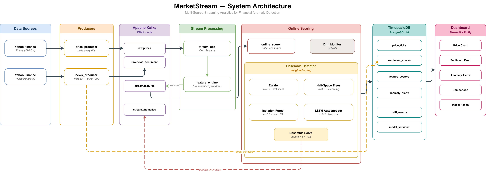

> 历史材料／非主稿（2026-10-22）：本文件保留旧口径，不作为当前结果或提交正文。唯一主稿见[中文修订报告](ownership_evidence/07_Revised_Report_CN.md)；计数解释与运行边界以主稿及其运行台账为准。

# report draft

### Abstract

金融市场的实时数据太乱，噪音多、变化快、数据质量还不稳定。只看价格有没有超过固定线很容易误报，因为分不清到底是股票自己出问题，还是整个大盘都在涨，又或者是单纯的新闻影响。又或者，用好几个机器学习模型凑出一个“异常分数”。虽然考虑得全，但算起来太慢，而且完全是个“黑盒”，就算报警了也不知道到底是因为什么报警，时间先后顺序也无法判断。

因此，本文设计并实现了 MarketStream，一个轻量、快速、且能解释清楚异常的市场监控系统。系统将 Alpaca IEX 成交、报价、分钟 K 线和时间戳新闻，以及历史回放数据，统一进一种格式 `MarketEvent`；在经过数据质量检测后，按10秒、1分钟、5分钟三个时间段，算出 8 个金融指标；再使用复杂事件处理（Complex Event Processing，CEP）识别 6 种特定的异常模式，例如 Sustained Pressure 和 News-Confirmed Move。异常告警前还会经过冷却时间、多条件确认等过滤，减少错误和重复警报，并且警报后能直接查到是哪条原始数据触发的。

实验从多个层面验证了本系统的有效性。在异常检测质量方面，基于生成数据的测试显示，系统具备高召回率和良好的综合性能（精确率 0.750，召回率 1.000，F1 0.857），且计算延迟极低（p99 为 0.0495 毫秒）；但负对照组测试指出，极端的单因子波动仍会带来一定的误报风险。在受控数据实验中，相比传统的四模型集成方法（F1 0.639），本文采用的CEP方法在准确度（F1 0.785）和单次计算速度（0.0033 毫秒对 4.5135 毫秒）上均表现出显著优势。在系统稳定性方面，基础设施压力测试实现了异常警报数据的稳定落库（p95 延迟为 1.718 秒且零重复）；系统在现实中真实的Alpaca IEX 实时行情数据中成功处理了近 4.9 万条流数据，并为五个标的（Underlying Asset）稳定生成了多个时间尺度下的的因子snapshot。

综上，因子和CEP适合作为轻量、可解释的金融市场异常检测的核心模块。同时，相比于机器学习方法，这种方法下又能追溯异常事件之间的时间顺序。尽管如此，实验也有一些问题：合成序列无法保证规则设计在真实市场中依然奏效。IEX的数据不能代表美股市场的全貌，依赖 IEX 数据会导致对市场的流动性和价格判断出现偏差。作为ground truth的标签没有被第三方合规的机构进行检查。

**关键词**：实时异常检测；复杂事件处理；金融市场微观结构；流处理；事件级评测

### 一、introduction：研究背景与问题定义

#### 1.研究背景

##### 1.1 金融市场异常检测背景介绍

金融市场是由不断到达的成交、报价、K 线和新闻共同构成的。市场监管人员、投资者不仅关心价格是否发生了显著变化，也关心变化发生的原因、演化的顺序、影响范围和数据可信度。比如，一只股票在几分钟内上涨 3%，可能只是公司发布利好新闻后形成的上涨，也可能只是整个科技板块与纳斯达克指数共同上涨，还可能伴随买卖价差扩大、主动买入量增加和报价失衡，反映了短时流动性压力；甚至可能来自重复消息、陈旧数据或错误报价。上面这些情况虽然具有相似的价格结果，但却对应了不同的风险含义和调查优先级。

因此，市场异常不能被简单定义为 \(|r_t|>2\%\)（\(r_t\)在这里代表在时间t的资产收益率return）。如果固定价格阈值会忽略四类异常产生的情况。第一，不同标的具有不同波动水平，同一变化幅度对稳定 ETF 和高波动个股的含义不同。第二，不同时间段，如盘前、常规交易时段或者盘后，市场的流动性与价差分布大相径庭。第三，个股收益需要与 SPY 或 QQQ 等市场基准比较，才能区分是市场的共同波动还是个股的特异性变化。第四，实时系统必须知道输入是否完成暖机、是否乱序、是否过期以及是否存在跨价报价。因此，真正有价值的异常判断应该不仅是产生异常警报，更应该告诉用户：当前变化相对什么正常状态发生、有哪些因素参与、它们以何种顺序出现，以及证据是否可靠。

提到 MarketStream ，往往会想到机器学习建模的方法。比如，一种方法是使用指数加权移动平均（Exponentially Weighted Moving Average，EWMA）、Half-Space Trees、Isolation Forest 和长短期记忆自编码器（Long Short-Term Memory Autoencoder，LSTM-AE）四个检测器，通过加权集成输出异常分数。这种方法提供了多个模型异常检测的视角，但存在几个不足。首先，不同模型可能对相似的价格与成交量变化重复评分，最后难以区分。其次，最终分数与权重在金融上含义有限，用户很难从一个负分判断异常是由价格、流动性、市场总体还是新闻驱动。再次，模型的特征主要以窗口向量输入，而向量会把事件先后、间隔和持续时间隐式编码，无法告诉用户异常的先后顺序。

##### 1.2 本项目异常检测定义

因此，本研究将MarketStream异常检测重新定义为：在实时数据流中，结合市场上下文和事件之间的时间关系，识别具有金融意义的异常事件。具体做法是，先用少量具有金融意义的因子描述每个时间窗口中的ticker，再用 CEP 表达因子事件之间的方向、顺序、延续与跨资产关系。系统的总判定可表示为：

$$
A_t=g(F_t,F_{t-k:t},C_t,Q_t)
$$

其中，\(F_t\) 表示当前因子状态，\(F_{t-k:t}\) 表示最近k个窗口的因子序列，\(C_t\) 表示市场基准、交易时段和新闻等上下文，\(Q_t\) 表示数据质量与暖机状态，\(g\) 是带方向和时间约束的 CEP 异常事件告警逻辑。该定义把异常从孤立数值超过阈值转变为了可追溯的事件判断。

##### 1.3 本项目检测的异常模式概述

MarketStream 检测的不是所有可能的金融异常，而是以下六类具有明确金融、时间含义的异常模式，如下表1：

| 异常模式                                        | 定义                                                         |
| ----------------------------------------------- | ------------------------------------------------------------ |
| Stock-Specific Dislocation | 去除大盘影响后，该个股自身依然有异常变化。                 |
| Liquidity Pressure Move    | 价格涨跌的同时，买卖价差扩大，说明市场资金都在往一边挤，流动性恶化。这种异常通常伴随着市场的狂热或恐慌。 |
| News-Confirmed Move        | 新闻冲击出现后，价格在五分钟内向新闻的利好或利空方向显著变化 |
| Flash Reversal             | 俗称“画门”，即价格突然猛涨或猛跌，但没稳住，紧接着在极短的时间内又被迅速砸回（或拉回）原位。 |
| Sustained Pressure         | 俗称“盘口蓄力”，即连续好几个时间段里，一直有资金在持续单向买入或卖出，订单簿积累压力后，最终把实际价格真的推向了那个方向。 |
| Cross-Asset Shock          | 跨投资种类、跨板块的变化，即宏观市场受到冲击。在本实验里指的是60 秒内至少三个跟踪标的出现同方向价格异常，并且其中必须包括 SPY 或 QQQ。 |

Table1 六种异常模式

#### 2.研究问题

本项目围绕以下三个问题展开：

**Q1：轻量、可解释的市场因子能否替代复杂、繁重的模型，完成实时异常检测？**

该问题关注八个市场因子是否能够正确表达异常，计算和运维成本是否降低，异常输出是否更容易解释，以及在与模型对比实验中是否能保持一个合理的 precision 与 recall。当前结果初步表明八因子方法具有较低计算成本和较好的异常表达能力。然而，由于它尚未与 ML 方法在同一套真实市场标签上进行比较，暂时不能得出八因子方法能够在真实市场中全面替代 ML 的最终结论。

**Q2：与只检查单个时间点是否超过阈值的方法相比，CEP 是否更适合识别具有持续时间、先后顺序、方向一致性或跨资产关系的市场异常？**

本研究将检验六类 CEP 模式能否识别异常事件，并通过删除时间或因子条件以及加入负对照，判断这些关系是否确实有助于减少误报。

**Q3：MarketStream 能否达到合理的 precision、recall 和 F1，并满足实时系统对告警负担、重复率、检测延迟、数据质量和可追溯性的要求？**

#### 3.研究贡献

本项目的主要贡献如下：

以下为项目产出。本人主导方案选择与具体约束，AI 按确认方案实施；八因子／三窗口／六模式的架构采纳、核心模块与报告修订决策见[贡献归属五列表](ownership_evidence/08_Contribution_Attribution_Matrix_CN.md)。实现和文字的实际来源分别披露。

1. 设计了一个统一 live 与 replay 市场数据的数据结构。成交、报价、K 线和新闻在进入系统后，时间戳和数据来源都能保持一致，后续方便用相同方法处理。
2. 实现了一个轻量的拥有多窗口的因子流式模块。该engine能同时看三个时间窗口、计算 8 个因子，主要用来抓取价格、活跃度、流动性、大盘环境和新闻这 5 个维度的市场状态。由于多窗口且长期流式运行还对内存占用做了限制。
3. 设计了 6 种金融 CEP 模式。用复杂事件处理（CEP）设定了 6 种规则，专门用来捕捉该项目需要观察的六种异常现象，并明确事件前后的逻辑关系。
4. 完善了带追溯功能的告警机制。该机制包含质量检查、暖机、告警冷却合并、去重的功能。每次告警都能直接追溯到触发警报的原始数据，避免系统运行中有过多无效的重复异常。
5. 接入了真实行情流测试。不仅用自己合成的市场数据和ML方法做了对比验证，还跑了 Kafka 到数据库的压力测试，最后接入了 Alpaca IEX 的真实数据流，证明这套基础架构在真实业务场景下能稳定跑通。

### 二、跨领域异常检测综述

本项目参考了多个领域的异常检测方法和理论。在此将异常检测综述分为三个问题讨论：如何将原始市场数据转化为可解释的事件、金融因子的选择依据，以及如何更科学地评估异常检测结果。

#### 1. 可解释的复杂事件处理

在处理实时数据时，如果只对原始数值设定固定阈值，往往效果不佳。Barrie 等人（2025）在航天器监测系统 MEDOS [1] 中的做法给了我们启发：系统不直接根据单条测量值下结论，而是先把零散数据转换成专家易于理解的“派生状态”，再与基准进行对比。项目参考了这一理念，将基础的交易、报价和新闻数据，先转化为 8 个带有明确金融含义的因子，然后结合对应标的、时间段的历史基准进行判断。虽然我们没有使用 MEDOS 复杂的模糊逻辑，但系统最终输出的检测结果保留了模式特征、因子状态和原始事件 ID，让每一次告警都有迹可循。

单条底层数据通常缺乏完整的业务含义，这也是 Gyllstrom 等人提出的 SASE [4] 的核心观点。虽然 SASE 的应用背景是零售和物联网，但它的复杂事件处理（CEP）思想同样适用于金融场景。受此启发，MarketStream 构建了从基础事件到因子快照，再到状态机判定的处理流水线。系统进一步定义了 News-Confirmed Move、Sustained Pressure 等金融模式，不过这些模式内的具体时间窗口和触发条件仍需后续实验验证。

#### 2. 金融因子的设计

在因子设计上，Cont 等人（2014）的研究 [3] 证明了订单流失衡（OFI）和市场深度对短期价格有显著影响。这促使我们在项目中引入了报价失衡、交易失衡和价差压力等因子，用于捕捉买卖双方的博弈状态。不过，由于目前系统主要接入的是 IEX 顶层报价，无法获取全市场完整的订单簿，因此项目里的因子只是理论指标的一种近似替代。

为了剔除大盘整体涨跌带来的干扰，我们参考了 MacKinlay（1997）在事件研究方法中的思路 [5]，引入了市场残差指标 \(r_i - r_m\)。出于实时计算的性能考虑，这是一个轻量级的近似处理，并没有去严格估算传统市场模型里的 \(alpha\)和 \(beta\)。

另外，Tetlock（2007）发现媒体的悲观情绪会带来短期的市场下行压力 [6]。基于这点，项目将新闻情绪作为一种市场上下文引入。但考虑到系统使用的是比较简单的词典匹配法，且新闻本身不一定与价格异动构成绝对的因果关系，系统不会单纯因为负面新闻直接触发异常，而是还要求有相应的价格或订单流变化来相互确认。

#### 3. 评测方法

在评估时间序列的检测效果时，Bhattacharya 等人 [2] 指出，传统的逐点计算（Point-wise）或简单的点调整方法（Point Adjustment）极易引发问题，它们容易把一段连续的异常重复计分，导致 F1 分数虚高。因此项目中借鉴了他们对评测的严谨考量，采用了“一对一”的事件匹配机制：一个真实的异常最多只能匹配一次告警，没匹配上的就算误报（FP）或漏报（FN）。同时，系统还会重点考察首次检测延迟、告警冗余度等实操指标。

### 三、研究对象定义

#### 1.金融市场异常定义

在介绍部分对金融市场异常进行了一个笼统的定义，在此在进行一个具体的本项目遵循的定义。在数据质量可接受且基线准备完成的条件下，当前因子与最近有限序列相对于 ticker、时间尺度、交易时段和日内位置的正常状态发生显著偏离，并组成具有金融意义的方向性事件模式。形式上：

$$
A_{a,t,c}=g(F_{a,t,c},F_{a,t-k:t,c},C_{a,t,c},Q_{a,t,c})
$$

这里 \(C\) 至少包含市场session、日内位置、SPY/QQQ 上下文和新闻时间关系。该定义允许同一个绝对价差或收益在不同上下文下得到不同判断，也允许质量恶化时记录模式但抑制正式告警。

#### 2.Market_event数据结构

设市场事件为：

$$
e_i=(id_i,s_i,f_i,y_i,a_i,t_i^{event},t_i^{recv},p_i,q_i,z_i)
$$

其中，\(id_i\) 为确定性事件身份，\(s_i\) 为数据来源，\(f_i\) 为 feed 覆盖，\(y_i\) 为事件类型，\(a_i\) 为 ticker，\(t_i^{event}\) 与 \(t_i^{recv}\) 分别为事件发生和系统接收时间，\(p_i\) 为 typed payload，\(q_i\) 为质量标记，\(z_i\) 为运行、数据集和 provenance 信息。事件类型属于 trade、quote、bar、news 四类，而且每个事件必须且只能携带与类型一致的一种 payload。

规定了统一的市场事件结构之后，可以避免下游不断判断数据来自 live 还是 replay。如果上游不能提供稳定事件 ID，系统则不能根据来源、feed、事件类型、ticker、事件时间和 payload **计算确定性摘要**。相同输入因而产生相同身份，可以用于重复检查和可重放测试。

#### 3.Factor Snapshot

对 ticker \(a\) 和时间尺度 \(c\)，窗口 \(w_t=[t-c,t)\) 内的事件经过质量处理与聚合后形成：

$$
S_{a,t,c}=(F_{a,t,c},H_{a,t,c},B_{a,t,c},Q_{a,t,c},R_{a,t,c})
$$

其中，\(F\) 是八个因子值，\(H\) 是每个因子相对历史基线的状态，\(B\) 是 baseline 版本与暖机状态，\(Q\) 是窗口质量摘要，\(R\) 是参与计算的原始事件 ID。因子状态属于 `warmup`、`normal`、`elevated` 和 `extreme`。`FactorSnapshot` 不只保存数值，还保存方向、robust z-score、阈值、历史天数和因子组，使 CEP 不必重新推断统计语义。

#### 4.CEP

若某因子状态达到 `elevated` 或 `extreme`，系统将其映射为 `AtomicEvent`：

$$
u_j=(factor_j,group_j,direction_j,value_j,z_j,t_j,R_j)
$$

CEP 在当前原子事件和有限历史中搜索模式。一个模式具有名称、方向、开始时间、完成时间、状态和证据集合。完成模式并不自动等于正式告警；系统还必须检查：

1. baseline 已至少覆盖五个严格在先的交易日；
2. 窗口不存在 duplicate、stale、invalid price 或 crossed quote 等关键质量问题；
3. 相同 ticker、模式和方向不处于冷却合并期；
4. 模式满足方向、时间间隔、持续或跨资产条件。

最终 `DetectionResult` 保存 `is_alert`、分数、严重度、方向、全部原子事件、完成与进行中模式、因子证据、事件时间、检测时间、原始事件引用、质量摘要、解释文本和确定性去重键。由此，异常不再是孤立分数，而是可以审计的事件报告。

### 四、系统架构

#### 1.总体架构

图4.1 MarketStream 系统架构图

如图4.1所示，本文设计的 MarketStream 系统采用了基于事件驱动的流处理架构。整个系统从数据进入到最终展示，可以清晰地划分为四个主要模块。四个模块共同形成一条完整的data pipeline：采集模块统一输入，处理模块形成可比较的因子状态，检测模块识别具有时间关系的异常，存储与可视化模块负责保存和呈现证据。

首先是数据接入层，专门负责接收外部不同格式的数据，比如历史回放数据或是来自 Alpaca IEX 的实时交易、报价和新闻。接入层会把这些外部数据统一转换成系统内部通用的标准格式 `MarketEvent`。这样做的好处是，后面的核心计算模块不需要去关注数据最初是什么样子，只需要处理标准事件即可。

处理好的 `MarketEvent` 随后会进入流处理与因子处理模块。在这个环节，Kafka 作为中转站，把数据的接收、处理和后续的检测隔离开来，让各个模块各司其职，互不干扰。在数据真正开始聚合计算之前，系统还设置了一个质量监测（`EventQualityGate`）的环节。这一步非常关键，它会在最初阶段拦截掉不可靠的数据，确保后续参与计算的数值都是有一定可信度的。数据通过检查后，轻量化的因子引擎就会开始提取特征。为了能更全面地观察市场，这个引擎不会只用一种时间间隔，而是会同时按照 10秒、1分钟和 5分钟三种时间窗口来计算特征，并把它们打包成 `FactorSnapshot` 发送给下一个环节。

接下来是负责做决策的异常检测层。这个模块会接收前面生成的 `FactorSnapshot`，并利用 CEP 技术进行实时判断。CEP 根据预先定义的规则筛选异常，最后输出具有解释信息的 `DetectionResult`。结果中会记录触发的模式、因子方向和原始事件，因此可以继续追查某条告警的判断依据。

最后是数据的存储与前端展示模块。系统会将计算出的因子和检测到的异常告警统一存放到 TimescaleDB 时序数据库中，方便后续查询和复盘。前端利用 Streamlit 搭建交互页面，并从 TimescaleDB 查询因子快照、新闻情绪和异常告警，用于监控和调试。此外，这套架构还保留了对 ML 方法的兼容，用于对比实验。

Kafka 位于各模块之间，负责传递和缓冲事件，但它本身不参与异常计算。这种设计使数据采集、因子计算和异常检测可以独立运行，也能在短时流量升高时暂存尚未处理的消息。

报告中的各个模块与代码实现之间的关系如下表所示。表中集中列出主要文件和数据结构，后文继续从系统行为和研究方法的角度说明各模块，不再重复展开具体函数。

| 报告模块                 | 主要代码与数据结构                                                                                           |
| ------------------------ | ------------------------------------------------------------------------------------------------------------ |
| 统一事件结构             | `processing/event_models.py`：`MarketEvent`、`FactorSnapshot`、`AtomicEvent`、`PatternMatch`、`DetectionResult` |
| 实时和历史数据接入       | `producers/alpaca_producer.py`、`replay/alpaca_history.py`                                                    |
| 数据质量检查             | `processing/data_quality.py`：`EventQualityGate`                                                             |
| 窗口聚合与八个因子       | `processing/factor_state.py`、`processing/factor_calculations.py`、`processing/factor_engine.py`              |
| Baseline 状态与持久化    | `baseline/`、`storage/models.py`                                                                             |
| 六种 CEP 模式            | `cep/state_machines.py`、`cep/cep_detector.py`、`cep/online_scorer.py`                                        |
| 存储与可视化             | `storage/`、`dashboard/`                                                                                     |

#### 2.数据采集模块

在数据接入与处理的具体实现上，系统的实时股票数据主要来源于 Alpaca 平台的 WebSocket 接口，目前重点跟踪了苹果（AAPL）、特斯拉（TSLA）、英伟达（NVDA）以及 QQQ 和 SPY 等核心标的。系统能够接收多种事件类型，不仅包含逐笔成交数据、最优报价和分钟级的K线（Bar），还能同步接收带有明确时间戳的新闻流。这里接受的数据源来自 IEX 交易所。IEX数据源意味着系统只检验了单一交易所的交易情况，不能验证全市场的综合行情（SIP）。

除了接入实时数据，系统还设计了接口用于接入历史回放数据。为了保证后续处理数据的逻辑简洁、统一，历史回放同样采用了标准的 MarketEvent JSON 格式来表示数据。回放数据会严格按照事件最初发生的时间顺序，逐条将 JSONL 格式发送到 Kafka 的数据队列中，然后再经过和live数据相同的质量门、factor engine和 CEP 检测。使用回放数据有一些好处。由于历史数据是确定的，系统可以每一次用相同的数据反复调试代码，并且能够对比系统在处理实时数据和回放数据时是否表现一致，用于排查代码bug。

另外，在实验数据管理上，本系统使用了SHA-256 校验码。通过为每一个事件计算出唯一的校验码，可以防止我们在做重复实验的过程中，无意间拿错了数据而得出错误结论，保障了实验结果的可靠性。

#### 3.数据处理与因子计算模块

MarketEvent 进入检测前，首先需要经过数据质量检查，主要检查重复事件、乱序事件、陈旧数据、零成交量、无效价格、买卖报价交叉和数据中断。相比于直接删除问题数据，MarketStream 会保留对应的质量标记：重复数据不会再次累加成交量，无效价格不会更新价格状态，但这些问题仍会进入证据记录。这样既能避免错误数据污染因子，也能在事后解释某次告警为什么被产生或抑制。

通过质量检查后，事件分别进入 10 秒、1 分钟和 5 分钟窗口。短窗口用于及时发现快速变化，较长窗口用于观察持续趋势，并兼容ml方法的五分钟实验。每个窗口汇总价格、成交量、最优报价、估计主动买卖量、新闻情绪和相关原始事件，然后计算八个轻量因子。

窗口结束后，系统生成 `FactorSnapshot`。快照中除了保存各个因子的数值，还记录了因子相对baseline的状态、方向、数据质量、暖机情况和原始事件引用。异常检测模块因此可以直接判断当前窗口是否值得关注，而不需要重新处理所有逐笔行情。

#### 4.异常检测模块

异常检测模块以 `FactorSnapshot` 为输入。因子达到 `elevated` 或 `extreme` 状态时，系统首先把它转换为带有时间、方向和证据的 `AtomicEvent`。CEP 随后检查不同 `AtomicEvent` 之间的组合关系来判断异常类型。

当前系统可以识别 Stock-Specific Dislocation、Liquidity Pressure Move、News-Confirmed Move、Flash Reversal、Sustained Pressure 和 Cross-Asset Shock 六类异常。这些模式分别使用因子之间的方向一致性、发生顺序、最大时间间隔、持续窗口数或涉及资产数量。例如，News Shock 出现后，还需要 Return Surprise 在规定时间内提供同方向确认，系统才会完成 News-Confirmed Move。

异常检测完成后还要经过告警控制。系统只会记录已经观察到几种情况，如尚未完成暖机、窗口存在严重质量问题或同类告警仍处于冷却期，但不重复产生正式告警。最终输出的 `DetectionResult` 包含异常类型、方向、严重程度、开始与完成时间、因子证据、质量状态和原始事件引用。在第 5 章中会进一步说明六类异常模式及告警条件。

#### 5.结果存储与可视化模块

结果存储使用 TimescaleDB ，保存了市场事件、因子快照和异常检测三种结果。三类结果分别对应了三个不同模块的输出，这种分层存储可以使用户从一条告警回溯查到相关因子，再继续得到对应的原始成交、报价、K 线或新闻。

可视化采用了 Streamlit 。界面用于展示价格变化、因子状态、新闻信息、异常告警和系统运行情况。用户可以先在总览中发现异常，再查看告警方向、触发模式、主要因子和数据质量，从而理解系统作出判断的原因。当前界面主要服务于项目演示、实验检查和告警调查，还不能作为专业的交易监控产品。

### 五、Methodology：轻量因子与CEP

#### 1.时间窗口内的设计

由于每个因子都在把“当前这个时间段”与“过去相似时间段”进行比较，因此需要首先定义一下窗口中会用到的变量。

设 \(P_t\) 为当前窗口结束时的价格，\(P_{t-1}\) 为上一个窗口结束时的价格，则窗口收益\(r_t\) 为：
$$
r_t=\frac{P_t-P_{t-1}}{P_{t-1}}
$$

窗口收益率是一个基础的指标，表示当前时间窗口的收盘价相比上一个窗口收盘价的变化百分比。如果在极短的窗口内 \(r_t\) 出现异常的大幅正负值，通常意味着发生了“闪崩”或“暴涨”等价格剧烈波动的异常事件。

窗口价格区间为：
$$
range_t=\frac{P_t^{high}-P_t^{low}}{P_t^{first}}
$$

窗口价格区间表示窗口内部的波动剧烈程度。它计算了窗口内的最高价与最低价之差，并除以窗口的开盘价。

若 bid 和 ask 均有效，中间价和买卖价差分别为：
$$
mid_t=\frac{ask_t+bid_t}{2},\qquad
$$

$$
spreadBps_t=\frac{ask_t-bid_t}{mid_t}\times 10{,}000
$$

其中，\(mid_t\) 是当前最低卖价 \(ask_t\) 和最高买价 \(bid_t\) 的平均值，代表当前市场的“公允价格”。\(spreadBps_t\) 是买卖价差的相对比率，乘以 10000是将其转化成常用的小单位，方便阅读。这两个指标也在微观金融交易市场中非常重要。在正常的流动性市场中，价差通常应维持在几个基点。如果 \(spreadBps_t\) 突然脉冲式放大，说明做市商在撤单或流动性异常，这往往是价格大幅波动的先兆。

系统在计算成交量 Volume 相关的活跃度因子时，首选“逐笔成交（Tick-level trades）”，如果拿不到逐笔数据，才退而求其次使用“K线（Bar Volume）”里的汇总成交量。使用回退数据不会影响因子的计算，但会削弱模型对微观结构的洞察力，因为Bar只是一个总量，但是逐笔成交是有方向性的，可以看出是买还是卖。

#### 2.八个轻量因子

##### 2.1 Return Surprise

Return Surprise 可以体现某只股票这次涨跌有多反常。其表达式定义如下：

$$
return\_surprise_t=\frac{r_t-m_r}{s_r}
$$

其中，\(r_t\) 为窗口收益即当前窗口的涨跌幅， \(m_r\) 为过去相似窗口通常的涨跌幅， \(s_r\) 为过去涨跌一般会波动多大。

当结果为较大的正数，表示反常上涨；较大的负数表示反常下跌；接近0表示与平时差不多。在六类异常模式中，系统主要依靠 Return Surprise 判断股价是否真的出现了反常涨跌。通常告警需要多个因子共同证明，但如果该因子显示价格变化已经达到 `extreme`，系统可以不等待其他因子，直接发出告警。

##### 2.2 Volatility Burst

Volatility Burst表示在当前窗口，价格来回摆动的幅度，是平时的多少倍。其定义如下：

\[
volatility\_burst_t=
\begin{cases}
range_t/m_{range}, & m_{range}>0\\
0, & m_{range}=0
\end{cases}
\]

其中， \(m_{range}\) 为过去相似窗口价格区间中位数，表示历史的通常价格范围；\(range_t\) 为窗口价格区间，公式见公式（7）。 Volatility Burst 与 Return Surprise 不同，前者关注的是窗口内上下波动幅度，而后者关注的是窗口最后的结果是涨还是跌。在确定异常模式时，Return Surprise 确认股票的涨跌，Volatility Burst 作为补充信息。

##### 2.3 Relative Volume

Relative Volume 表示当前成交量是平时的多少倍。定义如下：

\[
relative\_volume_t=
\begin{cases}
V_t/m_V, & m_V>0\\
0, & m_V=0
\end{cases}
\]

其中， \(V_t\) 为当前窗口的成交量， \(m_V\) 为过去相似窗口的成交量中位数，即历史通常的成交量。Relative Volume 较大时只能说明当前的交易活跃，但是不代表价格一定会上涨或者存在异常。

##### 2.4 Spread Stress

Spread Stress 表示买卖价格之间的距离扩大了多少。市场上通常同时存在 bid 即买方愿意出的最高价格，ask 即卖方愿意接受的最低价格。那么可以计算出中间价格 \(mid_t\)，见公式（8）。然后就可以计算出买卖价差\(spreadBps_t\) ，计算见公式（9）。最后，得到 Spread Stress 定义：
\[
spread\_stress_t=
\begin{cases}
spreadBps_t/m_s, & m_s>0\\
0, & m_s=0
\end{cases}
\]

其中，\(m_s\) 表示过去相似窗口通常的买卖价差。因此，该因子说明了当前相比于平时用合适的价格交易的困难程度。数值越大，说明买卖双方价格距离越远，交易条件可能越差。但盘后本来就可能价差较大，所以不能看到这个因子升高就直接报警异常。因此，还需要和相同交易时段 session 的交易价差对比，并检查 Quote Imbalance 或 Signed Trade Imbalance 是否提供同方向压力。这些信息共同用于后续的 Liquidity Pressure Move。

##### 2.5 Quote Imbalance

Quote Imbalance 表示当前挂出的买单和卖单哪边更多，定义如下：

\[
quote\_imbalance_t=
\begin{cases}
\frac{B_t-A_t}{B_t+A_t}, & B_t+A_t>0\\
0, & B_t+A_t=0
\end{cases}
\]

其中，\(B_t\) 为当前最高买价位置挂着的买单数量，\(A_t\) 为当前最低卖价位置挂着的卖单数量。\(B_t+A_t\) 表示两边挂单总量，\(B_t-A_t\) 表示买单比卖单多多少。结果范围为 \([-1,1]\)。如果接近1，表示买方挂单更多；如果接近-1，表示卖方挂单更多；接近0，说明买卖两边数量差不多。不过，挂单可以被取消，而且系统只看最接近成交价格的一层挂单。因此，买单更多不等于价格一定上涨。

##### 2.6 Signed Trade Imbalance

在定义该因子之前，系统需要先判断每笔成交更接近主动买入还是主动卖出。系统首先检查成交数据是否带有可识别的 `side`。当 `side` 为 `buy` 或 `b` 时，该笔成交量计入主动买入量；当 `side` 为 `sell` 或 `s` 时，则计入主动卖出量。若 `side` 缺失，系统会使用成交前最近一次有效双边报价继续估计。设最高买价为 \(bid_t\)，最低卖价为 \(ask_t\)，则中间价为：
$$
M_t=\frac{bid_t+ask_t}{2}
$$
中间价判断方法如下：
$$
side_t= \begin{cases} buy, & P_t\ge M_t\\ sell, & P_t<M_t \end{cases}
$$
其中，\(P_t\) 是成交价格。如果成交价格位于中间价或中间价以上，买方更可能主动接受了卖方报价，因此该笔成交量计入主动买入量；如果成交价格低于中间价，则计入主动卖出量。若 `side` 和有效双边报价都不可用，该笔成交仍会进入窗口总成交量，但不会进入 \(V_t^{buy}\) 或 \(V_t^{sell}\)。当前 Alpaca 实时数据和历史数据都没有提供主动买卖方向，因此实际运行主要使用中间价方法估计。

Signed Trade Imbalance 表示实际成交中，主动买入还是主动卖出更多。定义如下：
\[
signed\_trade\_imbalance_t=
\begin{cases}
\frac{V_t^{buy}-V_t^{sell}}{V_t^{buy}+V_t^{sell}}, & V_t^{buy}+V_t^{sell}>0\\
0, & \text{otherwise}
\end{cases}
\]

其中， \(V_t^{buy}\) 为系统估计的主动买入成交量， \(V_t^{sell}\) 为系统估计的主动卖出成交量， \(V_t^{buy}-V_t^{sell}\) 为主动买入比主动卖出多的数量，\(V_t^{buy}+V_t^{sell}\) 为已经完成方向分类的成交量。这里的主动买入可以理解为买方为了马上成交，接受了卖方当前开出的价格；主动卖出则相反。该因子结果位于 \([-1,1]\)，结果为正表示主动买入较多，结果为负表示主动卖出较多。Signed Trade Imbalance 关注已经完成的成交，Quote Imbalance 关注当前最优报价两侧的挂单数量，两者分别描述成交压力和报价压力。当前方向判断是一种透明、轻量的估计方法，无法等同于交易所提供的真实 aggressor label，也没有实现完整的 Lee–Ready 分类过程。

##### 2.7 Market Residual

Market Residual 表示某只股票剔除大盘共同涨跌后还剩多少变化。定义为：

\[
market\_residual_{i,t}=r_{i,t}-r_{m,t}
\]

其中，\(i\) 为当前股票，\(m\) 为市场参考标的，\(r_{i,t}\) 为当前股票在这个窗口的收益率，\(r_{m,t}\) 为SPY 或 QQQ 等市场参考标的的收益率。该因子用于区分个股的涨跌是随大盘还是个体异常。从结果来看，如果为正数且较大，则说明股票比市场涨的更多；反之为较大负数则说明股票比市场跌的更多。这里的 Market Residual 并不是严格的超额收益，仅仅只是做了减法，没有考虑每只股票平时与市场之间关系的差别。

##### 2.8 News Shock

News Shock 表示新闻的方向以及短时间内的新闻数量，用于描述最近的新闻总体偏正面还是负面，以及多条新闻是否集中出现。当前线上路径使用关键词方法计算情绪分数，没有加载自然语言处理模型。系统只分析新闻标题，不使用 summary 和正文。每个标题会先转换为小写，再提取英文单词并形成单词集合，因此同一个关键词在一条标题中重复出现时只计算一次。正面关键词表为 `beat, beats, growth, gain, gains, upgrade, surge, record, profit, strong`，负面关键词表为 `miss, misses, loss, losses, downgrade, drop, falls, fraud, weak, probe`。若正向和负向命中数分别为 \(n_+\) 和 \(n_-\)，则一条新闻标题的情绪分数为：
$$
s= \begin{cases} \frac{n_+-n_-}{n_++n_-}, & n_++n_->0\\ 0, & \text{otherwise} \end{cases}
$$
新闻情绪分数结果正数则为积极，负数则为消极，接近0表示较中性。如果当前窗口内有 \(n_t\) 条新闻，则这些新闻情绪分数的平均值为：
$$
\bar{s}_t=\frac{1}{n_t}\sum_{i=1}^{n_t}s_i
$$
最后，整个时间窗口内的 News Shock 可以用平均情绪分数与新闻集中程度来表达，其定义为：
\[
news\_shock_t=\bar{s}_t\log(1+n_t)
\]

其中，\(\bar{s}_t\) 为当前窗口所有新闻的平均情绪分数；\(n_t\) 为当前窗口的新闻数量。\(\log(1+n_t)\) 用于对新闻数量进行对数缩放。新闻越集中，News Shock 因子越大，但增大的速度逐渐变慢，从而避免大量重复或相似新闻使因子值随新闻数量线性膨胀。当窗口内没有新闻时，该项为 0。

关键词方法无法处理否定表达、上下文、公司实体关系和语义相近的重复报道，因此 News Shock 只提供新闻方向和集中程度的线索。系统还要观察之后几分钟内 Return Surprise 是否朝相同方向变化，具体规则会在后续的 News-Confirmed Move 中说明。即使两者方向一致，也只能说明新闻和价格变化在时间上接近，不能直接证明新闻造成了股价变化。

##### 2.9 因子汇总

可以简单把八类因子分成五种类别，分别为price、activity、liquidity、market context 和 news，见下表2。

| 分类           | 因子                   | 主要输入             | 主要解释             | 在CEP 中的角色                   |
| -------------- | ---------------------- | -------------------- | -------------------- | -------------------------------- |
| Price          | Return Surprise        | trade/bar price      | 相对历史的收益偏离   | 多数模式的价格确认与方向         |
| Price          | Volatility Burst       | high/low/first price | 窗口振幅放大         | 补充价格证据                     |
| Activity       | Relative Volume        | trade/bar volume     | 相对日内活动水平     | 活跃度背景，待进一步强化模式职责 |
| Liquidity      | Spread Stress          | bid/ask price        | 相对正常价差的恶化   | 流动性压力模式                   |
| Liquidity      | Quote Imbalance        | bid/ask size         | 报价两侧压力方向     | 流动性确认与持续压力             |
| Liquidity      | Signed Trade Imbalance | trade 与 midpoint    | 主动成交方向         | 流动性确认与持续压力             |
| Market context | Market Residual        | ticker 与 ETF return | 扣除共同变化后的偏离 | 个股特异性确认                   |
| News           | News Shock             | 新闻时间、数量与情绪 | 新闻方向与聚集程度   | 新闻先行、价格确认               |

Table2 八种因子

#### 3. 基线、阈值与暖机

基线、阈值与暖机这三个概念是为了解决系统在运行的过程中某个因子的变化是否正常，如果异常是否需要告警这个问题。我们可以简单理解，基线是过去正常情况下因子的值；阈值是正常和异常告警的临界点；暖机是一种操作，让系统先积累足够的历史数据，先不发出正式告警。

##### 3.1 基线 baseline

Baseline 在 Factor Engine 中由多个 baseline cell 组成。每个 cell 使用 `(ticker, cadence, market_session, intraday_slot, series_name)` 作为五维 key。`ticker` 表示股票，`cadence` 表示时间窗口长度，`market_session` 表示交易时段，`intraday_slot` 表示一天中的具体时间位置，`series_name` 表示需要保存历史的序列。market session 共分为 pre-market、regular、post-market 和 closed 四类。将 session 和 intraday slot 分开保存，可以避免把开盘、午间和盘后原本不同的交易状态混在一起。

`series_name` 包括 Return Surprise、Volatility Burst、Relative Volume、Spread Stress、Quote Imbalance、Signed Trade Imbalance、Market Residual 和 News Shock，也包括 `_return`、`_volume`、`_range` 和 `_spread` 四类用于因子计算的辅助历史序列。`session_date` 是一条历史 observation 对应的交易日期，不属于 cell key。同一个 cell 在同一个交易日只保留一个值，重复写入会更新当日 observation；每个 cell 最多保存最近 20 个有样本的交易日。

系统在判断当前窗口时，只读取严格早于当前交易日的历史 observation。完成因子状态分类后，当前值才会写入相应 cell。因此，对某个具体 cell 来说，实际参与当前窗口判断的样本数，等于该 cell 已覆盖的历史交易日数，取值范围为 0 到 20。历史少于 5 个交易日时，相关因子保持 `warmup`，不会产生正式告警。

当前实现已经支持 baseline epoch、数据库持久化、启动恢复和 checkpoint。系统启动时需要明确选择新的冷启动、经过验证的历史回填或从已有 epoch 恢复，并在消费实时数据前检查 baseline、运行状态和 Kafka offset 是否一致。该机制能够保存 baseline 状态，但目前还缺少长期生产运行数据来验证其持续稳定性。

##### 3.2 异常阈值 threshold

在系统中需要规定阈值，用于区分因子的正常变化和异常变化。系统先计算当前因子值与历史正常水平之间的差距，再将状态分为 `warmup`、`normal`、`elevated` 和 `extreme`。`normal` 表示因子处于正常范围，`elevated` 表示变化已经比较明显，`extreme` 表示变化更加突出，需要系统重点关注。

Factor Engine 首先根据当前窗口内的成交、报价、价格和新闻计算八个因子。同一个数值在不同股票、时间尺度和交易时段中的含义可能不同。因此，系统还需要将当前因子值与相同市场条件下的历史因子值比较。

为了避免少数极端数据影响基线，本项目主要使用中位数和 MAD 描述历史数据。中位数表示过去因子的正常水平，MAD 表示历史数据通常会在中位数附近变化多远。MAD定义式如下：
$$
\operatorname{MAD}(X)
=
\operatorname{median}(|x-\operatorname{median}(X)|)
$$
系统使用 \(z_t^{robust}\) 表示当前因子偏离正常值的程度，计算公式如下：
$$
z_t^{robust}= \frac{x_t-\operatorname{median}(X)} {\max(1.4826\operatorname{MAD}(X),10^{-6})}
$$
其中，\(x_t\) 是当前因子值；\(X\) 是过去相同条件下的历史因子值；1.4826 是正态分布假设下将 MAD 缩放为标准差估计值的常数；\(10^{-6}\) 是一个非常小的数，用来避免 MAD 等于 0 时无法做除法。这个公式可以简单理解为：当前值与过去正常水平相差多少，以及这个差距相当于平时变化范围的多少倍。结果越接近 0，说明当前值越接近正常；结果的绝对值越大，说明当前变化越明显。

为了写清 MAD 和经验分位数如何组合，令历史中位数为 \(m\)，缩放后的 MAD 为 \(s\)：

\[
m=\operatorname{median}(X),\qquad
s=\max(1.4826\operatorname{MAD}(X),10^{-6})
\]

对于 Return Surprise、Quote Imbalance、Signed Trade Imbalance、Market Residual 和 News Shock 等有方向因子，系统使用当前值到历史中位数的绝对距离：

\[
D_t=|x_t-m|
\]

\[
T_{\text{elevated}}
=\max(|q_{0.995}-m|,4s)
\]

\[
T_{\text{extreme}}
=\max(|q_{0.999}-m|,6s)
\]

其中，\(q_{0.995}\) 和 \(q_{0.999}\) 分别为历史样本的 99.5% 和 99.9% 经验分位数。有方向因子的方向由当前值相对于历史中位数的位置决定：当前值不低于中位数时记为向上，低于中位数时记为向下。

对于 Volatility Burst、Relative Volume 和 Spread Stress 等非负因子，系统直接比较因子值和上侧阈值：

\[
D_t=x_t
\]

\[
T_{\text{elevated}}
=\max(q_{0.995},m+4s)
\]

\[
T_{\text{extreme}}
=\max(q_{0.999},m+6s)
\]

当历史少于 5 个严格在先的交易日时，因子状态为 `warmup`。历史达到要求后，如果 \(D_t\ge T_{\text{extreme}}\)，状态为 `extreme`；如果没有达到 `extreme`，但满足 \(D_t\ge T_{\text{elevated}}\)，状态为 `elevated`；其余情况为 `normal`。代码使用大于或等于关系，因此当前值正好位于阈值上时也会进入对应状态。

经验分位数使用 nearest-rank 方法，即先将样本排序，再取索引为 \(\lceil pn\rceil-1\) 的样本值。MAD 候选边界和经验分位数边界通过 `max` 组合，系统最终采用数值更高的边界。由于每个 cell 最多保存 20 条 observation，99.5% 和 99.9% 经验分位数通常都会落在样本最大值上。因此，这两个分位数在当前实现中主要提供历史最大观测约束，并与 4 倍或 6 倍 robust scale 共同决定阈值。现有样本量不足以把它们解释为已经稳定估计出的 0.5% 或 0.1% 尾部概率。

##### 3.3 暖机 warmup

系统刚开始运行时，还没有足够的历史数据，因此不能立即准确判断一个因子是否异常。暖机就是让系统先运行一段时间并积累历史数据，在这段时间内可以正常计算和保存因子，但普通因子不会产生正式告警。

本项目默认保存最近 20 个交易日的历史数据，并要求至少有5个已经结束的交易日，才把基线标记为准备完成。这样可以避免系统只根据少量数据建立正常标准，从而减少错误告警。

系统处理新数据时，会先使用之前的基线判断当前因子是否异常，输出判断结果后，再把当前数据加入历史基线。正式测试时，基线会被固定，不再使用测试期间的数据更新。这样能够防当前异常数据改变正常标准，也能保证不同实验使用相同的判断条件。

#### 4. 六种CEP异常模式

##### 4.1 从因子状态到原子事件

Factor Engine 负责判断每个因子是否偏离正常范围。当因子状态达到 `elevated` 或 `extreme` 时，系统会把它转换成一个原子事件。原子事件会记录因子名称、数值、方向、发生时间和原始数据来源等信息。

这里的原子事件可以理解为一条需要关注的异常检测线索。例如，Return Surprise 明显为正，表示股票出现反常上涨；Signed Trade Imbalance 明显为负，表示主动卖出成交较多。一条线索通常不足以证明市场发生了完整的异常事件，因此原子事件不一定会直接产生正式告警。

而 CEP 的作用则是把不同时间出现的原子事件连接起来，检查它们的方向、顺序和持续时间是否符合某种异常模式。例如，买卖价差异常扩大本身只是一条线索；如果同时出现卖出压力，并且股价明显下跌，系统才会认为这些线索组成了较为完整的流动性压力事件。

部分模式在条件尚未完全满足时会输出 `in_progress`，表示系统已经发现部分线索，仍在等待其他因子确认。需要的条件全部满足后，模式状态变为 `completed`。Stock-Specific Dislocation 和 Cross-Asset Shock 不输出 `in_progress`，它们只在完整条件满足时输出 `completed`。

##### 4.2 六类方向性 CEP 模式

在本项目中，前文所述的八个因子负责提供不同方面的市场线索，而本节提出的六类 CEP 模式则负责把这些线索按照方向、顺序和时间关系组合起来，分别用于识别六种金融市场的异常事件。每种模式都规定了需要哪些因子、这些因子的方向是否一致，以及它们应当在多长时间内出现。这样可以避免系统只因为某一个因子短暂升高就立即告警，也可以表达单个阈值无法说明的新闻确认、快速反转和持续压力等事件。但是需要注意的是，即使匹配成功了一种 CEP 模式，系统仍会检查暖机状态、数据质量和告警冷却条件等，最后才会决定是否产生正式告警。

六种模式使用的输入都是状态已经达到 `elevated` 或 `extreme` 的 `AtomicEvent`。不同模式分别保存自身需要的有限历史，并根据方向、时间和证据数量输出 `in_progress` 或 `completed`。当前实现中的完整参数和状态转换汇总如下，后续小节再分别解释每种模式的金融含义。

| 模式                         | 历史范围                                                                                                                                  | `in_progress`                                                                                     | `completed`                                                                                                                                 |
| ---------------------------- | ----------------------------------------------------------------------------------------------------------------------------------------- | ------------------------------------------------------------------------------------------------- | ------------------------------------------------------------------------------------------------------------------------------------------- |
| Stock-Specific Dislocation   | 不保存跨窗口历史                                                                                                                          | 不输出                                                                                            | 当前窗口的 Return Surprise 与 Market Residual 同方向，或 Return Surprise 单独达到 `extreme`                                                |
| Liquidity Pressure Move      | 相同 ticker 和 cadence 下保留最多 64 个流动性 `AtomicEvent`；有效期限为 \(\max(60,2c)\) 秒                                                | 已出现 Spread Stress、Quote Imbalance 或 Signed Trade Imbalance，但价格确认尚未完成               | 当前窗口存在 Return Surprise，历史范围内同时存在 Spread Stress，以及同方向的 Quote Imbalance 或 Signed Trade Imbalance                     |
| News-Confirmed Move          | 相同 ticker 和 cadence 下保留最多 64 个 News Shock；有效期限为五分钟                                                                       | 存在未过期的 News Shock，但尚未得到同方向 Return Surprise 确认                                    | 最近的未过期 News Shock 与当前 Return Surprise 方向一致                                                                                     |
| Flash Reversal               | 相同 ticker 和 cadence 下保存最近一次异常 Return Surprise；有效期限为两个 cadence                                                          | 第一次异常价格变化，或后续仍为相同方向                                                            | 两个 cadence 内出现方向相反的 Return Surprise                                                                                               |
| Sustained Pressure           | 相同 ticker 和 cadence 下检查最近四个窗口；同时清除早于 \(\max(300,5c)\) 秒的窗口                                                       | 最近四个窗口中至少两个窗口出现同方向 Quote Imbalance 或 Signed Trade Imbalance                    | 至少三个不同窗口出现同方向压力，并且当前 Return Surprise 方向一致                                                                           |
| Cross-Asset Shock            | 全局保存最多 256 个 Return Surprise；有效期限为 60 秒                                                                                      | 不输出                                                                                            | 至少三个不同 ticker 出现同方向 Return Surprise，并且其中包含 SPY 或 QQQ                                                                     |

###### 4.2.1 Stock-Specific Dislocation

Stock-Specific Dislocation 用于判断价格变化主要来自个股本身，还是整个市场的共同变化。

当 Return Surprise 和 Market Residual 在当前窗口内同时达到 `elevated` 或 `extreme`，并且方向一致时，系统会匹配该模式。例如，某只股票出现反常上涨，同时它扣除 SPY 或 QQQ 的上涨后仍然明显上涨，这次变化包含了个股自身的偏离信息。

正常情况下，该模式需要价格因子和市场因子共同确认。但是，如果 Return Surprise 单独达到 `extreme`，系统也认为该事件符合该模式。这样做是为了及时发现突然暴涨或暴跌，但也可能把一些极端却仍属于正常市场活动的变化判断为异常，因此存在误警风险。

###### 4.2.2 Liquidity Pressure Move

Liquidity Pressure Move 用于识别交易条件变差时，同时出现的价格变化。

判定为该模式需要满足三个条件：Spread Stress 升高，表示买价和卖价之间的距离异常扩大；Quote Imbalance 或 Signed Trade Imbalance 显示买方或卖方压力；Return Surprise 表示价格朝相同方向发生了明显变化。例如，买卖价差异常扩大、主动卖出成交明显增多，并且股价出现反常下跌，这些现象组合起来后，系统才会完成向下的流动性压力模式。

系统按照当前 cadence 确定历史范围，保留最近 \(\max(60,2c)\) 秒内的流动性线索，并且最多保存 64 个相关 `AtomicEvent`。因此，这些因子可以在相邻窗口出现，不需要集中在同一秒。如果只发现价差扩大或订单压力，价格尚未发生明显变化，模式会保持 `in_progress`，不会立即产生正式告警。

###### 4.2.3 News-Confirmed Move

News-Confirmed Move 用于判断新闻出现后，股票价格是否发生了方向一致的变化。

系统首先寻找最近五分钟内出现的 News Shock。如果新闻情绪为正，之后的 Return Surprise 也显示股价反常上涨，系统会判定为正向的新闻信号。如果新闻情绪为负，之后股价明显下跌，则会判定为负向的新闻信号。

如果只有新闻出现，价格还没有明显变化，模式会保持 `in_progress`，等待价格确认。当前价格变化与新闻方向相反时，未过期的 News Shock 仍会保留，模式继续处于 `in_progress`。超过五分钟后，这条新闻线索会被清除，后续价格变化不再与它组成 News-Confirmed Move。

该异常模式只能说明新闻与价格变化在时间和方向上互相配合，不能直接证明新闻一定是股价变化的原因。

###### 4.2.4 Flash Reversal

Flash Reversal 用于识别价格在短时间内先向一个方向快速变化，随后又向相反方向变化的情况。

例如，某只股票先出现反常上涨，接着在不超过两个 cadence 的时间内又出现反常下跌，系统会把这两个价格事件连接起来，识别为一次快速反转。相反，先明显下跌再迅速上涨，也属于快速反转。第一次出现异常 Return Surprise 时，模式进入 `in_progress`；后续出现同方向变化时，系统更新最近一次价格事件并继续等待反向变化。

普通的单点阈值只能分别发现一次上涨和一次下跌，而 CEP 可以进一步说明它们发生得很接近，并且共同组成了“先冲击、后回撤”的事件。

###### 4.2.5 Sustained Pressure

Sustained Pressure 用于区分持续存在的买卖压力和偶然出现的一次变化。

系统会检查最近四个相关窗口，并清除超过 \(\max(300,5c)\) 秒的旧窗口。如果 Quote Imbalance 或 Signed Trade Imbalance 在至少三个不同窗口中持续保持相同方向，并且当前窗口的 Return Surprise 也朝相同方向变化，系统就会匹配该模式。

例如，最近四个窗口中有三个窗口显示主动卖出较多，当前窗口的股价同时出现反常下跌，系统会把这些线索组合成向下的 Sustained Pressure。如果只有两个窗口出现同向压力，模式标记为 `in_progress`，继续等待后续证据。

要求压力持续多个窗口，可以减少因为单次挂单变化、撤单或短暂成交变化产生的错误判断。

###### 4.2.6 Cross-Asset Shock

Cross-Asset Shock 用于识别多只股票或资产在短时间内共同发生的价格变化。

系统会检查最近 60 秒内不同标的的 Return Surprise。如果至少三个标的出现同方向的异常价格变化，并且其中包含 SPY 或 QQQ，系统就会匹配 Cross-Asset Shock。例如，在 60 秒内，SPY、AAPL 和 MSFT 都出现反常下跌，系统可以把它们识别为一次向下的跨资产冲击。SPY 或 QQQ 为模式提供市场层面的确认信息，有助于减少少量相关股票共同变化造成的触发。当积累的标的少于三个时，当前实现不会输出 `in_progress`。

匹配该模式后，`PatternMatch` 的 evidence 会列出参与同方向变化的 ticker，当前 `DetectionResult` 同时保留本次窗口的因子和原始事件 ID。这样可以查看本次 Cross-Asset Shock 涉及了哪些标的，并从当前结果继续追查触发证据。

###### 4.2.7 参数选择依据与证据边界

News-Confirmed Move 使用五分钟作为新闻确认范围，是为了给新闻发布后的短期价格反应留出时间，同时限制新闻与较晚价格变化之间的关联跨度。五分钟内没有出现同方向 Return Surprise 时，这条新闻线索会过期，后续价格变化需要由新的新闻或其他模式解释。

Sustained Pressure 在最近四个窗口中要求至少三个窗口出现同方向压力。这个条件用于过滤单个窗口或两个窗口中的短暂报价和成交变化，同时允许一个窗口缺少有效信号。只有当前 Return Surprise 也朝相同方向变化时，持续压力才会完成价格确认。

Cross-Asset Shock 使用 60 秒范围，使不同 ticker 的变化保持接近同步，同时容纳消息异步到达和窗口结束时间的差异。模式要求至少三个 ticker，并且其中包含 SPY 或 QQQ。三个标的可以减少单只股票或一对相关资产共同变化带来的触发，SPY 或 QQQ 则提供市场基准信息。

这些数值是当前系统采用的工程参数，主要用于表达短期确认、持续性和跨资产同步关系。现有实验尚未完成不同参数组合的敏感性比较，因此本文只说明其设计目的，不将它们表述为经过真实市场数据证明的最优参数。后续可以在验证集上比较 2、5、10 分钟的新闻范围，2、3、4 个持续窗口，30、60、120 秒的跨资产范围，以及不同的 ticker 数量，并在测试前固定最终选择。

##### 4.3 异常警告的控制方法

检测到异常因子或匹配 CEP 模式后，系统还会检查历史基线、数据质量、模式完整性和冷却状态。`FactorSnapshot` 的八个因子都结束 `warmup` 后，告警才具备正常输出条件。如果窗口带有 duplicate、stale、invalid price 或 crossed quote 等关键质量标记，系统仍会记录模式和证据，但会抑制正式告警。

同一个窗口可能完成多个模式。系统为 Stock-Specific Dislocation、Liquidity Pressure Move、News-Confirmed Move、Flash Reversal、Sustained Pressure 和 Cross-Asset Shock 分别设置 0.82、0.88、0.90、0.86、0.92 和 0.95 的基础分数，并使用基础分数最高的已完成模式作为主模式。最终严重度还会参考当前 `AtomicEvent` 中最大的绝对 robust z-score，取基础分数与 robust z-score 除以 10 后的较大值，并将结果限制在 1 以内。

为了减少同一次市场变化产生的重复告警，系统对相同 ticker、相同模式和相同方向设置 300 秒冷却时间。冷却期内再次完成的同类模式会标记为 `merged`，相关证据仍保留在 `DetectionResult` 中，但不会再次形成正式告警。每条结果还会保存模式方向、开始和完成时间、因子证据、数据质量和原始事件 ID，便于继续检查告警形成的过程。

### 六、实验设计

#### 6.1 实验设计思路

本项目的实验不仅要观察异常检测结果，还要保证系统能正常处理实时数据。由于一个实验很难同时回答规则是否正确、与其他方法相比表现如何、完整系统能否稳定运行和在真实市场中是否有效等问题，因此本文采用了分层的方式组织实验。具体的方法是让不同的实验分别回答不同问题，并限定每项结果能够支持的结论。比如，合成实验可以检查 CEP 规则是否按预期工作，但不能代表真实市场效果；实时数据测试可以证明系统成功接入行情，却不能单独证明检测准确率。将这些结果分开，可以避免对实验结论作出过度解释。实验设计分层结构图如图6.1所示。

图6.1 实验设计分层图

在分层实验中，前四层主要验证方法逻辑、早期对比结果和系统运行能力，第五层则用于评价在真实市场中的检测质量。

#### 6.2 实验对象与数据划分

实验主要关注 AAPL、TSLA 和 NVDA 三只科技股，并使用 QQQ 和 SPY 作为市场基准。日线价格和新闻数据覆盖 2025 年 7 月 9 日至 2026 年 8 月 13 日，每个标的包含 277 条日线记录，新闻共 15,148 条。这些数据用于检查数据覆盖和选择候选事件区间。日线数据缺少逐笔成交、最优报价和日内 slot，无法直接建立 10 秒、1 分钟和 5 分钟的正式微观结构 baseline。正式 baseline 需要使用评测区间之前、来源可核实的 trade、quote、bar 和 news 事件重新计算。

当前保存的实验材料还不能给出每个 baseline cell 的实际样本数量。第一层 synthetic CEP 实验直接构造 `FactorSnapshot`，并将 `history_days` 设为 20，用于让场景通过 `warmup` 检查；这个数值是测试场景设置，没有对应真实 baseline cell。Alpaca IEX 实时运行属于 warm-up-only 测试，现有结果文件也没有保存逐 cell 样本清单。因此，本文只能说明代码允许每个 cell 保存 0 到 20 条 observation，至少需要 5 个严格在先的交易日才能结束 `warmup`，尚不能报告真实 cell 的样本量分布。

为了保持金融数据的时间顺序，数据按照 60%、20% 和 20% 划分为训练、验证和测试三个阶段，如下表3.

| 阶段     | 时间范围                 | 任务                 |
| -------- | ------------------------ | -------------------- |
| 训练阶段 | 2025-07-09 至 2026-03-05 | 预留正式 baseline 回填区间       |
| 验证阶段 | 2026-03-06 至 2026-05-22 | 预留参数检查与规则选择区间       |
| 测试阶段 | 2026-05-23 至 2026-08-13 | 预留冻结设置后的正式评价区间     |

Table3 实验数据划分

这三个区间规定了后续正式真实回放应遵守的时间边界，目前还没有形成逐 cell 样本统计或正式真实市场检测结果。正式实验中的数据不能随机打乱，因为金融事件具有明确的先后顺序。如果把未来数据提前用于建立 baseline，系统就可能预先知道测试阶段的信息，导致实验结果过于乐观。

#### 6.3 第一层：生成序列

第一层实验用于检查第 5 章定义的六类 CEP 模式能否按照设计运行。实验分别生成 Stock-Specific Dislocation、Liquidity Pressure Move、News-Confirmed Move、Flash Reversal、Sustained Pressure 和 Cross-Asset Shock，并设置低、中、高三种强度。每种设置使用 20 个随机种子重复运行，以减少单次生成结果带来的偶然性。

由于生成数据中的异常类型、方向和发生时间都是预先知道的，因此可以直接比较系统检测结果和正确答案。实验除统计识别结果外，还进行了以下检查：

1. 加入“看起来异常但不应报警”的负对照，例如高成交量但价格不动、新闻已经过期或只有价差扩大；
2. 每次删除一组因子或一种 CEP 模式，观察检测结果是否发生变化；
3. 记录 CEP 的计算时间，检查规则匹配是否适合实时运行。

这一层能够说明系统逻辑是否实现正确，也能发现哪些因子或规则对结果影响最大。但生成数据是按照预定模式设计的，无法完整反映真实市场中的噪声，因此该实验只用于方法验证。

#### 6.4 第二层：CEP 与 ML 对比实验

第二层实验使用项目早期的 60 日五分钟数据，对完整 CEP、只使用序列规则的 CEP 和由四个模型组成的机器学习方法进行比较。数据包含 AAPL、TSLA 和 NVDA，并在测试部分加入 225 个价格、成交量、情绪和多特征异常。三种方法处理相同的数据，再比较检测结果和计算时间。

设置这一层的目的，是在输入条件相同的情况下初步观察 CEP 与旧机器学习方法的差异。它可以说明项目从模型组合转向轻量因子和事件规则的原因，也能比较两种方法的计算开销。

不过，该实验使用的是项目早期的五分钟特征和注入异常，并不是当前八因子与六类 CEP 模式的完整实现。因此，它只能作为早期对比证据，不能直接说明当前方法已经在真实市场中优于机器学习方法。

#### 6.5 第三、四层：系统运行实验

这两层实验的关注点在于系统是否能正常运行。

第三层是完整链路测试。实验生成 240 条测试事件，让它们依次经过 Kafka、因子计算、CEP 检测和数据库存储。检查内容包括事件是否全部保存、告警能否追踪到原始数据、是否出现重复告警，以及从事件进入系统到结果写入数据库需要多长时间。该实验主要回答系统各模块能否连接起来并稳定工作，而不是评价金融异常识别能力。

第四层接入 Alpaca IEX 真实的实时行情运行系统。实验检查了接口连接、数据订阅、五个标的的事件接收、trade、quote 和 minute bar 的存储，以及 10 秒、1 分钟和 5 分钟因子快照的生成情况。该实验能够证明系统可以处理真实输入，并帮助发现真实数据中的时间戳和数据质量问题。

#### 6.6 评价指标与数据限制

本实验把评价指标分为检测效果、告警质量和系统运行三类，分别对应表4、5、6。生成序列和旧对比实验中的异常位置是预先知道的，因此可以将系统告警与正确答案进行比较。其中，TP 表示系统正确发现的异常，FP 表示系统发出了告警但实际没有异常，FN 表示实际存在异常但系统没有发现。

| 指标      | 指标的作用                                                 |
| :-------- | ---------------------------------------------------------- |
| Precision | 查看系统发出的告警中有多少是正确的。数值越高，说明误警越少 |
| Recall    | 查看已知异常中有多少被系统发现。数值越高，说明漏警越少     |
| F1        | 综合考虑 Precision 和 Recall，便于比较方法的整体检测效果   |

Table4 检测效果指标

| 指标                 | 指标的作用                                                   |
| -------------------- | ------------------------------------------------------------ |
| 负对照告警率         | 查看本来不应报警的场景中有多少触发了告警，用于发现规则是否过于敏感 |
| 首次检测延迟         | 从异常开始到系统第一次发出正确告警的时间，用于判断发现是否及时 |
| 每只股票每小时告警数 | 表示使用者可能面对的告警数量，用于观察告警负担               |
| 重复告警率           | 查看同一异常是否被反复提示，用于检查冷却和去重机制           |

Table5 告警质量指标

| 指标                 | 指标的作用                                                   |
| -------------------- | ------------------------------------------------------------ |
| CEP 计算延迟         | 只记录规则匹配本身的计算时间，用于判断检测方法是否轻量       |
| 端到端持久化延迟     | 记录事件进入系统到告警写入数据库的总时间，用于判断整条链路的响应速度 |
| 事件持久化与可追溯性 | 检查事件是否完整保存，以及告警能否回查到参与计算的原始事件   |

Table6 系统运行指标

Precision、Recall 和 F1 的计算方式如下：
\[
Precision=\frac{TP}{TP+FP},\qquad
Recall=\frac{TP}{TP+FN}
\]

\[
F1=2\cdot\frac{Precision\cdot Recall}{Precision+Recall}
\]

在本项目中，Precision 较高但 Recall 较低，表示系统虽然很少误警，却漏掉了较多异常；Recall 较高但 Precision 较低，则表示系统发现得较全，但会带来更多误警。F1 用于观察这两方面是否相对平衡。本文没有把 Accuracy 作为主要指标，因为正常窗口通常远多于异常窗口，即使系统始终不报警，也可能得到看似很高的 Accuracy。

延迟结果使用 p50、p95 和 p99 表示。p50 可以理解为一般情况下的延迟，p95 和 p99 用于观察较慢情况。需要注意的是，CEP 计算延迟只包含规则运行时间，而端到端延迟还包含 Kafka 传输、组件等待、数据转换和数据库写入，两者不能直接当作同一个指标解释。

不同实验使用的指标也不同。在第一层生成序列实验可以计算 Precision、Recall、F1、首次检测延迟和告警负担；在第二层与 ML 对比实验主要比较检测效果和计算时间；在第三层数据完整链路实验检查数据是否完整、是否可追溯、是否重复以及端到端延迟；在第四层接入真实数据的实验只检查真实数据接入和因子快照生成。由于第四层没有可靠异常标签，因此不能用它计算检测效果。

本项目目前尚未找到与当前方法完全匹配的公开权威数据集。当前方法需要成交、报价、分钟 K 线、新闻和事件时间标签，而常见数据集通常只提供部分价格序列或单一异常标签，无法同时验证 News-Confirmed Move、Liquidity Pressure Move 和 Cross-Asset Shock 等模式。项目早期曾使用几个已知大幅波动交易日进行测试，但该数据只有日线价格和成交量，新闻情绪使用中性占位值，输入和时间尺度均与当前八因子方法不一致。因此，该结果只能作为开发过程中的简单检查，最后没有放到正式实验结果中。

### 七、实验结果

本章按照第 6 章的四层实验分别回答了四个问题：第一，六类 CEP 模式是否按照设计工作；第二，误警主要来自哪里，各组因子是否发挥作用；第三，在旧的相同输入条件下，CEP 与机器学习方法有什么差异；第四，系统能否完整处理测试事件和真实实时数据。

现有结果能够说明方法逻辑已经实现、规则计算较快、系统链路可以运行，也发现了极端价格规则容易误警的问题。但是，由于缺少适合当前方法的真实历史数据和可靠标签，本章不能证明系统在真实市场中的 Precision、Recall 或 F1。下面各节均按照“结果—含义—限制”的顺序进行说明。

#### 7.1 生成序列上的检测效果

第一层实验使用 20 个随机种子、三种异常强度和六类 CEP 模式，共生成 360 个带有正确答案的异常事件。系统在这些序列上发出 480 条告警。为避免把不同含义和单位的指标混在一起，下面分别报告事件匹配数量、检测效果比例、首次检测延迟和告警负担。

| 指标 | 意义                         | 结果                   |
| ---- | ---------------------------- | ---------------------- |
| TP   | 被系统正确发现的异常         | 360/360 个预设异常事件 |
| FP   | 发出告警但没有匹配到预设异常 | 120/480 条系统告警     |
| FN   | 存在异常但系统没有发现       | 0/360 个预设异常事件   |

Table4 事件匹配数量

表4 表明，系统正确发现了全部 360 个预设异常，因此没有出现漏警；但系统一共发出 480 条告警，其中有 120 条没有匹配到预设异常。这些错误告警将在第 7.3 节通过负对照实验进一步分析。

| 指标      | 结果（%） |
| --------- | --------- |
| Precision | 75.0%     |
| Recall    | 100.0%    |
| F1        | 85.7%     |

Table5 检测效果比例

表5 表明，如果系统发出 100 条告警，其中大约有 75 条能够匹配到预设的异常，准确率为75%；如果数据中有 100 个预设异常，系统在本次生成实验中可以发现全部异常。F1 为 85.7%，反映了告警准确程度和异常覆盖程度。该结果说明，CEP规则对异常的覆盖率较高，但错误告警仍然较多，不能只根据 Recall 为100%就认为检测已经完善。

| 分位数 | 结果(s) | 意义                                   |
| ------ | ------- | -------------------------------------- |
| p50    | 10      | 50% 的正确检测在异常开始后 10 秒内出现 |
| p95    | 30      | 95% 的正确检测在异常开始后 30 秒内出现 |
| p99    | 30      | 99% 的正确检测在异常开始后 30 秒内出现 |

Table6 首次检测延迟

表6 检测延迟的对象是表4 中的 360 个正确检测结果。一般情况下，系统在异常开始后 10 秒左右发出首次告警；较慢的情况也在 30 秒内完成。产生差异的原因是，部分异常模式在第一个 10 秒快照中就能满足条件，而持续压力、新闻确认等模式需要等待后续快照。

| 指标                                     | 结果  |
| ---------------------------------------- | ----- |
| 每只股票每小时告警数  (条/（股票·小时）) | 1.604 |
| 重复告警率  (%)                          | 0.0   |

Table7 首次检测延迟

表 7 表明，在本次生成实验的观察范围内，每只股票每小时平均产生约 1.604 条告警，并且没有发现冷却时间内的同类重复告警。这说明冷却和去重机制在生成实验中按设计工作。

另外，对不同随机种子进行重复抽样后，Precision、Recall 和 F1 的 95% 区间仍然是同一个数值。这只说明本次生成过程较为固定，不能理解为系统在真实市场中的结果没有不确定性。

#### 7.2 误警来源与因子作用

##### 7.2.1 负对照结果

240 个本来不应报警的负对照中，有 40 个触发了正式告警，负对照告警率为：

\[
\frac{40}{240}=16.7\%
\]

进一步发现，误警主要来自 Stock-Specific Dislocation 中的极端价格例外：当 Return Surprise 达到 `extreme` 时，即使缺少市场、流动性或新闻等第二项证据，系统仍可能直接告警。删除这一模式后的结果如下：

| 设置                            | Precision | Recall |    F1 | 负对照告警率 |
| ------------------------------- | --------: | -----: | ----: | -----------: |
| 完整方法                        |     0.750 |  1.000 | 0.857 |        16.7% |
| 删除 Stock-Specific Dislocation |     1.000 |  0.833 | 0.909 |         0.0% |

删除该模式后，当前负对照中的误警全部消失，F1 也有所提高，但同时漏掉了 60 个主要依靠极端价格变化表示的生成异常。这说明“立即提示极端价格”和“等待其他证据后再提示”之间存在取舍。由于当前实验没有权威数据集支撑不能决定真实市场中哪种取舍更合理，因此没有删除该模式，而是把它记录为接下来需要使用真实异常事件验证的问题。

##### 7.2.2 因子删除实验

为了观察不同因子组是否真正参与了检测，实验每次删除一组因子，再重新计算结果。

| 实验                               | Precision | Recall |    F1 | 负对照告警率 |
| ---------------------------------- | --------: | -----: | ----: | -----------: |
| 完整方法                           |     0.750 |  1.000 | 0.857 |        16.7% |
| 删除活跃度（activity）             |     0.750 |  1.000 | 0.857 |        16.7% |
| 删除流动性（liquidity）            |     0.600 |  0.667 | 0.632 |        16.7% |
| 删除市场背景（market context）     |     0.727 |  0.889 | 0.800 |        16.7% |
| 删除新闻（news）                   |     0.682 |  0.833 | 0.750 |        16.7% |
| 删除价格（price）                  |     0.000 |  0.000 | 0.000 |         0.0% |
| 删除全部微观结构（microstructure） |     0.600 |  0.667 | 0.632 |        16.7% |

上图为因子组删除后的 F1 对比。柱越短，表示删除该因子组后整体检测效果下降得越明显；虚线是完整方法的 F1。

改图最直接地表明，价格组是当前六类模式的基础。删除价格后，所有生成异常都无法完成检测。但这并不表示只看价格就足够，因为完整方法仍有 16.7% 的负对照告警，而且主要误警正是由极端价格例外产生的。

删除 liquidity 或全部 microstructure 后，F1 都下降到 0.632，说明报价和成交压力对 Liquidity Pressure Move、Sustained Pressure 等模式较为重要。删除 news 后 F1 下降到 0.750，说明 News Shock 主要支持 News-Confirmed Move；删除 market context 后 F1 为 0.800，说明判断个股是否偏离整体市场需要基准信息。

删除 activity 后结果没有变化，说明 Relative Volume 虽然容易理解，但还没有成为当前六类模式中的关键条件。后续可以研究它是否适合作为确认条件或严重程度参考；如果真实实验中仍然没有作用，也可以考虑简化这一因子。

### 7.3 与旧机器学习方法的比较

第二层实验在相同的旧五分钟数据和 225 个注入异常上比较三种方法。表格保留精确数值，图 7-2 用于观察方法之间的差异。

| 方法              | Precision | Recall |    F1 | 假阳性率 | 平均计算延迟 | p99 计算延迟 |
| ----------------- | --------: | -----: | ----: | -------: | -----------: | -----------: |
| ML ensemble       |     0.572 |  0.724 | 0.639 |    3.06% |    4.5135 ms |    5.1190 ms |
| CEP full          |     0.754 |  0.818 | 0.785 |    1.51% |    0.0033 ms |    0.0080 ms |
| CEP automata-only |     0.611 |  0.049 | 0.091 |    0.18% |    0.0033 ms |    0.0094 ms |

**图 7-2 对比ml和因子检测效果与平均计算延迟。** 

左图的柱越高表示检测指标越好；右图使用对数刻度，用于显示毫秒级数值之间较大的数量级差异。

在这组早期受控实验中，完整 CEP 的 F1 为 0.785，高于 ML ensemble 的 0.639；假阳性率为 1.51%，也低于 ML 的 3.06%。完整 CEP 的平均单窗口计算时间为 0.0033 ms，而 ML 为 4.5135 ms，说明规则方法在这套旧协议下计算开销较小。

只使用序列规则的 CEP（automata-only）Recall 只有 0.049。主要原因是旧数据中的异常大多是单个时间窗口的点异常，无法完成需要多个事件的序列模式。因此，这个结果不是简单说明序列规则无效，而是说明实验数据的异常形式必须与所评价的方法相匹配。

这一比较使用的是项目早期特征和注入异常，并不是当前八因子和六类 CEP 模式的完整实验。因此，它只能解释项目为什么选择轻量规则作为主要方向，不能写成“当前方法已经在真实市场中全面优于机器学习”。

### 7.4 系统运行结果

#### 7.4.1 规则计算与完整链路

第三层实验同时检查规则计算速度和完整链路运行情况。两种延迟的范围不同：CEP 计算延迟只包含规则匹配，端到端持久化延迟则包含消息传输、组件等待和数据库写入。

| 测试范围                 |       p50 |       p95 |       p99 |
| ------------------------ | --------: | --------: | --------: |
| CEP 规则计算             | 0.0114 ms | 0.0227 ms | 0.0495 ms |
| 事件接收到告警写入数据库 |   1.418 s |   1.718 s |   1.738 s |

CEP 规则计算在 p99 下仍低于 0.05 ms，说明六类模式本身不会成为当前系统的主要速度瓶颈。端到端 p95 为 1.718 秒，明显高于规则计算时间，因此整条链路的等待主要来自 Kafka 调度、组件轮询、数据转换和数据库写入。

完整链路的事件处理结果如下：

| 指标           | 结果 |
| -------------- | ---: |
| 输入事件       |  240 |
| 持久化事件     |  240 |
| 可追溯告警样本 |   88 |
| 重复告警       |    0 |

240 条测试事件全部写入数据库，88 条告警样本均能回查到参与计算的事件，并且没有重复告警。这说明 Kafka、因子计算、CEP 和数据库已经连通，追溯与去重功能能够正常工作。第一次测试只产生 15 条告警样本，没有达到预定样本量，因此项目保留了失败记录并重新运行，而没有把第一次结果当作成功结果。

如果后续需要继续降低告警展示时间，应优先检查消息消费频率和数据库写入过程，而不是首先重写 CEP 规则。

#### 7.4.2 Alpaca IEX 运行结果

在2026.8.19进行了接入 IEX 的测试，运行窗口约为 88 秒，结果如下：

| 项目               |   数量 |
| ------------------ | -----: |
| 持久化真实市场事件 | 48,734 |
| 覆盖 ticker        |      5 |
| Quote              | 48,283 |
| Trade              |    446 |
| Bar                |      5 |
| 无质量标记事件     | 48,729 |
| Feed-gap 标记      |      5 |
| Stale bar 标记     |      0 |
| 10 秒因子快照      |     40 |
| 1 分钟因子快照     |      5 |
| 5 分钟因子快照     |      5 |

在此过程中，股票和新闻接口均能成功连接，五个标的的 trade、quote 和 bar 都能保存，10 秒、1 分钟和 5 分钟三种时间尺度也都生成了因子快照。该结果说明系统可以接受并处理真实场景的live data。

不过，这次运行处于系统暖机阶段，也没有可靠的真实异常标签。48,734 条市场事件只是系统处理的数据量，并不是 48,734 个带有正确答案的实验样本。因此，这一结果只能证明真实数据接入和处理链路可运行，不能用于说明真实检测准确率。

### 八、Discussion

#### 8.1复杂性应优先放在事件表达，而不是模型数量

MarketStream 的方向调整并不是简单地把机器学习替换成若干固定阈值，而是重新分配系统复杂性。旧四模型方案把复杂性放在不同检测器、训练流程、模型文件、加权分数和阈值上；当前方案把复杂性放在金融含义、运行基线、因子组、方向、时间顺序、持续条件和告警治理上。两种方法都可能复杂，但后者的每一部分更容易映射到使用者能理解的问题：价格是否独立于市场、价差是否恶化、订单压力是否同向、新闻是否先发生、压力持续了几个窗口。

旧受控实验中，CEP 在更低计算成本下获得较高 F1，为轻量方法提供了初步证据；当前生成序列中六类模式全部被识别，也说明事件表达具有足够功能覆盖。然而，这些结果并不证明规则永远优于学习方法。旧对比协议与当前生产协议不同，生成序列又可能偏向已知规则。更合理的系统定位是：因子与 CEP 作为在线主线，提供稳定、透明和低延迟的第一层检测；ML 保留为离线基线、shadow 进程或告警后的二阶段调查工具。若未来学习方法能在冻结真实标签上显著提高 precision，而没有破坏延迟与解释性，它仍可以补充系统，而不是被原则性排除。

#### 8.2 异常是相对于运行状态的偏离

相同数值在不同状态下具有不同意义，是本研究最重要的设计认识。盘后价差扩大可能是流动性自然下降，常规盘同幅度扩大则可能值得调查；开盘五分钟的成交量天然高于午间，因此必须与相同日内位置比较；TSLA 上涨 3% 在 QQQ 同涨 2.8% 时与 QQQ 平稳时具有不同个股含义。

五维 baseline key 将 ticker、cadence、market session、intraday slot 和 series name 放入正常状态定义。median、MAD 和经验分位数减少少量极端样本对基线的影响，暖机和阈值冻结则防止系统在历史不足或测试期间不断改变判断标准。这个设计比单一全局阈值更符合市场运行机制，也为解释提供具体参照。

代价是 baseline 被切分得更细后，每个 cell 需要更多历史才能稳定。五个交易日只是当前最低暖机门槛，不能保证所有稀疏 ticker、盘后 slot 或 News Shock 都具有充分样本。当前 synthetic CEP 实验中的 `history_days=20` 是场景设置，IEX 实时运行也没有保存逐 cell 样本清单，所以现有材料无法给出实际样本量分布。未来取得正式 baseline epoch 后，应按五维 key 统计每个 cell 的样本数，并报告最小值、中位数、分位数、最大值和少于五条 observation 的 cell 比例。全局数据覆盖天数不能替代这一层统计。

#### 8.3 检测准确率不是唯一系统目标

异常检测的使用价值不仅由 F1 决定。高 recall 但持续重复报警会造成使用者疲劳；高 precision 但首次发现延迟过长可能失去实时预警价值；算法很快但数据库落库慢会延迟实际界面；没有原始事件引用的高分告警难以被调查；坏数据上的模式如果没有质量说明，甚至可能比漏警更具误导性。

MarketStream 因此分别测量事件 precision/recall/F1、首次检测延迟、每 ticker 每小时告警数、重复告警率、CEP 计算分位数和端到端持久化分位数。合成实验中的 duplicate rate 为 0，基础设施 soak 也没有重复，说明 cooldown 与 dedupe 机制按设计工作。CEP p99 低于 0.05 ms，但端到端 p95 为 1.718 秒，说明系统优化需要辨别算法与基础设施瓶颈。

告警可追溯性也应作为质量维度。`DetectionResult` 保留因子、方向、阈值状态、时间范围、质量和 source event IDs，使用户可以从结果回到参与计算的窗口和原始事件。虽然本文尚未进行正式的用户研究，但这种结构至少提供了可验证的解释接口，优于只保存一个 ensemble score。

#### 8.4 可靠评测可能比继续增加模型更有价值

异常检测结果很容易因评测细节被高估。如果当前异常参与自身基线，分数会被稀释；如果测试段继续更新阈值，模型在评测过程中看到了测试分布；如果允许真实事件开始前的检测匹配，系统可以在因果上不可能知道事件时得到 TP；如果正常点数量巨大，accuracy 会掩盖事件漏检。

MarketStream 的真实回放链通过时间切分、冻结 threshold state、独立标签审阅、一对一向前匹配、checksum 和 provenance 门主动处理这些问题。当前没有正式真实历史结果，反而体现了协议约束的意义：草稿标签没有通过独立审阅，就不应为了完成结果章而计算 headline metrics。相比快速生成一个看似完整的 F1，保留“尚待验证”的状态更符合研究可信度。

评测协议本身仍可继续完善。12 个异常与 12 个正常对照的规模较小，标签选择可能偏向知名大事件；人工审阅者之间的一致性尚未测量；模式类别与人工事件类别不一定一一对应。后续应在不查看模型输出的前提下扩大正常期抽样、记录多审阅者一致性，并预先定义标签争议处理流程。

#### 8.5 对负面结果的解释

负对照 16.7% 的触发率不能被“生成数据太极端”轻易忽略。它直接说明当前 Return Surprise 的单因子 `extreme` 通道可能在高强度但缺少上下文确认的序列上产生误警。另一方面，删除 Stock-Specific Dislocation 会漏掉六分之一正事件，表明该例外仍然具有检测作用。接下来需要区分“必须立即提示的极端价格”和“应等待第二项证据的极端但可解释变化”。

可以考虑三种后续方向。第一，根据真实正常期告警负担校准 `extreme` 阈值，而不是只用生成序列。第二，将单因子 `extreme` 告警标记为较低置信度或调查提示，与多因素确认告警分层展示。第三，让轻量 ML shadow 或市场状态分类器只处理单因子边界案例，而不阻塞主 CEP 链。任何方案都应在新的冻结 holdout 上评估，不能根据同一测试集误警反复调参。

activity 消融无影响也是有价值的负面结果。它说明因子列表的金融合理性不等于模式库已经有效利用该因子。未来若 Relative Volume 继续保留，应明确其独立用途：作为 Liquidity Pressure Move 的附加证据、用于严重度调整，或构成 volume-led 模式；若真实评测中仍无增益，则应考虑删除，保持研究方法简洁。

### 九、Conclusion and Future Work：结论与未来工作

#### 9.1研究总结

本文提出并实现 MarketStream，一套将统一市场事件、显式数据质量、八个轻量因子、六类方向性 CEP、可追溯告警和严格事件级评测连接起来的实时异常检测系统。与只判断价格越界的点检测不同，MarketStream 将异常定义为当前因子、有限历史序列、市场上下文和质量状态共同作用下的事件判断。与旧四模型集成相比，当前生产主线不依赖在线模型训练或推理，并能够直接输出模式、方向、时间和因子证据。

系统在方法、基础设施和真实数据接入三个层次获得初步证据。生成因子序列上的 F1 为 0.857，CEP p99 计算延迟约 0.0495 ms；旧兼容协议中 CEP 的 F1 和计算成本优于四模型 ensemble；Kafka 到数据库 soak 完成全部事件持久化并达到 1.718 秒 p95；真实 IEX 运行处理 48,734 条事件并生成三种 cadence 的五标的快照。同时，16.7% 负对照触发率暴露了极端单因子例外的误警风险，真实历史标签尚未冻结也限制了结论范围。

#### 9.2对研究问题的回答

**RQ1：轻量、可解释因子能否替代冗余模型集成？**

现有证据对该问题提供初步支持。八因子能够覆盖价格、活跃度、流动性、市场上下文和新闻，生成序列实验表明其可以驱动六类模式；纯 CEP 计算延迟远低于毫秒，旧共同协议上的 CEP 也优于四模型 ensemble。系统因此有理由把轻量因子和 CEP 设为在线生产主线，把 ML 降为离线 baseline 或 shadow。然而，当前八因子方法尚未与 ML 在同一冻结真实事件集上比较，activity 因子的消融也没有影响。因此不能得出“八因子已在真实市场全面替代 ML”的最终结论。

**RQ2：CEP 是否比点检测更适合序列异常？**

从表达能力看，答案是肯定的。News-Confirmed Move、Flash Reversal、Sustained Pressure 和 Cross-Asset Shock 均需要顺序、间隔、持续或集合条件，单个 \(x_t>\theta\) 无法完整表示。生成序列与模式消融说明这些关系能够由当前实现检测，automata-only 在点异常数据上的低 recall 也反向表明序列方法必须用适当任务评价。但 CEP 的价值不等于规则越多越好：极端单因子例外造成负对照误警，activity 因子尚未形成独立贡献，真实数据仍需检验时间关系是否实际降低误报。

**RQ3：系统能否同时满足检测质量、告警负担、可追溯性与实时性？**

实时性、重复控制和可追溯性已经获得较强工程证据。CEP p99 低于 0.05 ms，Kafka 到数据库 p95 为 1.718 秒，soak 重复为零，真实 IEX 五标的事件与三 cadence 快照均成功持久化；三层合同和 source event IDs 支持告警回溯。检测质量和正常期告警负担则只有生成协议证据，尚不能代表真实市场。RQ3 因而只能被部分回答：系统链路具备满足要求的能力，但真实事件级 precision、recall、delay 与 alert burden 仍待严格评测。

#### 9.3 未来研究方向

第一优先级是完成真实历史事件评测。独立审阅者应在不查看 detector 输出的情况下批准或拒绝草稿区间，冻结标签后采集对应 IEX trade、quote、bar 和新闻，运行 production replay，并报告 CEP、简单点阈值和旧 ML baseline 的同协议事件级结果。任何调参都应在验证集完成，测试集只能运行一次；若测试后修改方法，应建立新的 detector 版本与独立 holdout。

第二，应扩大数据覆盖。使用 SIP 或更完整的订单簿数据验证 quote/trade imbalance，增加不同规模、行业和流动性的股票，并考虑市场高波动、低波动、财报期和正常期的分层结果。长时间真实 soak 应覆盖完整交易日、断线重连、开盘与收盘高负载，并监控内存上界与告警负担。

第三，应改进标签与新闻。建立包含多审阅者、一致性记录、证据质量和争议处理的真实事件集；对新闻去重、主体识别、发布时间与更新时间进行更严格处理；将轻量词法情绪与金融语言模型离线比较，但保持在线主链的延迟和可解释边界。

第四，应研究自适应但仍可解释的阈值。可以监控 baseline drift、分市场状态校准 empirical quantile，或学习少量透明参数；任何自适应方法都必须保持当前“测试不回写 baseline”的评测约束，并记录 baseline 版本。

第五，可以把 ML 放在 shadow 或二阶段调查。CEP 完成模式后，异步调用较重模型评估置信度、聚类相似历史事件或辅助新闻归因，而不阻塞实时告警。这样能够利用学习方法的非线性能力，同时保留主链的确定性和低延迟。

第六，应重构调查型前端。未来界面应分别展示实时总览、告警时间线、因子与原始证据、研究评测和系统健康；对 merged、suppressed、warming-up 和 degraded-quality 状态使用明确视觉区分，并通过用户研究评价解释是否真正帮助分析人员做出更快、更一致的判断。

### 9.4 本人主导的核心贡献与 AI 辅助开发

我主导 MarketStream 核心方案的选择与开发推进，负责确定实施优先级、开发范围、关键设计约束和验证要求。我决定先完成底层主链，选定八因子、三窗口、六类 CEP 模式作为检测架构，并推动系统核心化与模块化。我直接提出 baseline 落库、每 cell 保留最近 20 个交易日、三种显式启动模式及恢复要求，同时要求评测使用真实数据、预先确定异常区间并提供可视化回放。

AI 作为辅助开发工具，为上述决策提供技术建议，协助细化方案、生成和重构代码、执行测试与调试，并起草和修改报告文字。详细因子／窗口／模式方案及显式状态机重构包含 AI 的具体建议，实施方案经我确认后开展；这些建议和实际生成记录在来源说明中逐项保留。

我的核心贡献体现为方案选型、具体问题与约束设计、开发取舍、验证要求和报告修订决策。贡献表将“我直接提出的要求”和“我选择采纳的建议”分别列证，并将个人决策、AI 辅助工作与最终代码／实验产物连接起来。

我直接推动的具体工作包括：确定底层优先并要求核心化与模块化；提出 baseline 落库、20 日保留及三种显式启动模式；质疑指标是否来自真实数据并要求预先标签与 HTML 回放；要求报告明确异常定义、逐篇引用、指标单位、分母和分表呈现。八因子／三窗口／六模式的详细技术方案和六状态机重构由 AI 提出建议，经我确认后实施。AI 承担了具体代码生成、重构、工具执行、调试和大量参考稿文字起草。

我主张的个人贡献是这些方案选择、具体约束和修订决策；核心代码及报告逐段的本人手写范围目前不能完整确认，不把它们写成已证实的个人生成。详细证据与待确认项见[贡献归属对照表](ownership_evidence/08_Contribution_Attribution_Matrix_CN.md) D01–D10，其中每项均定位本人消息、AI 工作和实际产物。Git 记录与测试结果分别证明版本和行为，不能代替作者来源。MAD、订单失衡、市场残差和 CEP 等公开方法及第三方平台保留其原有归属。

参考文献

[1] Barrie, A. C., Bengtson, M., Greenlee, L., Patton, J., Kinney, R., Firth, C., Doe, S., et al. (2025). *The Module for Event Driven Operations on Spacecraft (MEDOS)*. NASA Technical Reports Server, Document ID 20250002215. <https://ntrs.nasa.gov/citations/20250002215>

[2] Bhattacharya, D., Mukherjee, S., Kamanchi, C., Ekambaram, V., Jati, A., & Dayama, P. (2024). *Towards Unbiased Evaluation of Time-series Anomaly Detector*. arXiv:2409.13053. <https://arxiv.org/abs/2409.13053>

[3] Cont, R., Kukanov, A., & Stoikov, S. (2014). The Price Impact of Order Book Events. *Journal of Financial Econometrics, 12*(1), 47–88. <https://doi.org/10.1093/jjfinec/nbt003>

[4] Gyllstrom, D., Wu, E., Chae, H.-J., Diao, Y., Stahlberg, P., & Anderson, G. (2006). *SASE: Complex Event Processing over Streams*. arXiv:cs/0612128. <https://arxiv.org/abs/cs/0612128>

[5] MacKinlay, A. C. (1997). Event Studies in Economics and Finance. *Journal of Economic Literature, 35*(1), 13–39. <https://ideas.repec.org/a/aea/jeclit/v35y1997i1p13-39.html>

[6] Tetlock, P. C. (2007). Giving Content to Investor Sentiment: The Role of Media in the Stock Market. *The Journal of Finance, 62*(3), 1139–1168. <https://doi.org/10.1111/j.1540-6261.2007.01232.x>

### 
